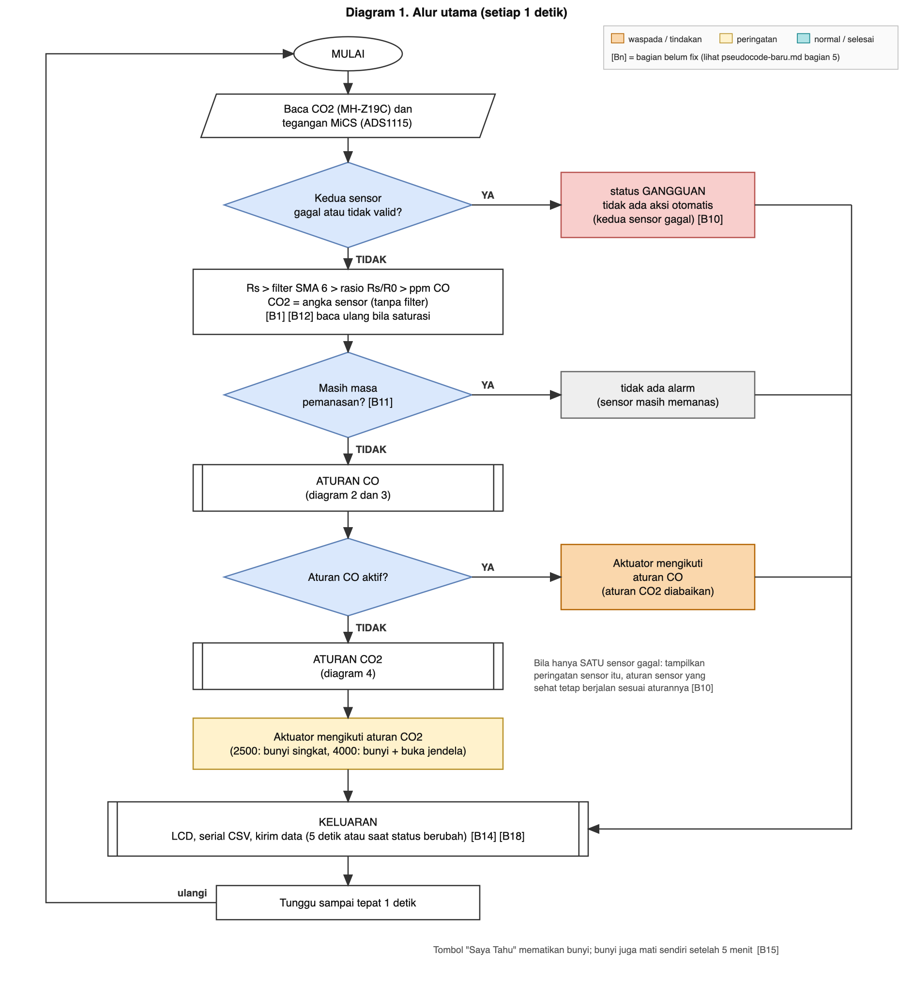
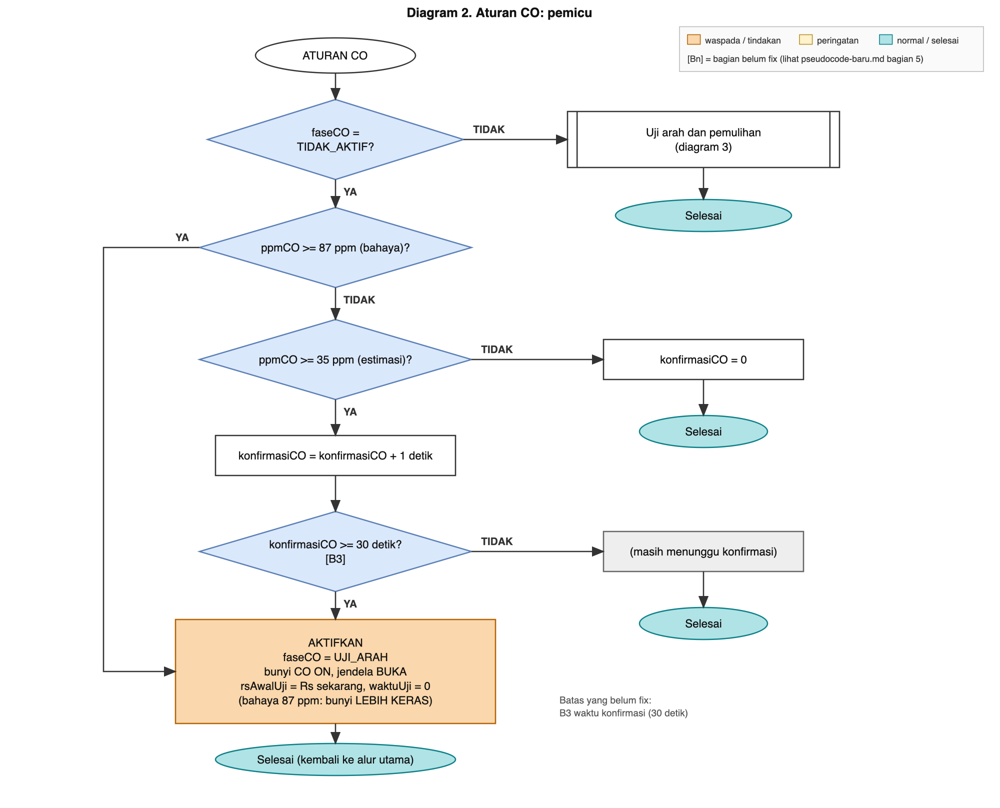
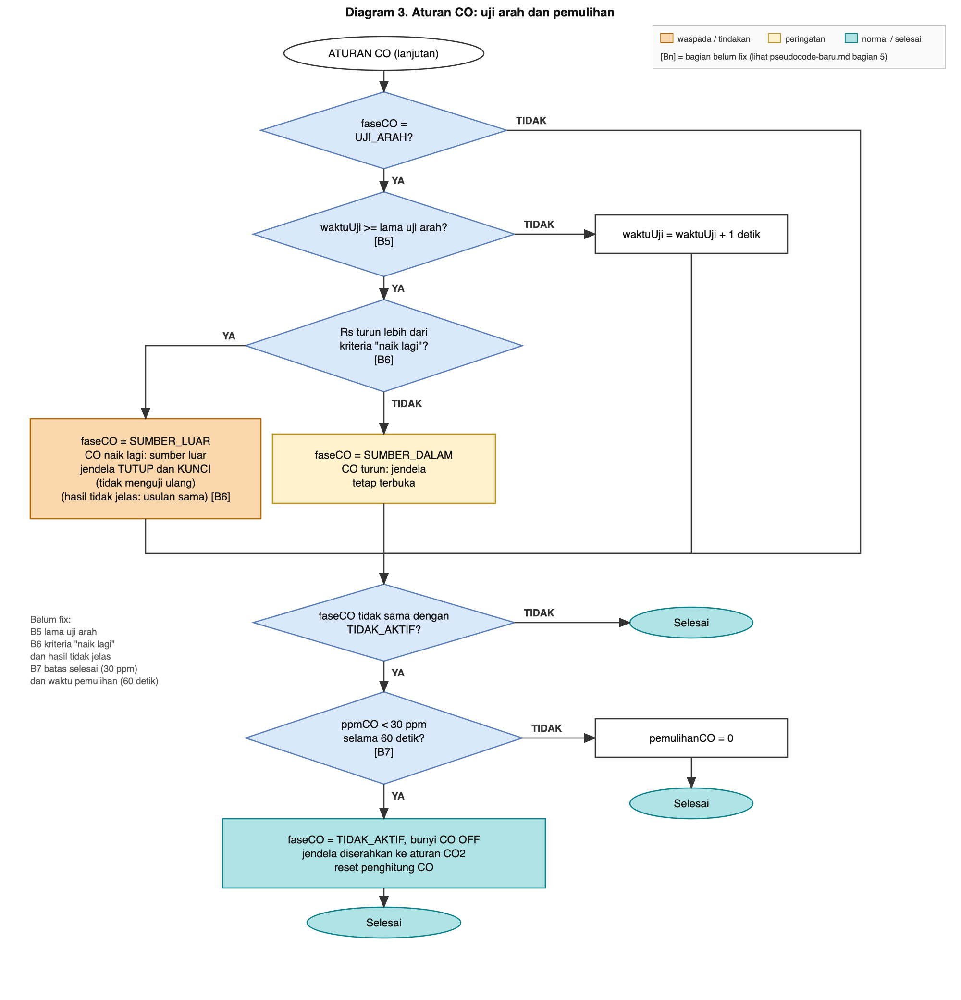
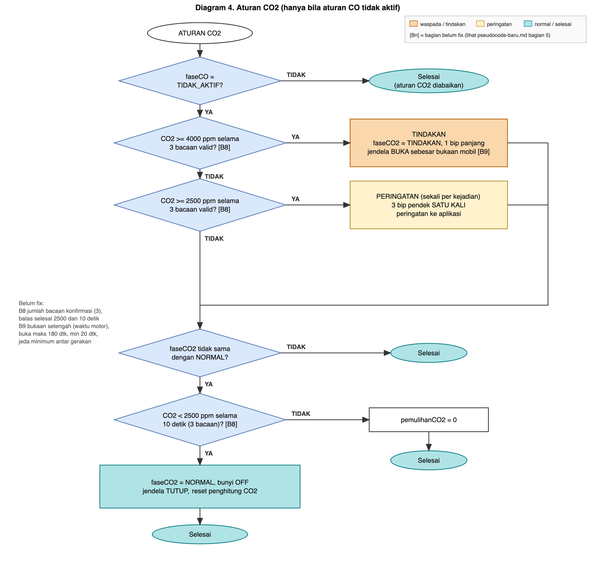

# Pseudocode Baru (Rencana Algoritma)

Versi 25 Oktober 2026. File ini **berdiri sendiri**. Ia **tidak mengubah** `src/main.cpp` dan tidak mengubah pseudocode yang sudah ada di [rencana-desain.md](rencana-desain.md) (bagian 3.4 rencana dan 3.5 kode sekarang).

Diagram alurnya ada di bagian 4 dan di folder [diagram/](../diagram/).

**Tanda yang dipakai:**
- `[Bn]` : bagian ini **belum fix**. Rinciannya di daftar bagian 5.
- Tanpa tanda : sudah cukup diputuskan, dengan dasar di [rencana-desain.md](rencana-desain.md).

---

## 1. Pilihan filter untuk CO

**Yang difilter:** Rs (hambatan MiCS) per detik, sebelum dibagi R0 dan diubah menjadi ppm. CO2 **tidak** difilter (sensornya sudah lambat dan datanya halus).

**Keputusan sementara: rata-rata bergerak 6 titik (SMA 6)**, dengan sampling tepat 1 detik.

### 1.1 Kandidat yang dibandingkan
Data: rekaman kamar 3,6 jam (13.000 detik). Lonjakan adalah satu titik buatan +30%. Respons 90% adalah simulasi.

| Filter | Peredaman noise | Respons 90% | Lonjakan yang lolos | Catatan |
|---|---|---|---|---|
| SMA 4 | 76% | 3 detik | 7,4% | Paling cepat di antara yang genap yang layak |
| **SMA 6** | **76%** | **5 detik** | **4,9%** | **Dipilih** |
| SMA 8 | 76% | 7 detik | 3,7% | Lebih tahan lonjakan, lebih lambat |
| SMA 10 | 76% | 8 detik | 2,9% | Sama peredamannya, lebih lambat |
| SMA 5 (ganjil) | 69% | 4 detik | 6,0% | Tidak meredam pola bergantian dengan baik |
| EMA 0,2 (kode sekarang) | 74% | 10 detik | 5,9% | Kalah dari SMA 6 di ketiga ukuran |
| EMA 0,1 | 77% | 21 detik | 3,0% | Halus, tetapi lambat |
| Median 5 | 2% | 2 detik | 11,4% | Tidak berguna untuk pola ini |

### 1.2 Alasan memilih SMA 6
1. Sekitar 95% goyangan Rs berupa pola bergantian naik-turun tiap detik. Rata-rata **jumlah genap** menghapus pola itu (peredaman sama untuk SMA 2 sampai 10), sedangkan jumlah ganjil tidak.
2. Di antara yang genap, peredamannya sama. Yang membedakan hanya kecepatan dan ketahanan terhadap lonjakan. SMA 6 mengambil jalan tengah: 5 detik dan 4,9%.
3. SMA 6 lebih baik dari filter di kode sekarang (EMA 0,2) pada **ketiga** ukuran: peredaman 76% lawan 74%, respons 5 lawan 10 detik, lonjakan lolos 4,9% lawan 5,9%.
4. Keterlambatan kecil (sekitar 2,5 detik pada perubahan lambat), jauh di bawah anggaran keterlambatan 60–120 detik.
5. **Ingatannya pendek.** Lonjakan hilang seluruhnya setelah 6 detik. EMA menyimpan sisa lonjakan lebih lama.
6. Sederhana: cukup menyimpan 6 nilai terakhir.

### 1.3 Kelebihan dan kekurangan
| Kelebihan | Kekurangan |
|---|---|
| Meredam pola dominan (sekitar 76%) dengan keterlambatan kecil | **Bergantung pada sampling tepat 1 detik.** Kalau interval berubah (misalnya 5 detik), pola bergantian tidak lagi terhapus |
| Lebih cepat dan lebih baik dari EMA 0,2 | Bergantung pada pola periode sekitar 2 detik yang kemungkinan berasal dari rangkaian ini. **Perlu diuji ulang di PCB dan di mobil** |
| Memori terbatas, lonjakan tidak berbekas | Lonjakan +30% tetap lolos sekitar 4,9% selama 6 detik |
| Mudah dijelaskan dan diimplementasikan | Tidak membuang gerakan lambat (sekitar 3% pada Rs, setara sekitar 4% pada ppm). Itu bukan noise yang bisa dibuang tanpa menambah keterlambatan |
| | Enam detik pertama setelah menyala atau setelah data tidak valid belum penuh [B13] |

### 1.4 Cadangan
- **SMA 4** bila butuh lebih cepat (lonjakan lolos naik menjadi 7,4%).
- **SMA 8** bila ada alarm palsu dari lonjakan.
- **EMA 0,1** bila di PCB pola bergantian itu hilang (lebih umum, tetapi respons sekitar 21 detik).
- Panjang akhir (4, 6, atau 8) divalidasi ulang pada rangkaian akhir dan dengan tabel sensitivitas [B12].

---

## 2. Pseudocode

### 2.1 Parameter

```
INTERVAL_SIKLUS        = 1 detik, TEPAT  (syarat agar filter genap bekerja)
PANJANG_FILTER_CO      = 6                                        [B12]

CO_AMBANG_WASPADA      = 35 ppm (estimasi)                        [B2 diputuskan: angka ppm estimasi]
CO_KONFIRMASI          = 30 detik                                 [B3]
CO_AMBANG_BAHAYA       = 87 ppm (estimasi, WHO 15 menit)          [B4 diputuskan]
CO_LAMA_UJI_ARAH       = 30 detik (sementara)                     [B5]
CO_KRITERIA_NAIK       = sekitar 15% penurunan Rs (usulan; 8% terlalu kecil, lihat B6)   [B6]
CO_BATAS_SELESAI       = 30 ppm (estimasi)                        [B7]
CO_WAKTU_PEMULIHAN     = 60 detik                                 [B7]

CO2_AMBANG_PERINGATAN  = 2500 ppm
CO2_AMBANG_TINDAKAN    = 4000 ppm
CO2_BATAS_SELESAI      = 2400 ppm                                 [B8]
CO2_WAKTU_PEMULIHAN    = 60 detik                                 [B8]
CO2_BACAAN_KONFIRMASI  = 3 bacaan valid berturut-turut            [B8]

PEMANASAN_CO           = 180 detik   (diputuskan 25 Okt malam; alasan di 2.7)
PEMANASAN_CO2          = 180 detik   (diputuskan 25 Okt malam; alasan di 2.7)

BUKAAN_JENDELA         = sesuai mobil (waktu jalan motor)         [B9]
JEDA_MINIMUM_JENDELA   = belum ada angka                          [B9]
BUZZER_BERHENTI_SENDIRI = 5 menit
```

### 2.2 Keadaan yang disimpan

```
faseCO       : TIDAK_AKTIF | UJI_ARAH | SUMBER_DALAM | SUMBER_LUAR
faseCO2      : NORMAL | PERINGATAN | TINDAKAN
rsAwalUji                     (nilai Rs yang sudah difilter saat uji arah dimulai)
penghitung   : konfirmasiCO, pemulihanCO, konfirmasiCO2, pemulihanCO2, waktuUji
jendela      : TERTUTUP | TERBUKA
statusSensor : CO_VALID?, CO2_VALID?, pemanasanCO?, pemanasanCO2?
```

### 2.3 Program utama

```
SAAT DINYALAKAN:
    siapkan serial, LCD, I2C, sensor CO2 (UART 9600), ADS1115
    kalau ADS1115 tidak ada: tampilkan error                       (tidak berhenti selamanya) [B10]
    ambil R0 dari memori                                           [B1]
    kalibrasi otomatis CO2: matikan                                [B16]
    mulai hitung pemanasan CO dan CO2

SETIAP INTERVAL_SIKLUS (tepat 1 detik):

    1. BACA
        baca CO2 dari MH-Z19C (cek header dan checksum)
        baca tegangan MiCS dari ADS1115 (rata-rata 16 pembacaan)
        kalau saturasi: naikkan gain dan BACA ULANG saat itu juga   (bukan dibuang)

    2. VALIDASI
        CO2_VALID = (bacaan lengkap, checksum cocok)
                    dan bukan nilai 410 atau 500 selama PEMANASAN_CO2 (itu nilai palsu bawaan sensor
                    sampai detik ke-64 sampai 128 setelah menyala)
        CO_VALID  = tegangan masuk akal (tidak mentok, tidak di luar rentang)

    3. HITUNG
        kalau CO_VALID:
            Rs  = RL * (VCC - V) / V
            masukkan Rs ke buffer 6 nilai terakhir                  [B13]
            RsHalus = rata-rata buffer (sudah penuh 6?)             [B12]
            rasio   = RsHalus / R0
            ppmCO   = (3,7 / rasio) ^ (1 / 0,856)  ; 0 bila rasio >= 0,5      [B1, B2]
        CO2 = angka dari sensor (tanpa filter tambahan)

    4. KEADAAN SENSOR
        kalau CO_VALID salah DAN CO2_VALID salah:
            status = GANGGUAN, tidak ada aksi otomatis              [B10]
            lompat ke LANGKAH 8
        kalau hanya satu sensor yang tidak valid:
            tampilkan peringatan "CO tidak terbaca" atau "CO2 tidak terbaca"
            aturan sensor yang sehat TETAP berjalan sesuai aturannya   [B10]
        kalau sebuah sensor masih masa pemanasan:
            aturan sensor itu belum berjalan (tanpa alarm)

    5. ATURAN CO   (prioritas tertinggi; hanya bila CO valid dan selesai memanas)   -> lihat 2.4

    6. ATURAN CO2  (hanya bila CO2 valid dan selesai memanas, dan aturan CO tidak aktif)   -> lihat 2.5

    7. AKTUATOR
        perintah jendela dan bunyi dihasilkan oleh aturan yang aktif
        batasi gerakan: jangan bergerak lebih sering dari JEDA_MINIMUM_JENDELA   [B9]
        pola bunyi dibedakan antara CO dan CO2                      [B15]

    8. KELUARAN
        LCD: nilai dan status (teks pesan)                          [B18]
        selama PEMANASAN_CO: tampilkan "PEMANASAN", bukan angka ppm CO
            (data 25 Okt: 20 detik pertama terbaca 3000-4120 ppm palsu karena Rs masih 59 kOhm)
        serial: baris CSV
        kirim data tiap 5 detik (rata-rata dan maksimum), dan segera saat status berubah   [B14]
        data simulasi diberi label                                  [B17]

    9. TOMBOL "SAYA TAHU": matikan bunyi. Bunyi juga mati sendiri setelah BUZZER_BERHENTI_SENDIRI.   [B15]

    10. TUNGGU sampai tepat INTERVAL_SIKLUS sejak awal siklus, lalu ulangi
```

### 2.4 Aturan CO

```
ATURAN CO:

    kalau faseCO = TIDAK_AKTIF:
        kalau ppmCO >= CO_AMBANG_BAHAYA:                           [B4]
            AKTIFKAN (tanpa konfirmasi), bunyi LEBIH KERAS      ; aturan jendela sama dengan >= 35 ppm (uji arah)
        sebaliknya kalau ppmCO >= CO_AMBANG_WASPADA:               [B2]
            konfirmasiCO = konfirmasiCO + 1 detik
            kalau konfirmasiCO >= CO_KONFIRMASI:                   [B3]
                AKTIFKAN
        sebaliknya:
            konfirmasiCO = 0

    AKTIFKAN:
        faseCO     = UJI_ARAH
        bunyi CO   dinyalakan
        jendela    = BUKA
        rsAwalUji  = RsHalus sekarang
        waktuUji   = 0

    kalau faseCO = UJI_ARAH:
        waktuUji = waktuUji + 1 detik
        kalau waktuUji >= CO_LAMA_UJI_ARAH:                        [B5]
            kalau RsHalus turun lebih dari CO_KRITERIA_NAIK dari rsAwalUji:   [B6]
                faseCO = SUMBER_LUAR        ; CO naik lagi, sumber dari luar
                jendela = TUTUP dan KUNCI   ; tidak menguji ulang
            sebaliknya kalau tidak jelas (perubahan kecil):         [B6]
                perlakuan belum diputuskan  (usulan: anggap sumber luar, tutup)
            sebaliknya:
                faseCO = SUMBER_DALAM       ; CO turun, jendela tetap terbuka

    kalau faseCO bukan TIDAK_AKTIF:
        kalau ppmCO < CO_BATAS_SELESAI:                            [B7]
            pemulihanCO = pemulihanCO + 1 detik
            kalau pemulihanCO >= CO_WAKTU_PEMULIHAN:               [B7]
                faseCO = TIDAK_AKTIF
                bunyi CO dimatikan
                jendela diserahkan ke aturan CO2 (tertutup bila CO2 normal)
                reset semua penghitung CO
        sebaliknya:
            pemulihanCO = 0

    selama faseCO bukan TIDAK_AKTIF: aturan CO2 DIABAIKAN
```

### 2.5 Aturan CO2

```
ATURAN CO2   (dijalankan hanya bila faseCO = TIDAK_AKTIF):

    hitung bacaan valid berturut-turut di atas tiap ambang           [B8]

    kalau CO2 >= CO2_AMBANG_TINDAKAN selama CO2_BACAAN_KONFIRMASI bacaan:
        faseCO2 = TINDAKAN
        bunyi dinyalakan
        jendela = BUKA sebesar BUKAAN_JENDELA                       [B9]
    sebaliknya kalau CO2 >= CO2_AMBANG_PERINGATAN selama CO2_BACAAN_KONFIRMASI bacaan:
        kalau faseCO2 masih NORMAL:
            faseCO2 = PERINGATAN
            bunyi singkat SATU KALI
            kirim peringatan ke aplikasi

    kalau faseCO2 bukan NORMAL:
        kalau CO2 < CO2_BATAS_SELESAI:                              [B8]
            pemulihanCO2 = pemulihanCO2 + 1 detik
            kalau pemulihanCO2 >= CO2_WAKTU_PEMULIHAN:              [B8]
                faseCO2 = NORMAL
                bunyi dimatikan
                jendela = TUTUP
                reset penghitung CO2
        sebaliknya:
            pemulihanCO2 = 0
```

Catatan untuk aturan CO2: di mobil yang tidak kedap, CO2 bisa **turun sendiri tanpa jendela dibuka** saat mobil melaju (turun 51 sampai 90 ppm/menit di Civic EG6, jendela tertutup, sirkulasi dalam). Karena itu pemulihan CO2 hanya dinilai dari bacaan, tidak dari anggapan "jendela terbuka".

### 2.6 Mode simulasi (isi belum fix) [B17]

```
KALAU MODE_SIMULASI aktif:
    gantikan ppmCO dengan kurva yang diputar dari model:
        skenario A (sumber dalam): CO naik, lalu TURUN setelah jendela dibuka
        skenario B (sumber luar) : CO naik, lalu tetap NAIK setelah jendela dibuka
    beri label "SIMULASI" di layar, serial, dan pesan data
```

### 2.7 Pemanasan: kenapa 3 menit untuk masing-masing sensor

| | CO2 (MH-Z19C) | CO (MiCS-5524) |
|---|---|---|
| Angka | 180 detik | 180 detik (**sementara**) |
| Datasheet | Manual Winsen v1.2: preheat 1 menit | **Tidak ada** angka pemanasan, respons, maupun pemulihan |
| Data kita | Nilai palsu 410/500 berhenti pada detik ke-64 (4 dari 5 kali menyala) dan detik ke-128 (1 kali, nyala dingin pertama malam itu). Di kamar nilainya datar 996–999 ppm dari detik ke-64 sampai 300 | Di kamar Rs stabil dalam 1–2 menit (menit ke-0 sampai 4: 1492, 1878, 1968, 1973, 1994 kOhm). Di mobil Rs terus bergeser, tetapi mengikuti kondisi kabin, bukan pemanasan |
| Alasan angka | Kasus terburuk teramati 128 detik. 180 detik masih memberi jarak aman 52 detik. Dipersingkat tidak sebanding: hemat 1 menit, risiko kasus dingin tidak tertutup | Data mendukung 2 menit stabil. 3 menit memberi jarak 1 menit. Sebelumnya 5 menit (pilihan di kode, tidak ada dasar) |
| Dasar angka | Datasheet + log (5 kali menyala) | Log (2 kali menyala di kamar + 2 di mobil). **Tanpa datasheet** |
| Sampai kapan sementara | Final | Sampai ada uji nyala dingin: mati lebih dari 1 jam, rekam 10 menit di kamar, bandingkan Rs menit ke-3 dan ke-10. Bila Rs menit ke-3 masih jauh dari menit ke-10, naikkan |
| Yang tidak diklaim | Akurasi CO2 di menit awal tidak terbukti (tanpa gas acuan) | Stabil bukan berarti benar. Baseline di mobil masih bergeser dan R0 dari kamar tidak cocok (lihat B1) |

Perlu diingat: pemanasan dihitung dari saat ESP32 menyala. Pada uji mobil malam itu alat menyala tiga kali (21:37, 21:41, 22:00) dan setiap kali pemanasan mulai dari nol, sehingga alarm CO mati selama 3 menit pertama tiap kali menyala.

---

## 3. Yang tidak diubah

- `src/main.cpp` tetap seperti 23 Oktober 2026.
- Pseudocode lama (rencana-desain.md bagian 3.4 dan 3.5) tetap.
- Perbedaan kode dan rencana ada di [rencana-desain.md](rencana-desain.md) bagian 4.2.

---

## 4. Diagram alur

Dibuat dengan gaya contoh yang Anda berikan (oval awal, jajar genjang untuk data, persegi untuk proses, belah ketupat untuk keputusan, warna oranye untuk kondisi waspada dan hijau kebiruan untuk normal).

### Diagram 1. Alur utama (setiap 1 detik)


### Diagram 2. Aturan CO: pemicu


### Diagram 3. Aturan CO: uji arah dan pemulihan


### Diagram 4. Aturan CO2


Berkas SVG (bisa dibuka di draw.io atau Inkscape untuk diedit) dan skrip pembuatnya, [diagram/buat_diagram.py](../diagram/buat_diagram.py), ada di folder [diagram/](../diagram/). Mengubah isi diagram berarti mengubah skrip itu lalu menjalankannya lagi (`python3 buat_diagram.py`).

---

## 5. Daftar bagian yang belum fix

| Kode | Yang belum fix | Cara menentukan | Terkait |
|---|---|---|---|
| B1 | Strategi R0 dan pergeseran baseline (kalibrasi ulang tiap menyala, atau baseline adaptif). **Data mobil 25 Okt:** dengan R0 kamar (1730 kOhm) rasio Rs/R0 di mobil 0,30–0,67, jadi ppm terbaca 0–19 terus-menerus tanpa CO nyata. Ambang 35 ppm setara rasio 0,176, tinggal 41% di bawah titik terendah teramati (0,301) | Diskusi, lalu uji pada data | validasi-parameter.md A3, A4 |
| B2 | ~~Ambang CO pakai angka ppm mutlak atau perubahan relatif~~ **Diputuskan: angka ppm estimasi** (tanpa konsep tambahan). Konsekuensi: angka ppm bergantung pada R0, jadi wajib ditulis sebagai estimasi dan R0 diulang (B1) | Keputusan pengguna 25 Okt malam | rencana-desain.md 3.3 |
| B3 | Waktu konfirmasi CO (30 detik) | Tabel sensitivitas pada log | desain-peringatan.md F |
| B4 | Ambang bahaya CO: 87 atau 200 ppm | Keputusan tim, dasar WHO atau NIOSH | rencana-desain.md FR-08 |
| B5 | Lama uji arah (30 sampai 60 detik) | Batas bawah respons filter, batas atas tambahan paparan | desain-peringatan.md F2 |
| B6 | Kriteria "CO naik lagi" dan perlakuan hasil tidak jelas. **8% tidak aman:** tanpa gas, Rs berubah lebih dari −8% dalam 30 detik pada 8–13% waktu (mobil dan kamar). Persentil ke-5 perubahan 30 detik: −11,7 (mobil sesi 1), −9,0 (mobil sesi 2), −13,4 (kamar). Usulan sementara 15%. Lonjakan CO nyata jauh lebih besar (35 → 87 ppm = Rs turun sekitar 54%) | Tabel sensitivitas; ulangi dengan log uji korek | desain-peringatan.md E4 |
| B7 | Batas selesai CO (30 ppm) dan waktu pemulihan (60 detik) | Tabel sensitivitas | desain-peringatan.md F5 |
| B8 | Konfirmasi CO2 (3 bacaan), batas selesai 2400 dan 60 detik | Tabel sensitivitas, uji mobil | desain-peringatan.md H |
| B9 | Besar bukaan jendela per mobil, jeda minimum, anti-jepit | Ukur laju pertukaran udara (N) dan waktu motor tiap mobil | skenario-uji-mobil.md |
| B10 | Perlakuan bila satu sensor gagal (apakah menahan aksi sensor lain), dan perilaku bila ADS1115 tidak ada | Keputusan tim | rencana-desain.md FR-09 |
| B11 | ~~Panjang pemanasan~~ **Diputuskan 3 menit untuk keduanya** (2.7). Sisa: cara mendeteksi sensor mati sebentar tanpa ESP32 mulai ulang | Analisis log baseline dan uji nyala dingin | rencana-desain.md FR-10 |
| B12 | Panjang filter final (4, 6, atau 8) | Tabel sensitivitas dan uji ulang di PCB dan mobil | bagian 1 |
| B13 | Penanganan sampel tidak valid di dalam buffer filter | Keputusan teknis (usulan: kosongkan buffer bila lebih dari 3 sampel berturut-turut tidak valid) | |
| B14 | Format pesan MQTT, laju kirim, retensi. **Draf perkiraan sudah ada** di [rancangan-data.md](rancangan-data.md) | Rapat dengan tim backend dan software | desain-data-dfd.md |
| B15 | Pola bunyi CO dan CO2, perilaku tombol "Saya Tahu" | Keputusan UX | rencana-desain.md FR-11, FR-12 |
| B16 | Kalibrasi otomatis CO2 dimatikan | Konfirmasi tim | batasan-sistem.md |
| B17 | Isi mode simulasi | Disusun saat menulis firmware | rencana-desain.md FR-16 |
| B18 | Teks pesan di LCD dan aplikasi | Dengan tim software | agenda-pertemuan-tim.md |

---

## 6. Status keputusan (25 Oktober 2026, malam)

Dari 18 bagian, sebagian besar tidak perlu diputuskan sekarang. Pengelompokannya:

| Kelompok | Bagian | Keterangan |
|---|---|---|
| **Diputuskan** | B2, B4, B10, B11 (panjang pemanasan) | B11: pemanasan 3 menit untuk CO dan CO2 (bagian 2.7; CO sementara sampai uji nyala dingin). B2: ambang CO memakai angka ppm estimasi. B4: ambang bahaya CO = 87 ppm (WHO 15 menit), aturan jendela tetap sama dengan CO ≥ 35 ppm (uji arah), bunyi tingkat bahaya lebih keras. B10: sensor yang sehat tetap menjalankan aturannya sendiri bila sensor lain gagal |
| **Pakai usulan sementara**, diuji nanti dengan tabel sensitivitas atau uji | B3, B6, B7, B8, B13 | Tidak perlu keputusan sekarang. Nilainya sudah ada di pseudocode. **B6 diubah dari 8% menjadi 15%** karena drift alami Rs sering melewati 8% |
| **Menunggu hasil uji atau data** | B1 (data mobil menunjukkan R0 kamar tidak cocok), B5 (30 detik sementara; uji korek bisa membantu), B12 | Ditentukan setelah ada data |
| **Menunggu pengukuran sensor dan mobil** | B9 | Setelah sensor selesai |
| **Menunggu tim** | B14, B15, B16, B17, B18 | Dibahas di pertemuan (agenda-pertemuan-tim.md) |

### Rekap: yang sudah pasti, yang ditetapkan, yang belum bisa dipastikan

**Pasti (ada datasheet atau data ukur):**
- Goyangan Rs 0,5 Hz ada di kamar dan di mobil (13% dan 9–10% mentah, 93–95% berupa pola bergantian).
- Rata-rata jumlah genap menghapusnya. Sisa noise di mobil: SMA 4 dan SMA 6 sekitar 0,9%, EMA 0,2 (kode sekarang) 1,3%. Lompatan 0 ↔ 10 ppm: 1–2 kali (SMA 6) lawan 14–19 kali (EMA 0,2).
- Sampling harus tepat 1 detik (syarat filter genap).
- MH-Z19C: nilai palsu 410/500 sampai detik 64 (4 dari 5 kali) dan 128 (1 kali). Datasheet: preheat 1 menit.
- MiCS: datasheet tidak memuat pemanasan, respons, dan pemulihan. Di kamar Rs stabil dalam 1–2 menit.
- Rs/R0 di mobil 0,30–0,67 dengan R0 kamar. Tidak ada detik ≥ 35 ppm di dua sesi mobil (sekitar 30 menit), jadi tidak ada alarm palsu.
- Tanpa gas, Rs berubah lebih dari −8% dalam 30 detik pada 8–13% waktu.
- CO2 di Civic EG6 bisa turun sendiri saat melaju tanpa jendela dibuka.

**Ditetapkan (keputusan, bukan fakta):**
- Pemanasan 3 menit untuk CO dan CO2 (CO sementara).
- SMA 6 (cadangan SMA 4 atau 8), CO2 tidak difilter.
- Ambang CO berupa ppm estimasi 35 (waspada) dan 87 (bahaya); CO2 2500 (peringatan) dan 4000 (tindakan).
- Sensor yang sehat tetap bekerja bila sensor lain gagal.

**Belum bisa dipastikan (kurang bukti):**
- Nilai ppm CO yang sebenarnya (tidak ada gas acuan; hanya estimasi dari grafik datasheet, ±10%).
- Penyebab Rs naik-turun sekitar 7 menit di kamar (bukan AC) dan penyebab pergeseran Rs di mobil.
- Sumber pola bergantian 2 detik (dugaan catu pemanas, belum terbukti) dan apakah ia hilang di PCB.
- Strategi R0 untuk mobil (B1), lama uji arah (B5), kriteria 15% (B6, usulan), waktu konfirmasi dan pemulihan (B3, B7, B8).
- Laju pertukaran udara (N) tiap mobil: belum ada uji dengan jendela dibuka.
- Apakah pemanasan CO 3 menit cukup pada nyala dingin.

Aturan sementara untuk yang belum jelas:
- **B6**: bila hasil uji arah tidak jelas, anggap sumber luar dan tutup jendela (lebih aman).
- **B10 (diputuskan 25 Okt malam)**: bila satu sensor gagal, tampilkan peringatan sensor itu, dan sensor yang sehat tetap menjalankan seluruh aturannya sendiri (termasuk jendela). Bila kedua sensor gagal: GANGGUAN dan tidak ada aksi otomatis. Bila ADS1115 tidak ditemukan saat menyala: tampilkan error dan coba lagi secara berkala. Belum jelas: sensor CO gagal saat aturan CO sedang aktif (usulan: pertahankan bunyi dan tutup jendela).
- **B5**: pengamatan informal pengguna (tidak diukur): gas korek yang dekat dengan sensor terdeteksi dalam kurang dari 5 detik, dari jauh jarang terdeteksi. Artinya yang menentukan lamanya uji arah adalah seberapa cepat gas sampai ke sensor dan filter, bukan kecepatan sensor itu sendiri. Dipakai 30 detik sementara.
- **B13**: bila lebih dari 3 sampel berturut-turut tidak valid, kosongkan buffer filter dan isi ulang.
