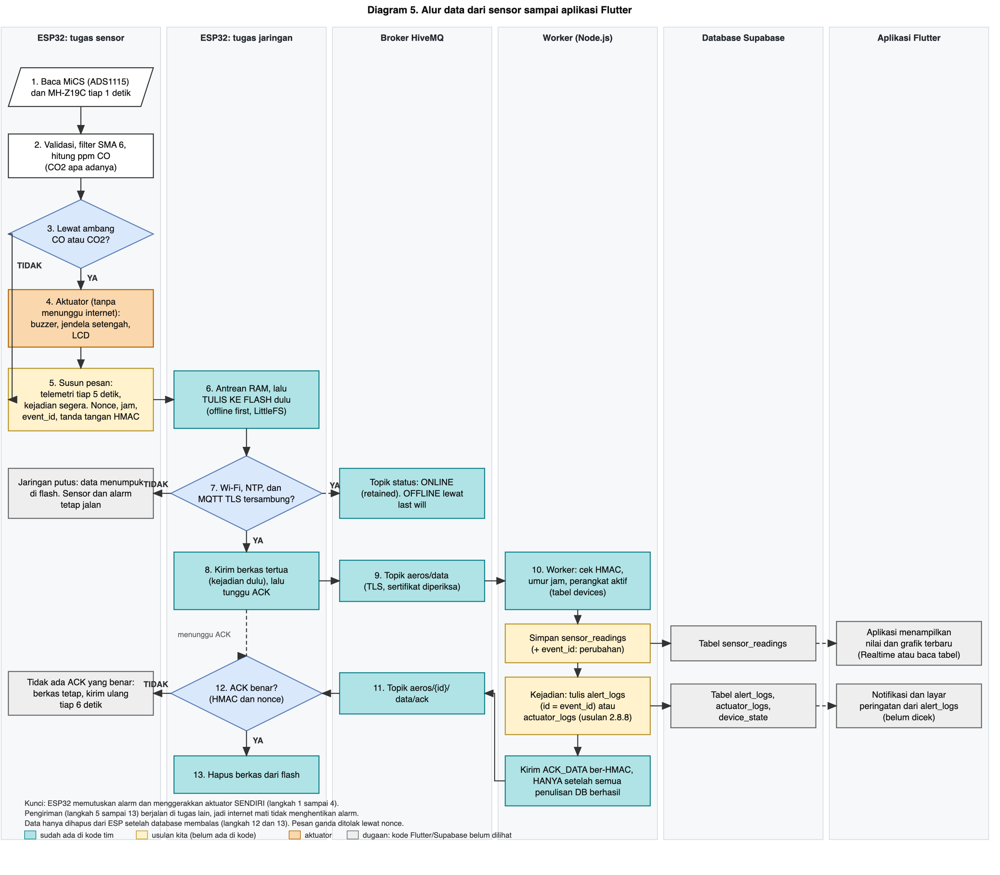

# Pseudocode Baru (Rencana Algoritma)

Versi 25 Oktober 2026. File ini **berdiri sendiri**. Ia **tidak mengubah** `src/main.cpp` dan tidak mengubah pseudocode yang sudah ada di [rencana-desain.md](rencana-desain.md) (bagian 3.4 rencana dan 3.5 kode sekarang).

Diagram alurnya ada di bagian 4 dan di folder [diagram/](../diagram/).

**Tanda yang dipakai:**
- `[Bn]` : bagian ini **belum fix**. Rinciannya di daftar bagian 5.
- Tanpa tanda : sudah cukup diputuskan, dengan dasar di [rencana-desain.md](rencana-desain.md).

---

## 1. Pilihan filter untuk CO

**Yang difilter:** Rs (hambatan MiCS) per detik, sebelum dibagi R0 dan diubah menjadi ppm. CO2 **tidak** difilter (sensornya sudah lambat dan datanya halus).

**Keputusan sementara: rata-rata bergerak 6 titik (SMA 6)**, dengan sampling tepat 1 detik.

### 1.1 Kandidat yang dibandingkan
Data: rekaman kamar 3,6 jam (13.000 detik). Lonjakan adalah satu titik buatan +30%. Respons 90% adalah simulasi.

| Filter | Peredaman noise | Respons 90% | Lonjakan yang lolos | Catatan |
|---|---|---|---|---|
| SMA 4 | 76% | 3 detik | 7,4% | Paling cepat di antara yang genap yang layak |
| **SMA 6** | **76%** | **5 detik** | **4,9%** | **Dipilih** |
| SMA 8 | 76% | 7 detik | 3,7% | Lebih tahan lonjakan, lebih lambat |
| SMA 10 | 76% | 8 detik | 2,9% | Sama peredamannya, lebih lambat |
| SMA 5 (ganjil) | 69% | 4 detik | 6,0% | Tidak meredam pola bergantian dengan baik |
| EMA 0,2 (kode sekarang) | 74% | 10 detik | 5,9% | Kalah dari SMA 6 di ketiga ukuran |
| EMA 0,1 | 77% | 21 detik | 3,0% | Halus, tetapi lambat |
| Median 5 | 2% | 2 detik | 11,4% | Tidak berguna untuk pola ini |

### 1.2 Alasan memilih SMA 6
1. Sekitar 95% goyangan Rs berupa pola bergantian naik-turun tiap detik. Rata-rata **jumlah genap** menghapus pola itu (peredaman sama untuk SMA 2 sampai 10), sedangkan jumlah ganjil tidak.
2. Di antara yang genap, peredamannya sama. Yang membedakan hanya kecepatan dan ketahanan terhadap lonjakan. SMA 6 mengambil jalan tengah: 5 detik dan 4,9%.
3. SMA 6 lebih baik dari filter di kode sekarang (EMA 0,2) pada **ketiga** ukuran: peredaman 76% lawan 74%, respons 5 lawan 10 detik, lonjakan lolos 4,9% lawan 5,9%.
4. Keterlambatan kecil (sekitar 2,5 detik pada perubahan lambat), jauh di bawah anggaran keterlambatan 60–120 detik.
5. **Ingatannya pendek.** Lonjakan hilang seluruhnya setelah 6 detik. EMA menyimpan sisa lonjakan lebih lama.
6. Sederhana: cukup menyimpan 6 nilai terakhir.

### 1.3 Kelebihan dan kekurangan
| Kelebihan | Kekurangan |
|---|---|
| Meredam pola dominan (sekitar 76%) dengan keterlambatan kecil | **Bergantung pada sampling tepat 1 detik.** Kalau interval berubah (misalnya 5 detik), pola bergantian tidak lagi terhapus |
| Lebih cepat dan lebih baik dari EMA 0,2 | Bergantung pada pola periode sekitar 2 detik yang kemungkinan berasal dari rangkaian ini. **Perlu diuji ulang di PCB dan di mobil** |
| Memori terbatas, lonjakan tidak berbekas | Lonjakan +30% tetap lolos sekitar 4,9% selama 6 detik |
| Mudah dijelaskan dan diimplementasikan | Tidak membuang gerakan lambat (sekitar 3% pada Rs, setara sekitar 4% pada ppm). Itu bukan noise yang bisa dibuang tanpa menambah keterlambatan |
| | Enam detik pertama setelah menyala atau setelah data tidak valid belum penuh [B13] |

### 1.4 Cadangan
- **SMA 4** bila butuh lebih cepat (lonjakan lolos naik menjadi 7,4%).
- **SMA 8** bila ada alarm palsu dari lonjakan.
- **EMA 0,1** bila di PCB pola bergantian itu hilang (lebih umum, tetapi respons sekitar 21 detik).
- Panjang akhir (4, 6, atau 8) divalidasi ulang pada rangkaian akhir dan dengan tabel sensitivitas [B12].

---

## 2. Pseudocode

### 2.1 Parameter

```
INTERVAL_SIKLUS        = 1 detik, TEPAT  (syarat agar filter genap bekerja)
PANJANG_FILTER_CO      = 6                                        [B12]

CO_AMBANG_WASPADA      = 35 ppm (estimasi)                        [B2 diputuskan: angka ppm estimasi]
CO_KONFIRMASI          = 30 detik                                 [B3]
CO_AMBANG_BAHAYA       = 87 ppm (estimasi, WHO 15 menit)          [B4 diputuskan]
CO_LAMA_UJI_ARAH       = 30 detik (sementara)                     [B5]
CO_KRITERIA_NAIK       = sekitar 25% penurunan Rs (usulan; 8% dan 15% terlalu kecil, lihat B6)   [B6]
CO_BATAS_SELESAI       = 30 ppm (estimasi)                        [B7]
CO_WAKTU_PEMULIHAN     = 60 detik                                 [B7]

CO2_AMBANG_PERINGATAN  = 2500 ppm
CO2_AMBANG_TINDAKAN    = 4000 ppm
CO2_BATAS_SELESAI      = 2500 ppm   (usulan: tutup saat bacaan < 2500; data Avanza, bagian 2.9)   [B8]
CO2_WAKTU_PEMULIHAN    = 10 detik   (3 bacaan; sebelumnya 60 detik)                              [B8]
CO2_BACAAN_KONFIRMASI  = 3 bacaan valid berturut-turut            [B8]

PEMANASAN_CO           = 180 detik   (diputuskan 25 Okt malam; alasan di 2.7)
PEMANASAN_CO2          = 180 detik   (diputuskan 25 Okt malam; alasan di 2.7)

BUKAAN_JENDELA         = setengah, diatur LEWAT WAKTU jalan motor (WAKTU_SETENGAH, diukur per mobil)   [B9]
JENDELA_BUKA_MAKS      = 180 detik  (batas aman: tutup walau CO2 belum turun)   [B9]
JENDELA_BUKA_MIN       = 20 detik   (jangan menutup sebelum ini)                 [B9]
JEDA_MINIMUM_JENDELA   = 5 menit tertutup sebelum buka lagi (usulan; data: siklus alami 15 menit)   [B9]
BUNYI_WASPADA          = 3 bip pendek (sekitar 2 detik), SEKALI saat status masuk WASPADA        [B15, diputuskan 27 Okt]
BUNYI_BAHAYA           = 1 bip panjang (sekitar 3 detik), SEKALI saat status masuk BAHAYA       [B15]
BUNYI_ULANG_CO         = ulangi tiap 60 detik selama CO masih WASPADA atau BAHAYA, berhenti sendiri setelah 5 menit   [B15]
BUNYI_ULANG_CO2        = tidak diulang                                                           [B15]

A_COEF, BETA           = 3,7 dan 0,856 (kurva datasheet; digitalisasi piksel memberi 3,46 dan 0,840, selisih < 1,5% di 35-100 ppm; nilai kode dipertahankan)
R0                     = 1730 kOhm, satu nilai tetap, label "estimasi"; ukur ulang SEKALI setelah buck terpasang   [B1 diputuskan 27 Okt]
VCC                    = 4,64 V sampai buck terpasang (lalu ubah sekali dan ukur R0 ulang)
```

### 2.2 Keadaan yang disimpan

```
faseCO       : TIDAK_AKTIF | UJI_ARAH | SUMBER_DALAM | SUMBER_LUAR
faseCO2      : NORMAL | PERINGATAN | TINDAKAN
rsAwalUji                     (nilai Rs yang sudah difilter saat uji arah dimulai)
penghitung   : konfirmasiCO, pemulihanCO, konfirmasiCO2, pemulihanCO2, waktuUji, lamaBuka
jendela      : TERTUTUP | TERBUKA
statusSensor : CO_VALID?, CO2_VALID?, pemanasanCO?, pemanasanCO2?
```

### 2.3 Program utama

```
SAAT DINYALAKAN:
    siapkan serial, LCD, I2C, sensor CO2 (UART 9600), ADS1115
    kalau ADS1115 tidak ada: tampilkan error                       (tidak berhenti selamanya) [B10]
    ambil R0 dari memori (nilai tetap 1730 kOhm; diubah hanya lewat perintah 'r')   [B1 diputuskan]
    kalibrasi otomatis CO2: matikan                                [B16]
    mulai hitung pemanasan CO dan CO2
    [usulan T1] uji mandiri: periksa ADS1115, MH-Z19C, LCD; satu bip pendek; gagal = tag ERR tetapi sensor lain tetap jalan
    [usulan T2] aktifkan watchdog (siklus macet > 10 detik = mulai ulang); catat alasan reset

SETIAP INTERVAL_SIKLUS (tepat 1 detik):

    1. BACA
        baca CO2 dari MH-Z19C (cek header dan checksum)
        baca tegangan MiCS dari ADS1115 (rata-rata 16 pembacaan)
        kalau saturasi: naikkan gain dan BACA ULANG saat itu juga   (bukan dibuang)

    2. VALIDASI
        CO2_VALID = (bacaan lengkap, checksum cocok)
                    dan bukan nilai 410 atau 500 selama PEMANASAN_CO2 (itu nilai palsu bawaan sensor
                    sampai detik ke-64 sampai 128 setelah menyala)
        CO_VALID  = tegangan masuk akal (tidak mentok, tidak di luar rentang)

    3. HITUNG
        kalau CO_VALID:
            Rs  = RL * (VCC - V) / V
            masukkan Rs ke buffer 6 nilai terakhir                  [B13]
            RsHalus = rata-rata buffer (sudah penuh 6?)             [B12]
            rasio   = RsHalus / R0
            ppmCO   = (3,7 / rasio) ^ (1 / 0,856)  ; 0 bila rasio >= 0,5      [B1, B2]
        CO2 = angka dari sensor (tanpa filter tambahan)

    4. KEADAAN SENSOR
        kalau CO_VALID salah DAN CO2_VALID salah:
            status = GANGGUAN, tidak ada aksi otomatis              [B10]
            lompat ke LANGKAH 8
        kalau hanya satu sensor yang tidak valid:
            tampilkan peringatan "CO tidak terbaca" atau "CO2 tidak terbaca"
            aturan sensor yang sehat TETAP berjalan sesuai aturannya   [B10]
        kalau sebuah sensor masih masa pemanasan:
            aturan sensor itu belum berjalan (tanpa alarm)

    5. ATURAN CO   (prioritas tertinggi; hanya bila CO valid dan selesai memanas)   -> lihat 2.4

    6. ATURAN CO2  (hanya bila CO2 valid dan selesai memanas, dan aturan CO tidak aktif)   -> lihat 2.5

    7. AKTUATOR
        perintah jendela dan bunyi dihasilkan oleh aturan yang aktif
        batasi gerakan: jangan bergerak lebih sering dari JEDA_MINIMUM_JENDELA   [B9]
        bunyi mengikuti 2.10 (WASPADA 3 bip pendek, BAHAYA 1 bip panjang; CO diulang, CO2 tidak)   [B15]

    8. KELUARAN
        LCD: angka seperti v0, tag status 4 karakter, indikator Wi-Fi 1 karakter (lihat 2.10)   [B18]
        selama sebuah sensor MEMANASKAN (PEMANASAN_CO atau PEMANASAN_CO2):
            LCD: angka sensor itu TIDAK tampil (tampil "----", tag "WARM")
                 (data 25 Okt: 20 detik pertama CO terbaca 3000-4120 ppm palsu karena Rs masih 59 kOhm; CO2 410/500 palsu)
            serial: angka mentah TETAP dicetak, dengan status WARMUP   (bukti uji tidak hilang)
            pesan data: TETAP dikirim, dengan penanda kond = pemanasan; aplikasi tidak menampilkannya sebagai nilai nyata
        serial: baris CSV
        kirim data tiap 5 detik (rata-rata dan maksimum), dan segera saat status berubah   [B14] (lewat antrean, lihat 2.8)
        data simulasi diberi label                                  [B17]

    9. TOMBOL "SAYA TAHU": matikan bunyi SAJA (alarm dan jendela tetap berjalan sesuai aturan).
       Bunyi muncul lagi bila status naik ke BAHAYA. Pengulangan bunyi CO berhenti sendiri setelah 5 menit.   [B15]

    10. TUNGGU sampai tepat INTERVAL_SIKLUS sejak awal siklus, lalu ulangi
```

### 2.4 Aturan CO

```
ATURAN CO:

    kalau faseCO = TIDAK_AKTIF:
        kalau ppmCO >= CO_AMBANG_BAHAYA:                           [B4]
            AKTIFKAN (tanpa konfirmasi), status BAHAYA        ; aturan jendela sama dengan >= 35 ppm (uji arah)
        sebaliknya kalau ppmCO >= CO_AMBANG_WASPADA:               [B2]
            konfirmasiCO = konfirmasiCO + 1 detik
            kalau konfirmasiCO >= CO_KONFIRMASI:                   [B3]
                AKTIFKAN
        sebaliknya:
            konfirmasiCO = 0

    AKTIFKAN:
        faseCO     = UJI_ARAH
        status    = WASPADA (BAHAYA bila ppmCO >= CO_AMBANG_BAHAYA); bunyi sesuai 2.10
        jendela    = BUKA
        rsAwalUji  = RsHalus sekarang
        waktuUji   = 0

    kalau faseCO = UJI_ARAH:
        waktuUji = waktuUji + 1 detik
        kalau waktuUji >= CO_LAMA_UJI_ARAH:                        [B5]
            kalau RsHalus turun lebih dari CO_KRITERIA_NAIK dari rsAwalUji:   [B6]
                faseCO = SUMBER_LUAR        ; CO naik lagi, sumber dari luar: status BAHAYA (tag LUAR)
                jendela = TUTUP dan KUNCI   ; tidak menguji ulang
            sebaliknya kalau tidak jelas (perubahan kecil):         [B6]
                anggap sumber luar dan tutup (diputuskan 27 Okt: lebih aman)
            sebaliknya:
                faseCO = SUMBER_DALAM       ; CO turun, jendela tetap terbuka

    kalau faseCO bukan TIDAK_AKTIF:
        kalau ppmCO < CO_BATAS_SELESAI:                            [B7]
            pemulihanCO = pemulihanCO + 1 detik
            kalau pemulihanCO >= CO_WAKTU_PEMULIHAN:               [B7]
                faseCO = TIDAK_AKTIF
                bunyi CO dimatikan
                jendela diserahkan ke aturan CO2 (tertutup bila CO2 normal)
                reset semua penghitung CO
        sebaliknya:
            pemulihanCO = 0

    selama faseCO bukan TIDAK_AKTIF: aturan CO2 DIABAIKAN
```

### 2.5 Aturan CO2

```
ATURAN CO2   (dijalankan hanya bila faseCO = TIDAK_AKTIF):

    hitung bacaan valid berturut-turut di atas tiap ambang           [B8]

    kalau CO2 >= CO2_AMBANG_TINDAKAN selama CO2_BACAAN_KONFIRMASI bacaan:
        faseCO2 = TINDAKAN
        status BAHAYA; 1 bip panjang SEKALI (tidak diulang)
        jendela = BUKA sebesar BUKAAN_JENDELA                       [B9]
        lamaBuka = 0
    sebaliknya kalau CO2 >= CO2_AMBANG_PERINGATAN selama CO2_BACAAN_KONFIRMASI bacaan:
        kalau faseCO2 masih NORMAL:
            faseCO2 = PERINGATAN
            status WASPADA; 3 bip pendek SEKALI (tidak diulang)
            kirim peringatan ke aplikasi

    kalau faseCO2 = TINDAKAN dan jendela TERBUKA:
        lamaBuka = lamaBuka + 1 detik
        kalau lamaBuka >= JENDELA_BUKA_MAKS:                        [B9]
            jendela = TUTUP ; tandai "CO2 tidak turun" (tampilkan dan kirim sebagai kejadian)

    kalau faseCO2 bukan NORMAL:
        kalau CO2 < CO2_BATAS_SELESAI dan lamaBuka >= JENDELA_BUKA_MIN:   [B8, B9]
            pemulihanCO2 = pemulihanCO2 + 1 detik
            kalau pemulihanCO2 >= CO2_WAKTU_PEMULIHAN:              [B8]
                faseCO2 = NORMAL
                bunyi dimatikan
                jendela = TUTUP
                reset penghitung CO2
        sebaliknya:
            pemulihanCO2 = 0
```

Catatan untuk aturan CO2: di mobil yang tidak kedap, CO2 bisa **turun sendiri tanpa jendela dibuka** saat mobil melaju (turun 51 sampai 90 ppm/menit di Civic EG6, jendela tertutup, sirkulasi dalam). Karena itu pemulihan CO2 hanya dinilai dari bacaan, tidak dari anggapan "jendela terbuka".

### 2.6 Mode simulasi (isi belum fix) [B17]

```
KALAU MODE_SIMULASI aktif:
    gantikan ppmCO dengan kurva yang diputar dari model:
        skenario A (sumber dalam): CO naik, lalu TURUN setelah jendela dibuka
        skenario B (sumber luar) : CO naik, lalu tetap NAIK setelah jendela dibuka
    beri label "SIMULASI" di layar, serial, dan pesan data
```

### 2.9 Menutup jendela: batas turun dan lama buka (dasar data Avanza, 26 Okt)

Pertanyaan: jendela dibuka setengah berapa lama, dan kapan ditutup?

| Data (Avanza, dua jendela depan setengah, 20–40 km/jam) | Jendela 1 | Jendela 2 |
|---|---|---|
| CO2 saat dibuka | sekitar 4437 | sekitar 4447 |
| Lama sampai bacaan < 2500 | sekitar 95 detik | sekitar 100 detik |
| Bacaan saat ditutup | 2384 | 2121 |
| Terus turun sesudah ditutup | sampai 1831 | sampai 1660 |

Pengertian dari data:
- **Menutup saat bacaan < 2500 sudah cukup.** CO2 terus turun sesudah ditutup (jeda sensor dan pencampuran udara), sehingga menunggu 60 detik tambahan hanya membuat jendela terbuka lebih lama tanpa perlu.
- Naik kembali dari bawah 2500 ke 4000 butuh 7–10 menit, jadi jendela tidak sering bergerak.
- **Lama buka bergantung mobil dan kecepatan**, jadi lamanya tidak ditetapkan tetap. Rancangan: buka setengah dengan waktu motor (usulan teman elektro), **tahan sampai bacaan < 2500**, dengan batas atas 180 detik (sekitar 1,8 kali waktu yang dibutuhkan Avanza) dan batas bawah 20 detik.
- Bila sensor CO2 gagal, jendela tidak dibuka otomatis oleh aturan CO2 (tidak ada dasar untuk menutup). Batas 180 detik tetap melindungi bila bacaan tidak pernah turun.
- Bukaan setengah ditentukan oleh `WAKTU_SETENGAH` = setengah dari waktu buka penuh motor, diukur per mobil (Classy, Civic, Avanza).

Yang belum diketahui: waktu motor jendela tiap mobil dan perilaku di mobil lain (Civic belum punya uji buka jendela).

### 2.7 Pemanasan: kenapa 3 menit untuk masing-masing sensor

| | CO2 (MH-Z19C) | CO (MiCS-5524) |
|---|---|---|
| Angka | 180 detik | 180 detik (**diputuskan 27 Okt**) |
| Datasheet | Manual Winsen v1.2: preheat 1 menit | **Tidak ada** angka pemanasan, respons, maupun pemulihan |
| Data kita | Nilai palsu 410/500 berhenti pada detik ke-64 (4 dari 5 kali menyala) dan detik ke-128 (1 kali, nyala dingin pertama malam itu). Di kamar nilainya datar 996–999 ppm dari detik ke-64 sampai 300 | Di kamar Rs stabil dalam 1–2 menit (menit ke-0 sampai 4: 1492, 1878, 1968, 1973, 1994 kOhm). Di mobil Rs terus bergeser, tetapi mengikuti kondisi kabin, bukan pemanasan |
| Alasan angka | Kasus terburuk teramati 128 detik. 180 detik masih memberi jarak aman 52 detik. Dipersingkat tidak sebanding: hemat 1 menit, risiko kasus dingin tidak tertutup | Data mendukung 2 menit stabil. 3 menit memberi jarak 1 menit. Sebelumnya 5 menit (pilihan di kode, tidak ada dasar) |
| Dasar angka | Datasheet + log (5 kali menyala) | Log (2 kali menyala di kamar + 2 di mobil). **Tanpa datasheet** |
| Sampai kapan sementara | Final | **Diputuskan 27 Okt, tidak perlu uji baru.** Uji nyala dingin yang bersih (kamar, mati semalam, 26 Okt pagi): Rs 156 kOhm saat menyala, 1649 kOhm pada menit ke-2 sampai 3, lalu bergerak di sekitar nilai stabil (siklus sekitar 7 menit). Log mobil terpotong dan berulang, jadi tidak dipakai |
| Yang tidak diklaim | Akurasi CO2 di menit awal tidak terbukti (tanpa gas acuan) | Stabil bukan berarti benar. Baseline di mobil masih bergeser dan R0 dari kamar tidak cocok (lihat B1) |

Perlu diingat: pemanasan dihitung dari saat ESP32 menyala. Pada uji mobil malam itu alat menyala tiga kali (21:37, 21:41, 22:00) dan setiap kali pemanasan mulai dari nol, sehingga alarm CO mati selama 3 menit pertama tiap kali menyala.

### 2.10 Status, bunyi, dan tampilan (diputuskan 27 Okt)

Disederhanakan menjadi **5 status**. Jenis gas (CO atau CO2) terlihat dari baris LCD, bukan dari status tambahan.

| Status | Tag LCD | Nilai `status` di database | Pemicu | Bunyi |
|---|---|---|---|---|
| PEMANASAN | `WARM` (angka sensor itu tampil `----`; serial dan data tetap tercatat) | `normal` + penanda pemanasan | sensor masih 180 detik pertama | tidak ada |
| NORMAL | `OK` | `normal` | di bawah semua ambang | tidak ada |
| WASPADA | `WARN` | `waspada` | CO >= 35 ppm (terkonfirmasi 30 detik) atau CO2 >= 2500 | 3 bip pendek, sekali |
| BAHAYA | `DANG` | `bahaya` | CO >= 87 ppm atau CO2 >= 4000 | 1 bip panjang, sekali |
| BAHAYA (CO dari luar) | `LUAR` | `bahaya` | hasil uji arah: Rs turun > 25% atau tidak jelas | 1 bip panjang, sekali |
| GANGGUAN | `ERR` | `normal` + penanda gangguan | sensor tidak valid | tidak ada |

```
BUNYI:
    saat status BERUBAH ke WASPADA atau BAHAYA: bunyikan pola level itu (sekali)
    naik ke level lebih tinggi: selalu bunyikan lagi
    kalau status ASAL = CO dan masih WASPADA atau BAHAYA:
        ulangi pola tiap 60 detik, sampai kondisi turun, "Saya Tahu", atau 5 menit
    kalau status ASAL = CO2: tidak diulang       ; siklus CO2 sekitar 15 menit, jangan mengganggu
    "SAYA TAHU": hentikan pengulangan (alarm dan jendela tetap berjalan)
```

**Tampilan LCD 16x2.** Angka tetap seperti v0. Tanda titik dua dibuang untuk membebaskan 1 karakter di ujung kanan baris atas:

```
CO   12ppm WARN W
CO2  850ppm OK
```

**Indikator Wi-Fi (1 karakter, ujung kanan baris atas)**, diisi dari kode status yang dikirim tugas jaringan (2.8.2):

| Tampil | Arti |
|---|---|
| `W` | tersambung sampai MQTT |
| `w` | Wi-Fi ada, MQTT belum |
| `-` | tidak tersambung (data aman di flash) |
| `P` | mode portal Wi-Fi |

Alarm selalu menang atas pesan jaringan di LCD. Aplikasi memakai pesan `ONLINE`/`OFFLINE` (last will) untuk tahu perangkat tersambung atau tidak.

### 2.11 Dipakai dari rancangan tim, dan tambahan ringan (usulan 27 Okt)

#### A. Yang baik dari kode tim dan dimasukkan ke rencana kita
Semuanya sudah ada di kode tim, jadi tidak menambah beban. Yang perlu kita lakukan hanya menjaganya saat inti sensor diganti.

| # | Yang dipakai | Manfaat |
|---|---|---|
| 1 | **Nilai tidak diketahui dikirim `null`, tidak pernah angka palsu** (contoh `window_status = null` selama motor belum ada) | Aman dari tuduhan data karangan |
| 2 | **Waktu tiap sampel dikoreksi** bila pengiriman sempat tertahan jaringan | Grafik waktunya benar walau Wi-Fi putus sebentar |
| 3 | **Nilai puncak per 5 detik** (`co_peak`, `co2_peak`) selain nilai terakhir | Lonjakan singkat tidak hilang dari data |
| 4 | **`event_id` baru untuk tiap episode CO**, dan perintah lama tidak bisa mematikan alarm baru | "Saya Tahu" tidak bisa salah sasaran |
| 5 | Perintah ulang untuk alarm yang sudah dimatikan tetap aman (tidak menimbulkan efek ganda) | Tahan terhadap pesan terkirim dua kali |
| 6 | **Balasan jujur: `received` (diterima) berbeda dari `executed` (dijalankan)** untuk perintah jendela | Tidak mengklaim motor bergerak bila tidak terbukti |
| 7 | Data offline lama **disimpan tapi tidak membuka ulang alarm** di aplikasi (batas 90 detik) | Aplikasi tidak menampilkan peringatan basi |
| 8 | **Antrean sampel 128 di RAM**: bacaan tidak hilang saat TLS memblokir | Bukti uji utuh |
| 9 | Worker dalam **Docker** dan **tes otomatis** (HMAC, ACK, status) | Mudah dijalankan ulang oleh penguji |

#### B. Tambahan sederhana (usulan, perlu persetujuan)
Dipilih karena murah dibuat dan langsung menjawab pertanyaan yang biasa diajukan penguji ("bagaimana tahu sistem hidup?", "bagaimana kalau macet?").

| # | Tambahan | Isi singkat | Beban |
|---|---|---|---|
| T1 | **Uji mandiri saat menyala** | LCD menampilkan `CEK`; periksa ADS1115, MH-Z19C (menjawab), LCD; **satu bip pendek** membuktikan buzzer. Bila ada yang gagal: tag `ERR` dan sensor lain tetap jalan | beberapa baris kode |
| T2 | **Pengawas (watchdog) dan alasan reset** | Bila siklus sensor macet lebih dari 10 detik, ESP mulai ulang sendiri. Alasan reset (daya, watchdog, dan seterusnya) dicatat di serial dan di pesan `ONLINE` | 1 pengaturan + 1 baris |
| T3 | **"Data terakhir X detik lalu" di aplikasi** | Bila tidak ada data lebih dari 30 detik, aplikasi menulis "tidak terhubung", tanpa menunggu pesan last will yang bisa lambat. Menjawab "offline bukan berarti aman" | di sisi aplikasi, 1 hitungan waktu |
| T4 | **Pesan `ONLINE` membawa `fw`, `r0_kohm`, dan `rst`** | ppm bergantung pada R0, jadi R0 yang dipakai ikut tercatat di data. Versi firmware dan alasan reset juga | 3 field di pesan status |
| T5 | **Daftar periksa demo dan rekaman cadangan** | Satu halaman: hotspot 2,4 GHz, pemanasan 3 menit sebelum penonton datang, uji bip, cek R0, dan rekaman cadangan (video dan log CSV) bila jaringan atau jendela bermasalah | dokumen, tanpa kode |

#### C. Kalimat yang aman untuk laporan (tidak menjanjikan lebih dari bukti)
- "Tanda tangan HMAC mencegah pesan palsu atau diubah; tidak menjamin sensor mengukur dengan benar."
- "Alarm dan jendela berjalan di ESP32 dan tidak bergantung pada internet."
- "ppm CO adalah estimasi dari kurva datasheet (±10% pembacaan grafik), belum dikalibrasi gas referensi."
- "Perangkat tidak terhubung bukan berarti udara aman."

### 2.8 Pengiriman data lewat Wi-Fi dan MQTT [B14]

Versi 27 Oktober 2026. Status: **USULAN**, untuk dibahas dengan tim backend. Dasarnya adalah kode tim (`kode-tim/iot-mainproject/`, analisis di [analisis-kode-mqtt-tim.md](../2-lapangan/analisis-kode-mqtt-tim.md)). Tujuannya **menempelkan** kode itu, bukan menggantinya.

#### 2.8.1 Yang dipertahankan dari kode tim (tidak boleh hilang)

| # | Fitur milik tim | Tetap berlaku |
|---|---|---|
| 1 | **Offline first**: setiap pembacaan ditulis ke berkas flash (LittleFS) dulu, baru dikirim | ya |
| 2 | Berkas **dihapus hanya setelah ACK dari database** yang tanda tangannya benar. Terkirim ke broker belum berarti tersimpan | ya |
| 3 | Antrean **dipulihkan setelah mati listrik** (dibaca ulang saat menyala). Tidak pernah memformat flash otomatis. Berkas rusak tidak dihapus diam-diam | ya |
| 4 | **Tanda tangan HMAC-SHA256** pada telemetri, ACK data, perintah, dan ACK perintah. Perbandingan dengan cara aman waktu | ya |
| 5 | **TLS dengan sertifikat CA diperiksa**, tidak pernah `setInsecure()` | ya |
| 6 | **Nonce acak** per pesan (database menolak pesan ganda) | ya |
| 7 | **Last will** `OFFLINE` dan pesan `ONLINE` (retained) | ya |
| 8 | Perintah hanya diterima bila: tanda tangan benar, umur ≤ 120 detik, dan `alert_id` sama dengan alarm yang **sedang aktif** | ya |
| 9 | Jam dari NTP. Bila belum ada: `timestamp = 0` dan `time_valid = false` | ya |
| 10 | Portal Wi-Fi (hotspot AEROS-Setup), 5 kali percobaan sambung, tombol GPIO14 tahan 5 detik, tunggu 30 detik lalu ulangi | ya |
| 11 | Kata sandi, kunci HMAC, dan sertifikat hanya di `secrets.h` dan `root_ca.h` yang tidak masuk git | ya |
| 12 | Bendera data simulasi (`demo` di kode tim, `sim` di rancangan kita) dan worker menolaknya kecuali diizinkan | ya |

#### 2.8.2 Dua tugas yang berjalan sendiri

Aturan utama: **alarm, jendela, dan siklus 1 detik tidak pernah menunggu jaringan, dan kegagalan jaringan tidak boleh menghentikan alarm.** Dua tugas berbagi dua antrean kecil di memori (bukan berkas).

```
TUGAS_SENSOR   (loop utama, inti 1)          TUGAS_JARINGAN   (tugas terpisah, inti 0)
  siklus 1 detik, alarm, jendela, LCD          Wi-Fi, NTP, MQTT, LittleFS, portal
        |                                              ^
        |-- ANTREAN_KELUAR (pesan jadi) ---------------|
        |<-- ANTREAN_MASUK (perintah, status) ---------|
```

- **Hanya TUGAS_JARINGAN yang menyentuh** Wi-Fi, MQTT, LittleFS, dan NTP. (Objeknya tidak aman dipakai dua tugas sekaligus.)
- **Hanya TUGAS_SENSOR yang menulis ke LCD**, buzzer, dan jendela. TUGAS_JARINGAN hanya mengirim kode status (misalnya `WIFI_OK`, `MQTT_OK`, `PORTAL_AKTIF`, `OFFLINE`) lewat ANTREAN_MASUK. Alarm selalu mengalahkan pesan jaringan di LCD. Saat portal aktif, boleh tampil layar penuh "PORTAL WIFI" selama tidak ada alarm.

#### 2.8.3 TUGAS_SENSOR: bagian pengiriman (tambahan di langkah 8 dan 9)

```
SAAT DINYALAKAN:
    mulai TUGAS_JARINGAN
    kalau TUGAS_JARINGAN gagal mulai (konfigurasi kosong, flash rusak):
        tandai JARINGAN_MATI, tampilkan indikator di LCD
        LANJUTKAN sensor dan alarm seperti biasa          (kode tim saat ini berhenti total di sini; itu tidak boleh)

TIAP 1 DETIK (setelah langkah 1 sampai 7):
    kumpulkan: nilai CO terfilter, CO2, maksimum sejak pesan terakhir

    TIAP 5 DETIK  (INTERVAL_TELEMETRI, usulan; kode tim 10 detik):
        susun TELEMETRI dari nilai terakhir:  ppm dibulatkan ke bilangan bulat, rs_r0 dalam per seribu
        isi: nonce baru, jam dari NTP (atau 0 dan time_valid = tidak), sim, fw, event_id alarm aktif atau kosong
        tandatangani dengan HMAC
        taruh di ANTREAN_KELUAR            (tidak menunggu terkirim)

    SAAT ADA KEJADIAN  (alarm mulai atau selesai, hasil uji arah, jendela bergerak,
                        sensor gangguan, pemanasan selesai, mulai menyala):
        susun KEJADIAN dengan nonce baru, event_id yang sesuai, tanda tangan
        taruh di ANTREAN_KELUAR di depan telemetri       (kejadian didahulukan)

    kalau ANTREAN_KELUAR penuh:
        buang TELEMETRI tertua di antrean RAM
        KEJADIAN tidak pernah dibuang

    baca ANTREAN_MASUK:
        status jaringan   -> simpan untuk LCD
        perintah SAYA_TAHU(alert_id, command_id):
            kalau alarm aktif dan alert_id = event_id alarm aktif: matikan bunyi, hasil = berhasil
            selain itu                                          : hasil = gagal
            kirim hasil ke ANTREAN_KELUAR           (jaringan yang menandatangani dan mengirim ACK)
```

`event_id` dibuat UUID acak oleh firmware saat alarm dimulai (seperti kode tim) dan tetap sama sampai alarm selesai.

#### 2.8.4 TUGAS_JARINGAN

```
SAAT DINYALAKAN:
    periksa secrets.h dan root_ca.h; kalau tidak lengkap: kirim status KONFIGURASI_KOSONG lalu berhenti (hanya tugas ini)
    mount LittleFS TANPA memformat; kalau gagal: status PENYIMPANAN_RUSAK lalu berhenti (hanya tugas ini)
    pulihkan antrean dari berkas yang ada (hitung berkas, lanjutkan nomor urut)
    mulai tugas tombol GPIO14 (tahan 5 detik = buka portal)
    baca Wi-Fi dari memori NVS; kalau ada: mulai 5 percobaan; kalau tidak ada: buka portal

ULANGI TERUS:
    1. PINDAHKAN pesan dari ANTREAN_KELUAR ke flash (tulis ke berkas sementara, lalu ganti nama):
           kalau flash penuh: buang telemetri tertua di flash; kejadian dipertahankan
           kalau tidak bisa disimpan sama sekali: catat "pesan hilang" (jangan palsukan data)

    2. KELOLA SAMBUNGAN (state machine kode tim, tidak diubah):
           PORTAL, COBA_WIFI (5 kali, 10 detik), GAGAL (password diduga salah, buka portal),
           TUNGGU_ULANG (SSID tidak ada, tunggu 30 detik), MENUNGGU_TOMBOL, NORMAL
           kirim kode status ke TUGAS_SENSOR tiap berubah

    3. KALAU NORMAL dan Wi-Fi tersambung:
           NTP belum sinkron      : mulai NTP, tunggu (TLS butuh jam valid)
           MQTT belum tersambung  : sambung dengan TLS + last will OFFLINE (retained);
                                    subscribe topik perintah dan ACK; kirim ONLINE (retained)
           MQTT tersambung        : proses pesan masuk, lalu KIRIM_SATU()

KIRIM_SATU:
    kalau sedang menunggu ACK dan belum lewat 6 detik: tunggu
    ambil berkas tertua; urutan: KEJADIAN dulu, baru TELEMETRI
    kirim isinya ke broker
    tandai "menunggu ACK untuk nonce ini"

SAAT ACK_DATA MASUK:
    periksa: perangkat benar, versi benar, nonce sama dengan yang ditunggu,
             tanda tangan HMAC benar (dataack|device|nonce|stored)
    kalau semua benar: HAPUS berkas itu. Kalau salah satu salah: abaikan (berkas tetap, akan dikirim ulang)

SAAT PERINTAH MASUK:
    periksa: versi, perangkat, aksi dikenal, tanda tangan, umur <= 120 detik
    kalau lolos: teruskan ke TUGAS_SENSOR; setelah ada hasilnya, tandatangani dan kirim ACK_PERINTAH
    kalau tidak lolos: abaikan dan catat di serial
```

Saat internet mati, tugas ini hanya menyimpan ke flash. Telemetri dan kejadian tersusul otomatis setelah tersambung, tanpa data ganda karena nonce.

#### 2.8.5 Pesan (usulan versi 3, dengan jalan mundur ke versi 2)

**Keputusan 27 Okt:** isi pesan dan kerja worker **mengikuti kebutuhan firmware dan data yang harus dikirim**, bukan sebaliknya. Pesan versi 3 di bawah menjadi acuan, dan worker diubah menyesuaikan. Jalan mundur v2 hanya dipakai bila worker belum siap sebelum 29 Okt.

Satu jalur untuk telemetri dan kejadian: topik `aeros/data` dan ACK `aeros/{id}/data/ack` tetap seperti kode tim, ditambah field `jenis` (`telemetri` atau `kejadian`). Dengan begitu kejadian ikut offline first dan ACK-nya sama.

| Field | Keterangan | Ada di v2 tim? |
|---|---|---|
| `version`, `device_id`, `nonce`, `timestamp`, `time_valid` | seperti kode tim | ya |
| `jenis` | `telemetri` atau `kejadian` | **baru** |
| `co_ppm`, `co2_ppm` | bilangan bulat (dibulatkan) | ya |
| `status` | `normal`, `waspada`, `bahaya` | ya |
| `buzzer_state`, `window_status` | `on`/`off`, 0 sampai 100 (setengah terbuka = 50) | ya |
| `event_id` | UUID alarm aktif atau `null` | ya |
| `demo` | data simulasi | ya |
| `fw` | versi firmware | **baru** |
| `rs_r0_milli` | Rs/R0 dikali 1000, bilangan bulat | **baru** |
| `co_maks`, `co2_maks` | maksimum sejak pesan terakhir | **baru** |
| `kond_co`, `kond_co2` | `ok`, `pemanasan`, `gangguan` (tempat untuk keadaan yang tidak punya nilai di `status`) | **baru** |
| `fase_co`, `fase_co2` | fase aturan (uji arah, tindakan, dan seterusnya) | **baru** |
| `kejadian`, `detail` | hanya pada `jenis = kejadian`: jenis kejadian dan data pendukung | **baru** |
| `signature` | HMAC dari semua field di atas dengan urutan tetap | ya |

Aturan agar tanda tangan tidak pecah antara C++ dan JavaScript: **semua angka di dalam string yang ditandatangani berupa bilangan bulat**, tidak ada pecahan.

**Jalan mundur (v2 sementara):** bila keputusan v3 belum selesai sebelum 29 Okt, firmware mengirim v2 tim apa adanya: `jenis`, field baru, dan kejadian ditunda; `sim` dipetakan ke `demo`. v2 **tidak punya tempat untuk penanda pemanasan**, jadi pesan selama masa pemanasan **ditahan (tidak dikirim)** supaya angka palsu tidak masuk database; angkanya tetap tercatat di serial. Isi lengkap versi 3 mengikuti rancangan data bagian 2 dan 3.

#### 2.8.6 Yang berbeda dari kode tim (perlu persetujuan teman)

| # | Kode tim sekarang | Usulan | Alasan |
|---|---|---|---|
| 1 | Satu loop, pengambilan data 10 detik | Dua tugas, telemetri 5 detik | Siklus sensor harus tepat 1 detik untuk filter SMA 6 |
| 2 | Konfigurasi atau flash rusak: `while(true)` menghentikan semuanya | Hanya jaringan yang berhenti, alarm tetap | Alarm tidak boleh bergantung pada jaringan |
| 3 | Antrean penuh: pembacaan **baru** ditolak | Telemetri **tertua** dibuang, kejadian dilindungi | Kejadian lebih penting dari telemetri lama |
| 4 | Tidak ada kejadian terpisah | Field `jenis` dan `kejadian` | Uji arah, jendela, dan gangguan perlu tercatat |
| 5 | LCD ditulis firmware Wi-Fi | Hanya TUGAS_SENSOR yang menulis | Mencegah tampilan ppm tertimpa |
| 6 | Tabel partisi bawaan (kode tidak muat) | `huge_app.csv` | Terbukti gagal kompilasi tanpa itu |
| 7 | Worker membuang `event_id`, tidak menulis `alert_logs` | Worker menyimpan `event_id` dan `jenis`, dan menulis `alert_logs` dengan `id = event_id` (2.8.8, disetujui 27 Okt) | Agar "Saya Tahu" cocok dan alurnya ESP, MQTT, worker, database, aplikasi lengkap |

Semuanya mempertahankan fitur di 2.8.1. Hanya batas penuh antrean (nomor 3) yang mengubah kebijakan yang sengaja dipilih tim, jadi harus disepakati.

#### 2.8.7 Belum diputuskan

- Isi final v3 dan siapa yang mengubah worker (B14).
- Interval telemetri 5 atau 10 detik.
- Kapasitas antrean di flash (diuji, dugaan awal sekitar 200 berkas) dan ukuran partisi.
- Pin buzzer dan jendela di PCB (GPIO14 sudah dipakai tombol).
- Pengaruh Wi-Fi menyala terhadap catu 5 V dan Rs (uji T22).

#### 2.8.8 Tugas worker untuk `alert_logs` (keputusan 27 Okt: worker yang menulis, id = `event_id`)

Status 27 Okt sore: **sudah ada versi sederhana di worker terbaru** (`telemetryStateService.js`): `alert_logs` dibuat dari telemetri dengan `id = event_id` dan ditutup saat normal. Belum ada: gas, nilai, ambang, sumber, dan pesan `kejadian` terpisah (jendela, uji arah). Lihat [analisis-kode-mqtt-tim.md](../2-lapangan/analisis-kode-mqtt-tim.md) bagian 7.

```
SAAT PESAN MASUK (setelah HMAC benar dan perangkat aktif, seperti sekarang):
    simpan baris ke sensor_readings, TERMASUK event_id dan jenis      (sekarang event_id dibuang)

    kalau jenis = kejadian:
        kejadian ALARM_MULAI:
            tulis alert_logs dengan id = event_id   (gas, nilai, ambang, sumber, waktu mulai)
            kalau id sudah ada: dianggap pesan ulang yang sah, bukan kesalahan
            isi device_state.active_alert_id = event_id
        kejadian ALARM_SELESAI:
            isi alert_logs.resolved_at untuk id = event_id (hanya bila belum terisi)
            kosongkan device_state.active_alert_id bila sama dengan event_id
            kalau barisnya belum ada (pesan mulai belum sampai): buat baris sudah selesai
        kejadian JENDELA atau UJI_ARAH:
            tulis actuator_logs dengan trigger_source = auto dan event_id terkait

    kirim ACK_DATA hanya setelah SEMUA penulisan di atas berhasil (seperti sekarang)
```

Syaratnya: tiap penulisan **idempoten** (pesan yang sama dua kali tidak menghasilkan baris ganda), karena offline first memang mengirim ulang. Nama kolom mengikuti usulan di [rancangan-data.md](rancangan-data.md) bagian 4.3.

---

## 3. Yang tidak diubah

- `src/main.cpp` tetap seperti 23 Oktober 2026.
- Pseudocode lama (rencana-desain.md bagian 3.4 dan 3.5) tetap.
- Perbedaan kode dan rencana ada di [rencana-desain.md](rencana-desain.md) bagian 4.2.

---

## 4. Diagram alur

Dibuat dengan gaya contoh yang Anda berikan (oval awal, jajar genjang untuk data, persegi untuk proses, belah ketupat untuk keputusan, warna oranye untuk kondisi waspada dan hijau kebiruan untuk normal).

### Diagram 1. Alur utama (setiap 1 detik)


### Diagram 2. Aturan CO: pemicu


### Diagram 3. Aturan CO: uji arah dan pemulihan


### Diagram 4. Aturan CO2


### Diagram 5. Alur data dari sensor sampai aplikasi Flutter


### Diagram 6. Alur perintah "Saya Tahu" dari aplikasi kembali ke ESP32


Diagram 5 dan 6 dibuat oleh [buat_diagram_alur_data.py](../diagram/buat_diagram_alur_data.py). Warna: hijau kebiruan = sudah ada di kode tim, kuning = usulan kita (2.8), abu = bagian Flutter dan Supabase yang kodenya belum kita lihat.

Berkas SVG (bisa dibuka di draw.io atau Inkscape untuk diedit) dan skrip pembuatnya, [diagram/buat_diagram.py](../diagram/buat_diagram.py), ada di folder [diagram/](../diagram/). Mengubah isi diagram berarti mengubah skrip itu lalu menjalankannya lagi (`python3 buat_diagram.py`).

---

## 5. Daftar bagian yang belum fix

| Kode | Yang belum fix | Cara menentukan | Terkait |
|---|---|---|---|
| B1 | ~~Strategi R0~~ **Diputuskan 27 Okt:** satu nilai tetap 1730 kOhm dengan label estimasi, ukur ulang sekali setelah buck terpasang (perintah `r`, udara bersih). Catatan: R0 ini di atas batas datasheet 100-1500 kOhm; dugaan penyebab VCC 4,64 V | Ukur ulang setelah buck | validasi-parameter.md A3, A4 |
| B2 | ~~Ambang CO pakai angka ppm mutlak atau perubahan relatif~~ **Diputuskan: angka ppm estimasi** (tanpa konsep tambahan). Konsekuensi: angka ppm bergantung pada R0, jadi wajib ditulis sebagai estimasi dan R0 diulang (B1) | Keputusan pengguna 25 Okt malam | rencana-desain.md 3.3 |
| B3 | Waktu konfirmasi CO (30 detik) | Tabel sensitivitas pada log | desain-peringatan.md F |
| B4 | Ambang bahaya CO: 87 atau 200 ppm | Keputusan tim, dasar WHO atau NIOSH | rencana-desain.md FR-08 |
| B5 | Lama uji arah (30 sampai 60 detik) | Batas bawah respons filter, batas atas tambahan paparan | desain-peringatan.md F2 |
| B6 | Kriteria "CO naik lagi" dan perlakuan hasil tidak jelas. **8% tidak aman:** tanpa gas, Rs berubah lebih dari −8% dalam 30 detik pada 8–13% waktu (mobil dan kamar). Persentil ke-5 perubahan 30 detik: −11,7 (mobil sesi 1), −9,0 (mobil sesi 2), −13,4 (kamar). Tambahan kamar pagi 26 Okt: lebih dari −15% terjadi 2,6% waktu (7,1% pada P2), dan lebih dari −25% **tidak pernah** dalam sekitar 28.000 detik data tanpa gas (maksimum −21,4%). Usulan sementara 25%. Lonjakan CO nyata jauh lebih besar (35 → 87 ppm = Rs turun sekitar 54%) | Tabel sensitivitas; ulangi dengan log uji korek | desain-peringatan.md E4 |
| B7 | Batas selesai CO (30 ppm) dan waktu pemulihan (60 detik) | Tabel sensitivitas | desain-peringatan.md F5 |
| B8 | Konfirmasi CO2 (3 bacaan). **Batas selesai diusulkan 2500 dan pemulihan 10 detik** (data Avanza, 2.9) | Tabel sensitivitas, uji mobil | desain-peringatan.md H |
| B9 | Besar bukaan jendela (setengah, lewat waktu motor), lama buka maksimum 180 detik dan minimum 20 detik (usulan, 2.9), jeda minimum, anti-jepit | Ukur laju pertukaran udara (N) dan waktu motor tiap mobil | skenario-uji-mobil.md |
| B10 | Perlakuan bila satu sensor gagal (apakah menahan aksi sensor lain), dan perilaku bila ADS1115 tidak ada | Keputusan tim | rencana-desain.md FR-09 |
| B11 | ~~Panjang pemanasan~~ **Diputuskan 3 menit untuk keduanya** (2.7), didukung uji nyala dingin bersih 26 Okt pagi. Sisa kecil: cara mendeteksi sensor mati sebentar tanpa ESP32 mulai ulang | | rencana-desain.md FR-10 |
| B12 | Panjang filter final (4, 6, atau 8) | Tabel sensitivitas dan uji ulang di PCB dan mobil | bagian 1 |
| B13 | Penanganan sampel tidak valid di dalam buffer filter | Keputusan teknis (usulan: kosongkan buffer bila lebih dari 3 sampel berturut-turut tidak valid) | |
| B14 | Format pesan MQTT, laju kirim, retensi. **Draf perkiraan sudah ada** di [rancangan-data.md](rancangan-data.md) | Rapat dengan tim backend dan software | desain-data-dfd.md |
| B15 | **Diputuskan 27 Okt:** WASPADA 3 bip pendek, BAHAYA 1 bip panjang, sekali saat masuk level; CO diulang tiap 60 detik maks. 5 menit, CO2 tidak diulang; "Saya Tahu" hanya mematikan bunyi (2.10). **Belum:** tombol fisik "Saya Tahu" dan jenis buzzer (aktif atau pasif) | Tanya teman hardware | rencana-desain.md FR-11, FR-12 |
| B16 | Kalibrasi otomatis CO2 dimatikan | Konfirmasi tim | batasan-sistem.md |
| B17 | Isi mode simulasi | Disusun saat menulis firmware | rencana-desain.md FR-16 |
| B18 | **Diputuskan 27 Okt:** angka LCD seperti v0, tag status `OK/WARM/WARN/DANG/LUAR/ERR`, indikator Wi-Fi `W/w/-/P` (2.10). **Belum:** teks aplikasi (usulan: tulis "estimasi, kemungkinan CO atau gas lain" dan "offline bukan berarti aman") | Dengan tim software | agenda-pertemuan-tim.md |

---

## 6. Status keputusan (25 Oktober 2026, diperbarui 27 Oktober 2026)

Dari 18 bagian, sebagian besar tidak perlu diputuskan sekarang. Pengelompokannya:

| Kelompok | Bagian | Keterangan |
|---|---|---|
| **Diputuskan** | B1, B2, B4, B10, B11, B15 (bunyi), B18 (LCD) | B11: pemanasan 3 menit untuk CO dan CO2 (bagian 2.7; CO sementara sampai uji nyala dingin). B2: ambang CO memakai angka ppm estimasi. B4: ambang bahaya CO = 87 ppm (WHO 15 menit), aturan jendela tetap sama dengan CO ≥ 35 ppm (uji arah), bunyi tingkat bahaya lebih keras. B10: sensor yang sehat tetap menjalankan aturannya sendiri bila sensor lain gagal |
| **Pakai usulan sementara**, diuji nanti dengan tabel sensitivitas atau uji | B3, B6, B7, B8, B13 | Tidak perlu keputusan sekarang. Nilainya sudah ada di pseudocode. **B6 diubah dari 8% menjadi 25%** karena gerakan alami Rs melewati 8% pada 8–13% waktu dan 15% pada 1,6–2,6% waktu |
| **Menunggu hasil uji atau data** | B5 (30 detik sementara; uji korek bisa membantu), B12 | Ditentukan setelah ada data |
| **Menunggu pengukuran sensor dan mobil** | B9 | Setelah sensor selesai |
| **Menunggu tim** | B14, B15 (tombol fisik, buzzer), B16, B17, B18 (teks aplikasi) | Dibahas di pertemuan (agenda-pertemuan-tim.md) |

### Rekap: yang sudah pasti, yang ditetapkan, yang belum bisa dipastikan

**Pasti (ada datasheet atau data ukur):**
- Goyangan Rs 0,5 Hz ada di kamar dan di mobil (13% dan 9–10% mentah, 93–95% berupa pola bergantian).
- Rata-rata jumlah genap menghapusnya. Sisa noise di mobil: SMA 4 dan SMA 6 sekitar 0,9%, EMA 0,2 (kode sekarang) 1,3%. Lompatan 0 ↔ 10 ppm: 1–2 kali (SMA 6) lawan 14–19 kali (EMA 0,2).
- Sampling harus tepat 1 detik (syarat filter genap).
- MH-Z19C: nilai palsu 410/500 sampai detik 64 (4 dari 5 kali) dan 128 (1 kali). Datasheet: preheat 1 menit.
- MiCS: datasheet tidak memuat pemanasan, respons, dan pemulihan. Di kamar Rs stabil dalam 1–2 menit.
- Rs/R0 di mobil 0,30–0,67 dengan R0 kamar. Tidak ada detik ≥ 35 ppm di dua sesi mobil (sekitar 30 menit), jadi tidak ada alarm palsu.
- Tanpa gas, Rs berubah lebih dari −8% dalam 30 detik pada 8–13% waktu.
- CO2 di Civic EG6 bisa turun sendiri saat melaju tanpa jendela dibuka.

**Ditetapkan (keputusan, bukan fakta):**
- Pemanasan 3 menit untuk CO dan CO2 (CO sementara).
- SMA 6 (cadangan SMA 4 atau 8), CO2 tidak difilter.
- Ambang CO berupa ppm estimasi 35 (waspada) dan 87 (bahaya); CO2 2500 (peringatan) dan 4000 (tindakan).
- Sensor yang sehat tetap bekerja bila sensor lain gagal.

**Belum bisa dipastikan (kurang bukti):**
- Nilai ppm CO yang sebenarnya (tidak ada gas acuan; hanya estimasi dari grafik datasheet, ±10%).
- Penyebab Rs naik-turun sekitar 7 menit di kamar (bukan AC) dan penyebab pergeseran Rs di mobil.
- Sumber pola bergantian 2 detik (dugaan catu pemanas, belum terbukti) dan apakah ia hilang di PCB.
- Strategi R0 untuk mobil (B1), lama uji arah (B5), kriteria 15% (B6, usulan), waktu konfirmasi dan pemulihan (B3, B7, B8).
- Laju pertukaran udara (N) tiap mobil: belum ada uji dengan jendela dibuka.
- Apakah pemanasan CO 3 menit cukup pada nyala dingin.

Aturan sementara untuk yang belum jelas:
- **B6**: bila hasil uji arah tidak jelas, anggap sumber luar dan tutup jendela (lebih aman).
- **B10 (diputuskan 25 Okt malam)**: bila satu sensor gagal, tampilkan peringatan sensor itu, dan sensor yang sehat tetap menjalankan seluruh aturannya sendiri (termasuk jendela). Bila kedua sensor gagal: GANGGUAN dan tidak ada aksi otomatis. Bila ADS1115 tidak ditemukan saat menyala: tampilkan error dan coba lagi secara berkala. Belum jelas: sensor CO gagal saat aturan CO sedang aktif (usulan: pertahankan bunyi dan tutup jendela).
- **B5**: pengamatan informal pengguna (tidak diukur): gas korek yang dekat dengan sensor terdeteksi dalam kurang dari 5 detik, dari jauh jarang terdeteksi. Artinya yang menentukan lamanya uji arah adalah seberapa cepat gas sampai ke sensor dan filter, bukan kecepatan sensor itu sendiri. Dipakai 30 detik sementara.
- **B13**: bila lebih dari 3 sampel berturut-turut tidak valid, kosongkan buffer filter dan isi ulang.
