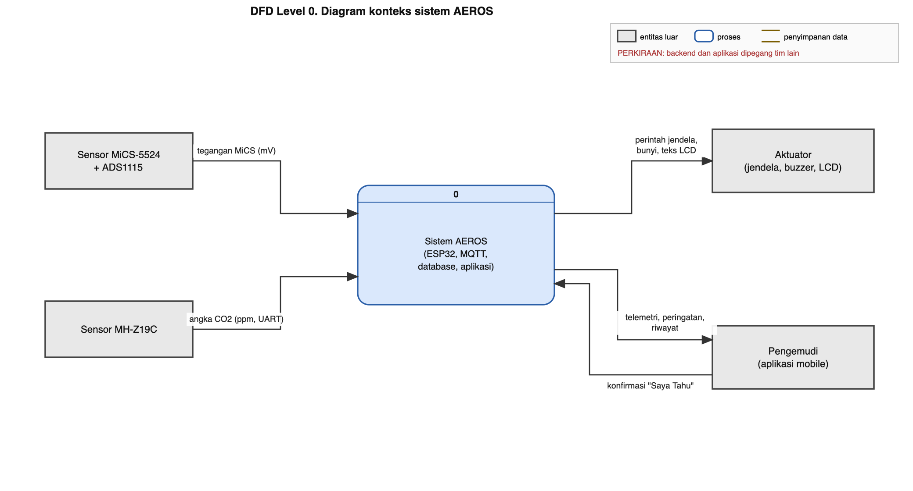

# Rancangan Data dan DFD (dari Sensor sampai Aplikasi)

Versi 25 Oktober 2026. Status: **PERKIRAAN**. Sisi firmware diturunkan langsung dari [pseudocode-baru.md](pseudocode-baru.md). Sisi **MQTT, database, dan aplikasi dipegang tim lain**, jadi bagian itu adalah usulan yang harus dicocokkan dengan mereka (agenda: [agenda-pertemuan-tim.md](../2-lapangan/agenda-pertemuan-tim.md)).

Dokumen terkait: [desain-data-dfd.md](../3-bukti/desain-data-dfd.md) (alasan laju kirim dan retensi), [rencana-desain.md](rencana-desain.md).

---

## 1. Gambaran singkat

```
Sensor  ->  ESP32 (firmware)  ->  MQTT  ->  Penyimpan data  ->  Database  ->  Layanan data  ->  Aplikasi  ->  Pengemudi
                 |  ^                                                                              |
                 |  +----------------------------- perintah ack ("Saya Tahu") <--------------------+
                 v
        jendela, buzzer, LCD
```

Tiga jenis data yang mengalir:
1. **Telemetri**: nilai dan status, tiap 5 detik. Nilai CO yang dikirim adalah hasil filter SMA 6 pada akhir interval, ditambah nilai maksimum selama interval.
2. **Kejadian (event)**: dikirim **segera** saat status berubah (alarm mulai, uji arah, jendela bergerak, dan seterusnya).
3. **Perintah ack**: dari aplikasi ke perangkat ("Saya Tahu" mematikan bunyi).

Keputusan alarm dan jendela dibuat **di ESP32 tiap 1 detik dan tidak bergantung pada internet**.

---

## 2. Data yang dihasilkan firmware

Diturunkan dari variabel di pseudocode baru.

| Variabel di pseudocode | Nama field | Tipe | Satuan | Keterangan | Dipakai di |
|---|---|---|---|---|---|
| (jam sejak menyala) | `t_s` | integer | detik | Penghitung sejak menyala. Kembali 0 saat ESP32 mulai ulang | CSV serial |
| (jam dinding) | `ts` | waktu (UTC) | | Cap waktu. **Belum fix** apakah dari NTP di ESP32 atau diisi server saat pesan diterima [B14] | Telemetri, kejadian |
| V (tegangan MiCS) | `v_mv` | real | mV | Rata-rata 16 pembacaan ADS1115 | CSV serial |
| Rs | `rs_kohm_mentah` | real | kΩ | Sebelum filter | CSV serial |
| RsHalus | `rs_kohm` | real | kΩ | Sesudah filter SMA 6 | CSV, telemetri |
| rasio | `rs_r0` | real | tanpa satuan | RsHalus dibagi R0 | CSV, telemetri |
| R0 | `r0_kohm` | real | kΩ | Patokan udara bersih dari memori NVS | Status |
| ppmCO | `co_ppm` | real | ppm | **Estimasi indikatif**, dihitung dari Rs yang **sudah difilter** | CSV, telemetri (nilai akhir interval), kejadian |
| (maksimum ppmCO) | `co_ppm_maks` | real | ppm | Nilai terbesar dari ppmCO terfilter selama 5 detik | Telemetri |
| CO2 | `co2_ppm` | integer | ppm | Angka dari MH-Z19C (tanpa filter di firmware). Di telemetri dirata-ratakan 5 detik | CSV (tiap detik), telemetri |
| (maksimum CO2) | `co2_maks` | integer | ppm | Nilai terbesar selama 5 detik | Telemetri |
| CO_VALID, CO2_VALID | `co_ok`, `co2_ok` | boolean | | Hasil validasi data | CSV, telemetri |
| (pemanasan) | `co_panas`, `co2_panas` | boolean | | Sensor masih memanas | CSV, telemetri |
| faseCO | `fase_co` | teks | | `TIDAK_AKTIF`, `UJI_ARAH`, `SUMBER_DALAM`, `SUMBER_LUAR` | CSV, telemetri, kejadian |
| faseCO2 | `fase_co2` | teks | | `NORMAL`, `PERINGATAN`, `TINDAKAN` | CSV, telemetri, kejadian |
| (status teks) | `st_co`, `st_co2` | teks | | Misalnya `OK`, `WASPADA`, `BAHAYA`, `GANGGUAN`, `PEMANASAN` | CSV, telemetri |
| jendela | `jendela` | teks | | `TERTUTUP`, `TERBUKA` (dan bukaan bila ada) | Telemetri, kejadian |
| (bunyi) | `buzzer` | teks | | `OFF`, `SINGKAT`, `CO`, `CO_KERAS`, `CO2` | Telemetri, kejadian |
| rsAwalUji, waktuUji | `rs_awal_uji`, `waktu_uji_s` | real, integer | kΩ, detik | Hanya pada kejadian uji arah | Kejadian (detail) |
| MODE_SIMULASI | `sim` | boolean | | Data dari mode simulasi | Semua pesan |
| (versi) | `fw` | teks | | Versi firmware | Telemetri, status |
| (identitas) | `device_id` | teks | | Misalnya `aeros-01` | Semua pesan |
| (urutan pesan) | `seq` | integer | | Untuk mendeteksi pesan hilang | Telemetri |

**Mengapa yang disimpan nilai terfilter.** Filter SMA 6 dijalankan **sebelum** perhitungan ppm: Rs mentah, lalu SMA 6, lalu rasio Rs/R0, lalu ppm. Jadi `rs_kohm`, `rs_r0`, dan `co_ppm` di telemetri sudah berasal dari hasil SMA, dan itu juga nilai yang dipakai alarm di perangkat. Dengan begitu data di database sama dengan yang dipakai untuk memutuskan. Karena sudah terfilter, nilai pada akhir interval 5 detik **tidak perlu dirata-ratakan lagi** (rata-rata ganda tidak menambah manfaat). Nilai maksimum tetap dikirim agar puncak singkat tidak hilang dari riwayat. Hanya CO2 yang dirata-ratakan 5 detik, karena di firmware ia tidak difilter. **Data mentah (`v_mv`, `rs_kohm_mentah`) hanya ada di CSV serial** sebagai bukti analisis noise dan pemilihan filter, tidak dikirim ke database.

**Format CSV serial** (usulan, melanjutkan format sekarang): `t_s, v_mv, rs_kohm, rs_r0, co_ppm, co2_ppm, co_ok, co2_ok, fase_co, fase_co2, st_co, st_co2, jendela, buzzer, sim`. Baris tetap dicetak tiap 1 detik untuk bukti pengujian.

---

## 3. Pesan MQTT (usulan)

### 3.1 Topik

| Topik | Arah | QoS | Isi |
|---|---|---|---|
| `aeros/{device_id}/telemetry` | perangkat ke broker | 0 | Telemetri tiap 5 detik |
| `aeros/{device_id}/event` | perangkat ke broker | 1 | Kejadian (segera saat status berubah) |
| `aeros/{device_id}/status` | perangkat ke broker | 1, retained | `online` saat tersambung, `offline` lewat pesan last will |
| `aeros/{device_id}/cmd/ack` | aplikasi ke perangkat | 1 | Konfirmasi "Saya Tahu" |

### 3.2 Contoh telemetri (tiap 5 detik) -> tabel `sensor_readings`

Nilai teks mengikuti batasan (CHECK) di database tim: `status` hanya `normal`, `waspada`, `bahaya`; `buzzer` hanya `on` atau `off`; `window_status` angka 0 sampai 100 (persen jendela terbuka).

```json
{
  "device_id": "aeros-01",
  "nonce": "b7f3-000123",
  "measured_at": "2026-10-25T13:18:05Z",
  "co_ppm": 6.2,
  "co2_ppm": 1412,
  "status": "normal",
  "window_status": 0,

  "rs_kohm": 1480.3,
  "rs_r0": 0.86,
  "co_ppm_maks": 7.9,
  "co2_maks": 1420,
  "st_co": "OK",
  "st_co2": "NORMAL",
  "fase_co": "TIDAK_AKTIF",
  "fase_co2": "NORMAL",
  "buzzer": "off",
  "co_ok": true,
  "co2_ok": true,
  "sim": false,
  "fw": "0.2.0"
}
```
- Enam field pertama (`device_id` sampai `window_status`) **sudah ada kolomnya**. `received_at` diisi server.
- Field setelah baris kosong (`rs_kohm` dan seterusnya) adalah **tambahan usulan** yang belum ada kolomnya (lihat 4.3).
- `nonce` = id boot ditambah nomor urut pesan (usulan). Database sudah punya `unique (device_id, nonce)`, jadi pesan ganda otomatis ditolak.

**Aturan `status` (usulan):** `bahaya` bila CO ≥ 87 ppm atau CO2 ≥ 4000. `waspada` bila CO ≥ 35 ppm (setelah konfirmasi) atau CO2 ≥ 2500. Selain itu `normal`. Keadaan gangguan sensor dan pemanasan **belum punya nilai** di database (lihat 4.3 nomor 2).

### 3.3 Contoh kejadian -> tabel `alert_logs` dan `actuator_logs`

Kejadian peringatan (membuka dan menutup satu baris `alert_logs`):
```json
{
  "device_id": "aeros-01",
  "event_key": "b7f3-000045",
  "fase": "mulai",
  "alert_type": "CO2_TINDAKAN",
  "gas": "CO2",
  "nilai": 4012,
  "ambang": 4000,
  "sumber": null,
  "detail": { "bukaan": 100 },
  "sim": false
}
```
Saat selesai, pesan yang sama dikirim dengan `"fase": "selesai"` dan `event_key` yang sama, sehingga backend mengisi `resolved_at`. Kunci `event_key` **belum ada kolomnya** (usulan 4.3 nomor 5).

Gerakan aktuator (satu baris `actuator_logs`):
```json
{
  "device_id": "aeros-01",
  "event_key": "b7f3-000045",
  "window_action": "open",
  "buzzer_state": "on",
  "trigger_source": "auto",
  "execution_status": "success",
  "window_status": 100,
  "sim": false
}
```
Aksi yang diputuskan di ESP32 dicatat sesudah terjadi (`execution_status` = `success`, `command_id` kosong).

Daftar `alert_type` dan jenis kejadian lain, dan kapan dibuat (dari pseudocode). Kolom `alert_type` di database tidak membatasi nilainya, jadi daftar ini bisa dipakai langsung:

| `tipe` | Dibuat saat |
|---|---|
| `CO_WASPADA` | Aturan CO aktif karena CO ≥ 35 ppm setelah konfirmasi |
| `CO_BAHAYA` | Aturan CO aktif karena CO ≥ 87 ppm |
| `CO_UJI_ARAH_MULAI` | Jendela dibuka untuk uji arah (`rs_awal_uji` dicatat) |
| `CO_SUMBER_LUAR` | Uji arah selesai dan Rs turun melebihi kriteria (jendela ditutup dan dikunci) |
| `CO_SUMBER_DALAM` | Uji arah selesai dan CO turun (jendela tetap terbuka) |
| `CO_SELESAI` | CO di bawah batas selesai selama waktu pemulihan |
| `CO2_PERINGATAN` | CO2 ≥ 2500 (sekali per kejadian) |
| `CO2_TINDAKAN` | CO2 ≥ 4000 |
| `CO2_SELESAI` | CO2 di bawah 2400 selama 60 detik |
| `SENSOR_GANGGUAN` | Sensor jadi tidak valid (`gas` menyebut CO atau CO2) |
| `SENSOR_PULIH` | Sensor valid kembali |
| `JENDELA_BUKA`, `JENDELA_TUTUP` | Perintah jendela dikirim ke aktuator |
| `BUZZER_ON`, `BUZZER_OFF` | Bunyi dinyalakan atau dimatikan |
| `ACK_DITERIMA` | Perintah ack dari aplikasi diterima |

### 3.4 Ukuran pesan
Contoh telemetri di atas sekitar 350 byte sebagai JSON. Itu **perkiraan kasar** (lebih besar dari asumsi 150–200 byte di [desain-data-dfd.md](../3-bukti/desain-data-dfd.md) karena nama field). Pada 5 detik, sekitar 17.280 pesan per hari, sehingga data jaringan perkiraan sekitar 6 MB per hari. Perlu dicek dengan tim backend, dan nama field bisa dipersingkat.

---

## 4. Tabel database

Sumber: **skrip SQL yang sudah dibuat tim backend** (25 Oktober 2026). Bagian ini menyatukan **yang sudah ada** dan **yang diusulkan ditambah**, supaya terlihat gambaran akhirnya. Pengembangan berjalan paralel: firmware dan backend saling uji kirim data, jadi yang paling penting adalah **kontrak data** yang disepakati lebih dulu (4.1).

Tanda: ✓ = sudah ada, ＋ = usulan tambahan, ⚠ = ada masalah yang perlu diperbaiki.

### 4.1 Kontrak data minimal yang perlu disepakati sekarang

Tujuh hal ini cukup agar kedua sisi tidak berbeda arah:

| # | Kesepakatan | Usulan |
|---|---|---|
| 1 | Teks yang diizinkan | Ikuti batasan database: `status` = `normal`, `waspada`, `bahaya`. `buzzer_state` = `on`, `off`. `window_action` = `open`, `closed`. `trigger_source` = `auto`, `manual`. `execution_status` = `pending`, `success`, `failed`. `connection_status` = `online`, `offline`, `unknown` |
| 2 | `window_status` | Persen jendela terbuka, 0 sampai 100 (sudah dibatasi database) |
| 3 | Arti `status` | `bahaya` bila CO ≥ 87 atau CO2 ≥ 4000. `waspada` bila CO ≥ 35 (terkonfirmasi) atau CO2 ≥ 2500. Selain itu `normal` |
| 4 | `nonce` | Id boot ditambah nomor urut pesan. Sudah dijaga `unique (device_id, nonce)` |
| 5 | Waktu | Perangkat mengirim `measured_at` hanya bila punya waktu nyata (NTP). Server mengisi `received_at` selalu |
| 6 | Nilai `alert_type` | `CO_WASPADA`, `CO_BAHAYA`, `CO2_PERINGATAN`, `CO2_TINDAKAN`, `SENSOR_GANGGUAN` |
| 7 | Pengambil keputusan | Alarm dan jendela diputuskan di ESP32 dan dicatat sesudahnya. Server tidak memerintah jendela kecuali penggantian manual |

### 4.2 Gambaran lengkap tiap tabel (ada dan tambahan)

**`devices`** (✓ semuanya)
| Kolom | Status | Keterangan |
|---|---|---|
| `device_id` text, kunci utama | ✓ | |
| `is_active` boolean, wajib, bawaan benar | ✓ | |
| `created_at` timestamptz | ✓ | |
| `nama`, `mobil` | ＋ opsional | Untuk membedakan Classy dan Civic |

**`sensor_readings`** (telemetri)
| Kolom | Status | Keterangan |
|---|---|---|
| `id` uuid, kunci utama | ✓ | |
| `device_id` text, wajib, kunci tamu ke `devices` | ✓ | |
| `co_ppm`, `co2_ppm` double, wajib | ✓ | |
| `status` text, wajib, hanya `normal`/`waspada`/`bahaya` | ✓ | Ringkasan satu kata untuk warna di aplikasi |
| `nonce` text, wajib, unik bersama `device_id` | ✓ | |
| `measured_at` timestamptz, bawaan sekarang | ✓ ⚠ | Bawaan sekarang berarti waktu server, bukan waktu perangkat (lihat 4.3 nomor 7) |
| `received_at` timestamptz | ✓ ⚠ | Tidak punya bawaan, jadi kosong bila tidak diisi |
| `window_status` smallint 0–100 | ✓ | |
| `sim` boolean | ＋ | Data simulasi |
| `rs_kohm`, `rs_r0` double | ＋ | Bukti uji arah dan analisis |
| `co_ppm_maks`, `co2_maks` double | ＋ | Puncak dalam 5 detik |
| `st_co`, `st_co2`, `fase_co`, `fase_co2` text | ＋ | Status dan fase rinci |
| `co_ok`, `co2_ok` boolean | ＋ | Validitas sensor |
| `buzzer` text (`on`/`off`) | ＋ | |
| `fw` text | ＋ | Versi firmware |
| Indeks (`device_id`, `measured_at` menurun) dan (`received_at`) | ＋ | Untuk grafik riwayat dan penghapusan data lama |

**`alert_logs`** (catatan peringatan)
| Kolom | Status | Keterangan |
|---|---|---|
| `id` uuid, kunci utama | ✓ | |
| `device_id` text, wajib | ✓ | |
| `alert_type` text, wajib (tanpa batasan nilai) | ✓ | Nilai diatur di kontrak nomor 6 |
| `created_at`, `resolved_at`, `acknowledged_at` | ✓ | Mulai, selesai, dikonfirmasi |
| `reading_id` uuid, kunci tamu ke `sensor_readings` | ✓ ⚠ | **`ON DELETE CASCADE`: berbahaya** (lihat 4.3 nomor 1) |
| `gas`, `nilai`, `ambang` | ＋ | Gas pemicu, nilai ppm, ambang |
| `sumber` (`LUAR`/`DALAM`/`TIDAK_JELAS`) | ＋ | Hasil uji arah |
| `event_key` text, unik bersama `device_id` | ＋ | Mencocokkan pesan "mulai" dan "selesai" |
| `detail` jsonb | ＋ | Misalnya `rs_awal_uji`, `waktu_uji_s`, bukaan |
| `sim` boolean | ＋ | |
| Indeks pada `reading_id`, `resolved_at` | ✓ | |

**`actuator_logs`** (gerakan aktuator)
| Kolom | Status | Keterangan |
|---|---|---|
| `id` uuid, kunci utama | ✓ | |
| `alert_id` uuid, kunci tamu ke `alert_logs` (cascade) | ✓ | Cascade di sini wajar |
| `device_id` text, wajib | ✓ | |
| `buzzer_state` (`on`/`off`), `window_action` (`open`/`closed`) | ✓ | Status "kunci" tidak punya nilai (lihat 4.3 nomor 6) |
| `trigger_source` (`auto`/`manual`) | ✓ ⚠ | Bawaan `''` tidak lolos batasannya (lihat 4.3 nomor 2) |
| `command_id` uuid, unik; `execution_status` (`pending`/`success`/`failed`) | ✓ | Untuk perintah dari server. Aksi otomatis ESP32 diisi `success` |
| `created_at` | ✓ | |
| `alasan` text | ＋ opsional | Misalnya `CO_UJI_ARAH`, `CO_SUMBER_LUAR`, `CO2_TINDAKAN`, `SELESAI`, `APP_ACK` |
| `sim` boolean | ＋ | |

**`device_state`** (keadaan terkini, satu baris per perangkat)
| Kolom | Status | Keterangan |
|---|---|---|
| `device_id` text, kunci utama | ✓ | |
| `status` text (tanpa batasan), `buzzer_state` (`on`/`off`) | ✓ | |
| `window_status` smallint 0–100 | ✓ | |
| `active_alert_id` uuid, kunci tamu ke `alert_logs` | ✓ | |
| `ack_driver` boolean, `ack_at` | ✓ | |
| `connection_status` (`online`/`offline`/`unknown`), `last_seen_at` | ✓ | Cocok dengan topik `status` MQTT |
| `updated_at` | ✓ | |
| `fase_co`, `fase_co2`, `sim` | ＋ | Aplikasi bisa menampilkan "uji arah" dan label simulasi |

### 4.3 Masalah dan penyesuaian (diurutkan dari yang terpenting)

| # | Temuan | Dampak | Usulan |
|---|---|---|---|
| 1 | ⚠ `alert_logs.reading_id` memakai **`ON DELETE CASCADE`**, dan `actuator_logs.alert_id` juga cascade | Saat telemetri lebih dari 7 hari dihapus, **catatan peringatan ikut terhapus, lalu log aktuatornya**. Riwayat kejadian (bukti terpenting) hilang. Selain itu `device_state.active_alert_id` tidak punya aturan hapus, jadi penghapusan bisa gagal | Ubah `reading_id` menjadi **`ON DELETE SET NULL`** |
| 2 | ⚠ `actuator_logs.trigger_source` bawaan `''`, padahal batasannya hanya `auto` atau `manual` | Menambah baris tanpa mengisi kolom ini **gagal** karena `''` tidak lolos | Hapus bawaan atau jadikan `auto` |
| 3 | `sensor_readings.status` hanya tiga nilai | Tidak bisa membawa gangguan sensor atau pemanasan, dan tidak membedakan CO dan CO2 | Pertahankan sebagai ringkasan warna. Tambah `st_co`, `st_co2`, `fase_*`, `co_ok`, `co2_ok` (tabel 4.2). Putuskan apakah `gangguan` ditambah ke batasan `status` |
| 4 | Tidak ada `sim` di tabel manapun | Data simulasi bercampur dengan data nyata | Tambah `sim` |
| 5 | `alert_logs` tidak punya `gas`, `nilai`, `ambang`, `sumber`, `detail`, dan kunci kejadian | Hasil uji arah dan nilai pemicu tidak tersimpan. Pesan "mulai" dan "selesai" tidak bisa dicocokkan | Tambah kolom (tabel 4.2), termasuk `event_key` |
| 6 | `window_action` hanya `open`/`closed`, dan `window_status` persen | Keadaan "ditutup dan dikunci" (sumber luar) tidak terwakili | Catat sebagai `closed` dengan `alert_logs.sumber = 'LUAR'`. Tidak perlu nilai baru |
| 7 | `measured_at` berbawaan `now()` sedangkan `received_at` tanpa bawaan | Waktu perangkat dan waktu server tertukar maknanya | `received_at` bawaan `now()`, `measured_at` tanpa bawaan (kosong bila perangkat tidak punya NTP) |
| 8 | Tidak ada indeks waktu pada `sensor_readings`, dan tidak terlihat tugas penghapusan | Grafik riwayat dan penghapusan 7 hari akan lambat atau tidak jalan | Tambah indeks dan tugas terjadwal (contoh di 4.4) |
| 9 | Kebijakan akses (RLS) dan kunci API tidak terlihat | Risiko data terbuka | Tim backend memeriksa. Kunci tidak boleh tertanam di kode firmware yang masuk repositori |
| 10 | ⚠ Kedua fungsi database memakai kolom **`created_at`**, padahal skrip tabel `sensor_readings` **tidak punya kolom itu** (hanya `measured_at` dan `received_at`) | Fungsi akan gagal dengan "column created_at does not exist", kecuali tabel aslinya berbeda dari skrip | Cek tabel yang sebenarnya. Bila memang tidak ada, pakai `coalesce(measured_at, received_at)` (lihat 4.8) |
| 11 | ⚠ Fungsi penghapus + `ON DELETE CASCADE` (nomor 1) | Begitu fungsi dijalankan, **catatan peringatan dan log aktuator ikut terhapus**. Bila ada peringatan aktif, penghapusan bisa gagal karena `device_state.active_alert_id` | **Perbaiki nomor 1 dulu**, baru fungsi dijadwalkan |
| 12 | Fungsi rata-rata per jendela waktu tidak menyaring perangkat | Bila perangkat lebih dari satu, rata-rata tercampur | Tambah parameter `device_id` dan saring (lihat 4.8) |

### 4.4 Contoh skrip SQL usulan (untuk ditinjau tim backend)

**Belum dijalankan dan belum diuji.** Ini hanya gambaran bentuk perubahannya.

```sql
-- 1. Cascade yang berbahaya (nomor 1)
alter table public.alert_logs drop constraint alert_logs_reading_id_fkey;
alter table public.alert_logs add constraint alert_logs_reading_id_fkey
  foreign key (reading_id) references public.sensor_readings (id) on delete set null;

-- 2. Bawaan trigger_source (nomor 2)
alter table public.actuator_logs alter column trigger_source set default 'auto';

-- 3 dan 4. Kolom tambahan telemetri (nomor 3, 4)
alter table public.sensor_readings
  add column if not exists sim boolean not null default false,
  add column if not exists rs_kohm double precision,
  add column if not exists rs_r0 double precision,
  add column if not exists co_ppm_maks double precision,
  add column if not exists co2_maks double precision,
  add column if not exists st_co text,
  add column if not exists st_co2 text,
  add column if not exists fase_co text,
  add column if not exists fase_co2 text,
  add column if not exists co_ok boolean,
  add column if not exists co2_ok boolean,
  add column if not exists buzzer text check (buzzer in ('on','off')),
  add column if not exists fw text;

-- 7. Waktu (nomor 7)
alter table public.sensor_readings alter column measured_at drop default;
alter table public.sensor_readings alter column received_at set default now();

-- 8. Indeks (nomor 8)
create index if not exists idx_sensor_readings_device_time
  on public.sensor_readings (device_id, measured_at desc);
create index if not exists idx_sensor_readings_received_at
  on public.sensor_readings (received_at);

-- 5. alert_logs (nomor 5)
alter table public.alert_logs
  add column if not exists gas text check (gas in ('CO','CO2','SENSOR')),
  add column if not exists nilai double precision,
  add column if not exists ambang double precision,
  add column if not exists sumber text check (sumber in ('LUAR','DALAM','TIDAK_JELAS')),
  add column if not exists event_key text,
  add column if not exists detail jsonb,
  add column if not exists sim boolean not null default false;
create unique index if not exists uq_alert_logs_device_event
  on public.alert_logs (device_id, event_key);

-- actuator_logs dan device_state
alter table public.actuator_logs
  add column if not exists alasan text,
  add column if not exists sim boolean not null default false;
alter table public.device_state
  add column if not exists fase_co text,
  add column if not exists fase_co2 text,
  add column if not exists sim boolean not null default false;

-- 8. Penghapusan telemetri lama (contoh dengan pg_cron, bila tersedia)
-- select cron.schedule('hapus-readings-lama', '0 3 * * *',
--   $$delete from public.sensor_readings
--     where coalesce(measured_at, received_at) < now() - interval '7 days'$$);
```

### 4.5 Pemetaan pesan firmware ke tabel

| Pesan atau field firmware | Tabel dan kolom | Keterangan |
|---|---|---|
| `co_ppm`, `co2_ppm`, `status`, `window_status`, `nonce`, `measured_at` | `sensor_readings` | Sudah cocok (kontrak 4.1) |
| `rs_kohm`, `rs_r0`, `st_co`, `st_co2`, `fase_*`, `co_ok`, `co2_ok`, `buzzer`, `sim`, `fw`, `co_ppm_maks`, `co2_maks` | `sensor_readings` (kolom tambahan) | Belum ada kolomnya |
| Kejadian `CO_WASPADA`, `CO_BAHAYA`, `CO2_PERINGATAN`, `CO2_TINDAKAN`, `SENSOR_GANGGUAN` (fase mulai) | `alert_logs` baris baru (`created_at`) | Nilai `alert_type` |
| Kejadian selesai (`CO_SELESAI`, `CO2_SELESAI`, `SENSOR_PULIH`) | `alert_logs.resolved_at` | Dicocokkan lewat `event_key` |
| `CO_UJI_ARAH_MULAI`, `CO_SUMBER_LUAR`, `CO_SUMBER_DALAM` | `alert_logs.sumber` dan `detail` | Belum ada kolomnya |
| `JENDELA_BUKA`, `JENDELA_TUTUP`, `BUZZER_ON`, `BUZZER_OFF` | `actuator_logs` (`window_action`, `buzzer_state`) | Sudah cocok |
| Topik `status` (online/offline) | `device_state.connection_status`, `last_seen_at` | Sudah cocok |
| Ack dari aplikasi | `alert_logs.acknowledged_at`, `device_state.ack_driver`, `ack_at` | Sudah cocok |

### 4.6 Pertanyaan untuk tim backend
1. Apakah kontrak 4.1 bisa disepakati, terutama arti `status` dan format `nonce`?
2. Apakah `gangguan` ditambahkan ke nilai `status`, atau gangguan dicatat lewat kolom lain?
3. Apakah `command_id` dan `execution_status` dipakai untuk perintah dari server, dan perintah apa saja?
4. Apakah ada tugas penghapusan data lama, indeks, dan kebijakan akses (RLS)?
5. Apakah perubahan di 4.4 bisa dijalankan, dan siapa yang menjalankannya?

### 4.7 Retensi
- `sensor_readings`: hapus data lebih dari 7 hari memakai fungsi hapus yang sudah ada (lihat 4.8), dijadwalkan setelah memperbaiki nomor 1 dan 10 di 4.3.
- `alert_logs`, `actuator_logs`: disimpan lama (jumlahnya kecil).
- `device_state`: satu baris per perangkat, ditimpa terus.
- Data uji untuk laporan disimpan **terpisah sebagai CSV**, bukan hanya di database.

### 4.8 Fungsi database yang sudah ada (25 Oktober 2026)

Dua fungsi dari tim backend. Nama dan parameter lengkap tidak terlihat dari yang ditempel, jadi saya hanya menilai isinya.

**Fungsi 1: hapus telemetri lama.** Menghapus baris `sensor_readings` yang lebih tua dari `p_days` hari dan mengembalikan jumlah yang terhapus. Ini cocok dengan rencana retensi 7 hari.

| Penilaian | Keterangan |
|---|---|
| ✓ | Memakai parameter jumlah hari, dan mengembalikan jumlah baris |
| ⚠ | Memakai `created_at`, yang tidak ada di skrip tabel (4.3 nomor 10) |
| ⚠ | Dengan `ON DELETE CASCADE` akan ikut menghapus catatan peringatan dan log aktuator (4.3 nomor 11) |
| Cek | Siapa yang boleh memanggilnya (hak eksekusi), dan bagaimana dijadwalkan |
| Saran | Bila data banyak, hapus bertahap agar tidak mengunci tabel lama |

Usulan isi (belum diuji):
```sql
delete from public.sensor_readings
where coalesce(measured_at, received_at) < now() - make_interval(days => p_days);
```

**Fungsi 2: rata-rata per jendela waktu.** Mengelompokkan telemetri dalam interval `p_bucket_seconds` antara `p_start` dan `p_end`, dan mengembalikan rata-rata CO, rata-rata CO2, dan jumlah sampel. Ini cocok untuk **grafik riwayat** di aplikasi, karena data diringkas di server.

| Penilaian | Keterangan |
|---|---|
| ✓ | Ringkasan di sisi server mengurangi data yang dikirim ke aplikasi |
| ⚠ | Memakai `created_at` (4.3 nomor 10) |
| ⚠ | Tidak ada saringan `device_id` (4.3 nomor 12) |
| Kurang | Hanya rata-rata. **Nilai maksimum** perlu ikut, supaya puncak singkat terlihat di grafik |
| Kurang | Setelah kolom `sim` ditambahkan, data simulasi harus disaring (atau parameter pilihan) |

Usulan isi (belum diuji):
```sql
select
  to_timestamp(floor(extract(epoch from coalesce(measured_at, received_at)) / p_bucket_seconds) * p_bucket_seconds) as bucket_start,
  round(avg(co_ppm)::numeric, 2)  as avg_co,
  round(max(co_ppm)::numeric, 2)  as max_co,
  round(avg(co2_ppm)::numeric, 2) as avg_co2,
  round(max(co2_ppm)::numeric, 2) as max_co2,
  count(*) as sample_count
from public.sensor_readings
where device_id = p_device_id
  and coalesce(measured_at, received_at) between p_start and p_end
  -- and sim = false   (setelah kolom sim ada)
group by 1
order by 1;
```

---

## 5. Diagram aliran data (DFD)

### 5.1 Level 0 (konteks)


### 5.2 Level 1A (perangkat ESP32)


| Proses | Tugas | Masuk | Keluar |
|---|---|---|---|
| 1.1 Akuisisi dan validasi | Membaca sensor dan menilai validitas | Tegangan MiCS, angka CO2 | Data tervalidasi (`v_mv`, `co2_ppm`, `co_ok`, `co2_ok`) |
| 1.2 Pengolahan sinyal | Rs, filter SMA 6, rasio, ppm CO | Data tervalidasi, R0 (D6) | `rs_kohm`, `rs_r0`, `co_ppm`, `co2_ppm`, flag. Juga baris CSV (D5) |
| 1.3 Logika keputusan | Aturan CO, CO2, prioritas | Nilai terhitung | Status, fase, perintah, kejadian |
| 1.4 Aktuasi dan tampilan | Jendela, buzzer, LCD | Status dan perintah, perintah ack | Perintah ke aktuator |
| 1.5 Agregasi dan pengiriman | Nilai terfilter pada akhir interval 5 detik dan maksimumnya, pesan kejadian | Nilai terhitung, status dan kejadian | Telemetri dan kejadian ke broker MQTT |

Penyimpanan: **D5** log serial CSV (berkas di komputer), **D6** memori NVS (R0).

### 5.3 Level 1B (MQTT, database, aplikasi, mengikuti skema tim)


| Proses | Tugas | Masuk | Keluar |
|---|---|---|---|
| 2.1 Broker MQTT | Menerima dan meneruskan pesan | Telemetri, kejadian, ack | Pesan ke penyimpan data, ack ke perangkat |
| 2.2 Penyimpan data | Validasi, cap waktu (`received_at`), simpan | Pesan | Baris ke D1, D2, D3, dan pembaruan D4. Memakai D5 sebagai referensi perangkat |
| 2.3 Penghapusan terjadwal | Menghapus telemetri lama | D1 | Menghapus baris lebih dari 7 hari. **Fungsinya sudah ada** (4.8), penjadwalannya belum terlihat |
| 2.4 Layanan data | Melayani data realtime dan riwayat | D1, D2, D3, D4 | Data ke aplikasi. **Sebagian sudah ada**: fungsi rata-rata per jendela waktu untuk grafik (4.8) |
| 2.5 Aplikasi mobile | Tampil, notifikasi, konfirmasi | Data dari layanan | Tampilan ke pengemudi, ack ke broker, `acknowledged_at` di D2 |

Penyimpanan: **D1** `sensor_readings`, **D2** `alert_logs`, **D3** `actuator_logs`, **D4** `device_state`, **D5** `devices`.

Pemetaan DFD ke pseudocode: proses 1.1 dan 1.2 adalah langkah 1–3 program utama, 1.3 adalah langkah 4–6 (aturan CO dan CO2), 1.4 adalah langkah 7, dan 1.5 adalah langkah 8 ([pseudocode-baru.md](pseudocode-baru.md) bagian 2.3).

Diagram dibuat lewat skrip [diagram/buat_dfd.py](../diagram/buat_dfd.py). Mengubah isi diagram berarti mengubah skrip lalu menjalankannya lagi.

---

## 6. Yang masih perkiraan dan perlu dikonfirmasi tim

| # | Hal | Siapa |
|---|---|---|
| 1 | Cap waktu: NTP di ESP32 atau cap waktu server (B14) | Backend |
| 2 | Nama topik, QoS, dan pesan last will | Backend |
| 3 | Nama field dan ukuran pesan (bisa dipersingkat) | Backend dan firmware |
| 4 | Kontrak 4.1, penyesuaian 4.3, dan pertanyaan 4.6 | Backend |
| 5 | Retensi 7 hari dan batas ukuran paket Supabase (belum dicek) | Backend |
| 6 | Perilaku saat Wi-Fi atau hotspot putus (buffer atau dibuang) | Backend dan firmware |
| 7 | Cara aplikasi membaca data (langsung dari database atau lewat layanan) | Software |
| 8 | Teks pesan dan pola notifikasi (B15, B18) | Software |
| 9 | Penanda `sim` di semua tampilan | Software |
| 10 | Target latensi "data tampil di aplikasi" | Semua |
