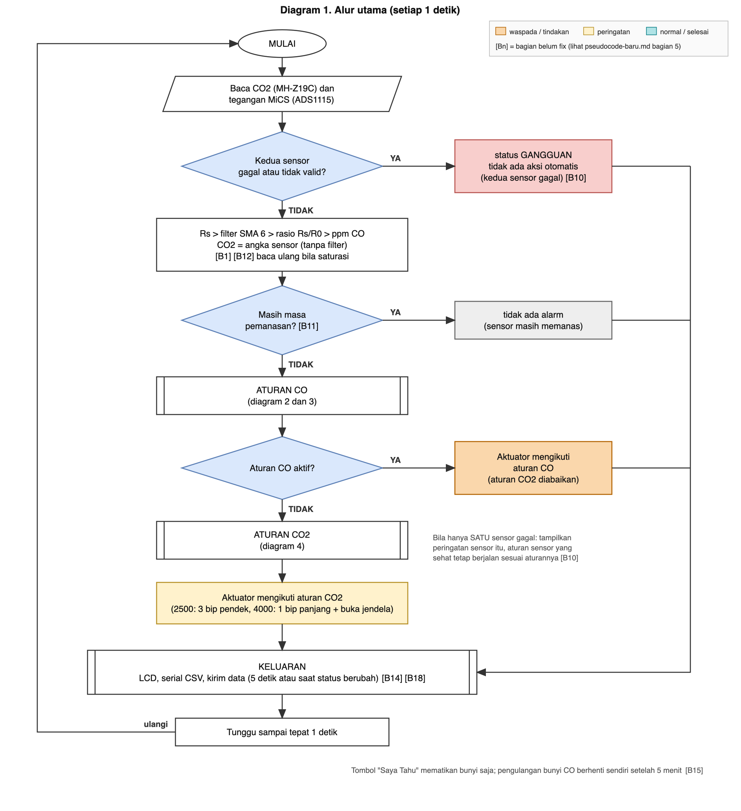
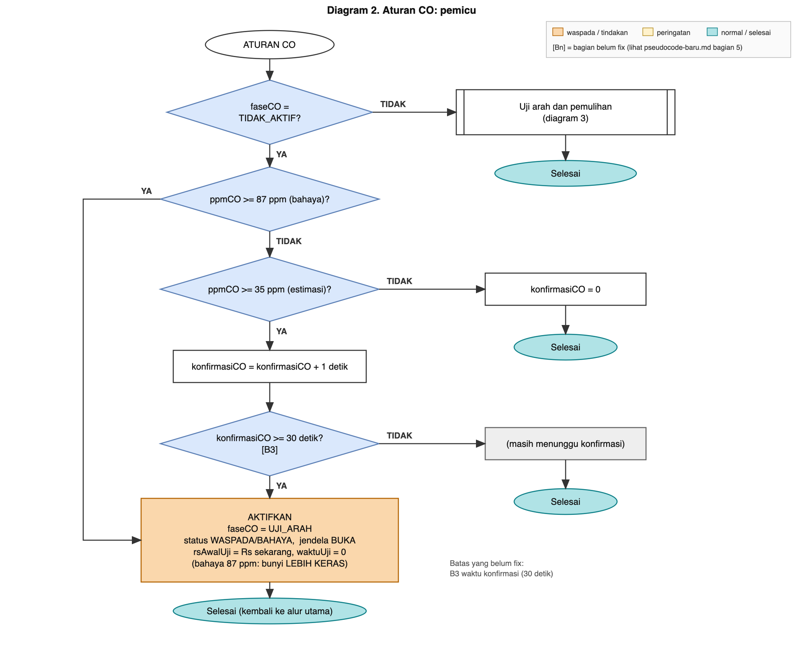

# Algoritma Firmware (Pseudocode Baru)

Versi 27 Oktober 2026. Ini rencana algoritma firmware baru. File ini **berdiri sendiri**: ia tidak mengubah `src/main.cpp` (v0, 23 Okt 2026) dan tidak mengubah pseudocode lama, yang disimpan apa adanya di [algoritma-firmware-lama-v0.md](algoritma-firmware-lama-v0.md).

**Tanda yang dipakai:** `[Bn]` menunjuk satu butir di daftar kode B. Butir yang sudah diputuskan ada di [keputusan.md](keputusan.md), yang masih terbuka ada di [belum-diputuskan.md](belum-diputuskan.md). Pengiriman data lewat Wi-Fi dan MQTT ada di [komunikasi.md](komunikasi.md).

---

## 1. Pilihan filter untuk CO

**Yang difilter:** Rs (hambatan MiCS) per detik, sebelum dibagi R0 dan diubah menjadi ppm. CO2 **tidak** difilter (sensornya sudah lambat dan datanya halus).

**Keputusan sementara: rata-rata bergerak 6 titik (SMA 6)**, dengan sampling tepat 1 detik.

### 1.1 Kandidat yang dibandingkan
Tabel perbandingan lengkap (peredaman noise, respons 90%, lonjakan yang lolos untuk SMA 2 sampai 10, EMA 0,05 sampai 0,2, dan median) ada di [analisis/filter.md](../analisis/filter.md) dan [analisis/ringkasan-temuan.md](../analisis/ringkasan-temuan.md). Ringkasnya: semua SMA jumlah genap meredam sekitar 76%; yang membedakan hanya kecepatan dan lonjakan yang lolos (SMA 4: 3 detik dan 7,4%; **SMA 6: 5 detik dan 4,9%**; SMA 8: 7 detik dan 3,7%); EMA 0,2 (kode lama): 74%, 10 detik, 5,9%; median 5 hanya 2%.

### 1.2 Alasan memilih SMA 6
1. Sekitar 95% goyangan Rs berupa pola bergantian naik-turun tiap detik. Rata-rata **jumlah genap** menghapus pola itu (peredaman sama untuk SMA 2 sampai 10), sedangkan jumlah ganjil tidak.
2. Di antara yang genap, peredamannya sama. Yang membedakan hanya kecepatan dan ketahanan terhadap lonjakan. SMA 6 mengambil jalan tengah: 5 detik dan 4,9%.
3. SMA 6 lebih baik dari filter di kode sekarang (EMA 0,2) pada **ketiga** ukuran: peredaman 76% lawan 74%, respons 5 lawan 10 detik, lonjakan lolos 4,9% lawan 5,9%.
4. Keterlambatan kecil (sekitar 2,5 detik pada perubahan lambat), jauh di bawah anggaran keterlambatan 60–120 detik.
5. **Ingatannya pendek.** Lonjakan hilang seluruhnya setelah 6 detik. EMA menyimpan sisa lonjakan lebih lama.
6. Sederhana: cukup menyimpan 6 nilai terakhir.

### 1.3 Kelebihan dan kekurangan
| Kelebihan | Kekurangan |
|---|---|
| Meredam pola dominan (sekitar 76%) dengan keterlambatan kecil | **Bergantung pada sampling tepat 1 detik.** Kalau interval berubah (misalnya 5 detik), pola bergantian tidak lagi terhapus |
| Lebih cepat dan lebih baik dari EMA 0,2 | Bergantung pada pola periode sekitar 2 detik yang kemungkinan berasal dari rangkaian ini. **Perlu diuji ulang di PCB dan di mobil** |
| Memori terbatas, lonjakan tidak berbekas | Lonjakan +30% tetap lolos sekitar 4,9% selama 6 detik |
| Mudah dijelaskan dan diimplementasikan | Tidak membuang gerakan lambat (sekitar 3% pada Rs, setara sekitar 4% pada ppm). Itu bukan noise yang bisa dibuang tanpa menambah keterlambatan |
| | Enam detik pertama setelah menyala atau setelah data tidak valid belum penuh [B13] |

### 1.4 Cadangan
- **SMA 4** bila butuh lebih cepat (lonjakan lolos naik menjadi 7,4%).
- **SMA 8** bila ada alarm palsu dari lonjakan.
- **EMA 0,1** bila di PCB pola bergantian itu hilang (lebih umum, tetapi respons sekitar 21 detik).
- Panjang akhir (4, 6, atau 8) divalidasi ulang pada rangkaian akhir dan dengan tabel sensitivitas [B12].

---

## 2. Pseudocode

### 2.1 Parameter

```
INTERVAL_SIKLUS        = 1 detik, TEPAT  (syarat agar filter genap bekerja)
PANJANG_FILTER_CO      = 6                                        [B12]

CO_AMBANG_WASPADA      = 35 ppm (estimasi)                        [B2 diputuskan: angka ppm estimasi]
CO_KONFIRMASI          = 30 detik                                 [B3]
CO_AMBANG_BAHAYA       = 87 ppm (estimasi, WHO 15 menit)          [B4 diputuskan]
CO_LAMA_UJI_ARAH       = 30 detik (sementara)                     [B5]
CO_KRITERIA_NAIK       = sekitar 25% penurunan Rs (usulan; 8% dan 15% terlalu kecil, lihat B6)   [B6]
CO_BATAS_SELESAI       = 30 ppm (estimasi)                        [B7]
CO_WAKTU_PEMULIHAN     = 60 detik                                 [B7]

CO2_AMBANG_PERINGATAN  = 2500 ppm
CO2_AMBANG_TINDAKAN    = 4000 ppm
CO2_BATAS_SELESAI      = 2500 ppm   (usulan: tutup saat bacaan < 2500; data Avanza, bagian 2.9)   [B8]
CO2_WAKTU_PEMULIHAN    = 10 detik   (3 bacaan; sebelumnya 60 detik)                              [B8]
CO2_BACAAN_KONFIRMASI  = 3 bacaan valid berturut-turut            [B8]

PEMANASAN_CO           = 180 detik   (diputuskan 25 Okt malam; alasan di 2.7)
PEMANASAN_CO2          = 180 detik   (diputuskan 25 Okt malam; alasan di 2.7)

BUKAAN_JENDELA         = setengah, diatur LEWAT WAKTU jalan motor (WAKTU_SETENGAH, diukur per mobil)   [B9]
JENDELA_BUKA_MAKS      = 180 detik  (batas aman: tutup walau CO2 belum turun)   [B9]
JENDELA_BUKA_MIN       = 20 detik   (jangan menutup sebelum ini)                 [B9]
JEDA_MINIMUM_JENDELA   = 5 menit tertutup sebelum buka lagi (usulan; data: siklus alami 15 menit)   [B9]
BUNYI_WASPADA          = 3 bip pendek (sekitar 2 detik), SEKALI saat status masuk WASPADA        [B15, diputuskan 27 Okt]
BUNYI_BAHAYA           = 1 bip panjang (sekitar 3 detik), SEKALI saat status masuk BAHAYA       [B15]
BUNYI_ULANG_CO         = ulangi tiap 60 detik selama CO masih WASPADA atau BAHAYA, berhenti sendiri setelah 5 menit   [B15]
BUNYI_ULANG_CO2        = tidak diulang                                                           [B15]

A_COEF, BETA           = 3,46 dan 0,840 (hasil digitalisasi piksel kurva datasheet; v0 memakai 3,7 dan 0,856 hasil baca mata, selisih < 1,5% di 35-100 ppm)   [diputuskan 27 Okt]
R0                     = 1730 kOhm, satu nilai tetap, label "estimasi"; ukur ulang SEKALI setelah buck terpasang   [B1 diputuskan 27 Okt]
VCC                    = 4,64 V sampai buck terpasang (lalu ubah sekali dan ukur R0 ulang)
```

### 2.2 Keadaan yang disimpan

```
faseCO       : TIDAK_AKTIF | UJI_ARAH | SUMBER_DALAM | SUMBER_LUAR
faseCO2      : NORMAL | PERINGATAN | TINDAKAN
rsAwalUji                     (nilai Rs yang sudah difilter saat uji arah dimulai)
penghitung   : konfirmasiCO, pemulihanCO, konfirmasiCO2, pemulihanCO2, waktuUji, lamaBuka
jendela      : TERTUTUP | TERBUKA
statusSensor : CO_VALID?, CO2_VALID?, pemanasanCO?, pemanasanCO2?
```

### 2.3 Program utama

```
SAAT DINYALAKAN:
    siapkan serial, LCD, I2C, sensor CO2 (UART 9600), ADS1115
    kalau ADS1115 tidak ada: tampilkan error                       (tidak berhenti selamanya) [B10]
    ambil R0 dari memori (nilai tetap 1730 kOhm; diubah hanya lewat perintah 'r')   [B1 diputuskan]
    kalibrasi otomatis CO2: matikan                                [B16]
    mulai hitung pemanasan CO dan CO2
    [usulan T1] uji mandiri: periksa ADS1115, MH-Z19C, LCD; satu bip pendek; gagal = tag ERR tetapi sensor lain tetap jalan
    [usulan T2] aktifkan watchdog (siklus macet > 10 detik = mulai ulang); catat alasan reset

SETIAP INTERVAL_SIKLUS (tepat 1 detik):

    1. BACA
        baca CO2 dari MH-Z19C (cek header dan checksum)
        baca tegangan MiCS dari ADS1115 (rata-rata 16 pembacaan)
        kalau saturasi: naikkan gain dan BACA ULANG saat itu juga   (bukan dibuang)

    2. VALIDASI
        CO2_VALID = (bacaan lengkap, checksum cocok)
                    dan bukan nilai 410 atau 500 selama PEMANASAN_CO2 (itu nilai palsu bawaan sensor
                    sampai detik ke-64 sampai 128 setelah menyala)
        CO_VALID  = tegangan masuk akal (tidak mentok, tidak di luar rentang)

    3. HITUNG
        kalau CO_VALID:
            Rs  = RL * (VCC - V) / V
            masukkan Rs ke buffer 6 nilai terakhir                  [B13]
            RsHalus = rata-rata buffer (sudah penuh 6?)             [B12]
            rasio   = RsHalus / R0
            ppmCO   = (A_COEF / rasio) ^ (1 / BETA)  ; A_COEF = 3,46, BETA = 0,840 ; 0 bila rasio >= 0,5      [B1, B2]
        CO2 = angka dari sensor (tanpa filter tambahan)

    4. KEADAAN SENSOR
        kalau CO_VALID salah DAN CO2_VALID salah:
            status = GANGGUAN, tidak ada aksi otomatis              [B10]
            lompat ke LANGKAH 8
        kalau hanya satu sensor yang tidak valid:
            tampilkan peringatan "CO tidak terbaca" atau "CO2 tidak terbaca"
            aturan sensor yang sehat TETAP berjalan sesuai aturannya   [B10]
        kalau sebuah sensor masih masa pemanasan:
            aturan sensor itu belum berjalan (tanpa alarm)

    5. ATURAN CO   (prioritas tertinggi; hanya bila CO valid dan selesai memanas)   -> lihat 2.4

    6. ATURAN CO2  (hanya bila CO2 valid dan selesai memanas, dan aturan CO tidak aktif)   -> lihat 2.5

    7. AKTUATOR
        perintah jendela dan bunyi dihasilkan oleh aturan yang aktif
        batasi gerakan: jangan bergerak lebih sering dari JEDA_MINIMUM_JENDELA   [B9]
        bunyi mengikuti 2.10 (WASPADA 3 bip pendek, BAHAYA 1 bip panjang; CO diulang, CO2 tidak)   [B15]

    8. KELUARAN
        LCD: angka seperti v0, tag status 4 karakter, indikator Wi-Fi 1 karakter (lihat 2.10)   [B18]
        selama sebuah sensor MEMANASKAN (PEMANASAN_CO atau PEMANASAN_CO2):
            LCD: angka sensor itu TIDAK tampil (tampil "----", tag "WARM")
                 (data 25 Okt: 20 detik pertama CO terbaca 3000-4120 ppm palsu karena Rs masih 59 kOhm; CO2 410/500 palsu)
            serial: angka mentah TETAP dicetak, dengan status WARMUP   (bukti uji tidak hilang)
            pesan data: TETAP dikirim, dengan penanda kond = pemanasan; aplikasi tidak menampilkannya sebagai nilai nyata
        serial: baris CSV
        kirim data tiap 5 detik (rata-rata dan maksimum), dan segera saat status berubah   [B14] (lewat antrean, lihat 2.8)
        data simulasi diberi label                                  [B17]

    9. TOMBOL "SAYA TAHU": matikan bunyi SAJA (alarm dan jendela tetap berjalan sesuai aturan).
       Bunyi muncul lagi bila status naik ke BAHAYA. Pengulangan bunyi CO berhenti sendiri setelah 5 menit.   [B15]

    10. TUNGGU sampai tepat INTERVAL_SIKLUS sejak awal siklus, lalu ulangi
```

### 2.4 Aturan CO

```
ATURAN CO:

    kalau faseCO = TIDAK_AKTIF:
        kalau ppmCO >= CO_AMBANG_BAHAYA:                           [B4]
            AKTIFKAN (tanpa konfirmasi), status BAHAYA        ; aturan jendela sama dengan >= 35 ppm (uji arah)
        sebaliknya kalau ppmCO >= CO_AMBANG_WASPADA:               [B2]
            konfirmasiCO = konfirmasiCO + 1 detik
            kalau konfirmasiCO >= CO_KONFIRMASI:                   [B3]
                AKTIFKAN
        sebaliknya:
            konfirmasiCO = 0

    AKTIFKAN:
        faseCO     = UJI_ARAH
        status    = WASPADA (BAHAYA bila ppmCO >= CO_AMBANG_BAHAYA); bunyi sesuai 2.10
        jendela    = BUKA
        rsAwalUji  = RsHalus sekarang
        waktuUji   = 0

    kalau faseCO = UJI_ARAH:
        waktuUji = waktuUji + 1 detik
        kalau waktuUji >= CO_LAMA_UJI_ARAH:                        [B5]
            kalau RsHalus turun lebih dari CO_KRITERIA_NAIK dari rsAwalUji:   [B6]
                faseCO = SUMBER_LUAR        ; CO naik lagi, sumber dari luar: status BAHAYA (tag LUAR)
                jendela = TUTUP dan KUNCI   ; tidak menguji ulang
            sebaliknya kalau tidak jelas (perubahan kecil):         [B6]
                anggap sumber luar dan tutup (diputuskan 27 Okt: lebih aman)
            sebaliknya:
                faseCO = SUMBER_DALAM       ; CO turun, jendela tetap terbuka

    kalau faseCO bukan TIDAK_AKTIF:
        kalau ppmCO < CO_BATAS_SELESAI:                            [B7]
            pemulihanCO = pemulihanCO + 1 detik
            kalau pemulihanCO >= CO_WAKTU_PEMULIHAN:               [B7]
                faseCO = TIDAK_AKTIF
                bunyi CO dimatikan
                jendela diserahkan ke aturan CO2 (tertutup bila CO2 normal)
                reset semua penghitung CO
        sebaliknya:
            pemulihanCO = 0

    selama faseCO bukan TIDAK_AKTIF: aturan CO2 DIABAIKAN
```

### 2.5 Aturan CO2

```
ATURAN CO2   (dijalankan hanya bila faseCO = TIDAK_AKTIF):

    hitung bacaan valid berturut-turut di atas tiap ambang           [B8]

    kalau CO2 >= CO2_AMBANG_TINDAKAN selama CO2_BACAAN_KONFIRMASI bacaan:
        faseCO2 = TINDAKAN
        status BAHAYA; 1 bip panjang SEKALI (tidak diulang)
        jendela = BUKA sebesar BUKAAN_JENDELA                       [B9]
        lamaBuka = 0
    sebaliknya kalau CO2 >= CO2_AMBANG_PERINGATAN selama CO2_BACAAN_KONFIRMASI bacaan:
        kalau faseCO2 masih NORMAL:
            faseCO2 = PERINGATAN
            status WASPADA; 3 bip pendek SEKALI (tidak diulang)
            kirim peringatan ke aplikasi

    kalau faseCO2 = TINDAKAN dan jendela TERBUKA:
        lamaBuka = lamaBuka + 1 detik
        kalau lamaBuka >= JENDELA_BUKA_MAKS:                        [B9]
            jendela = TUTUP ; tandai "CO2 tidak turun" (tampilkan dan kirim sebagai kejadian)

    kalau faseCO2 bukan NORMAL:
        kalau CO2 < CO2_BATAS_SELESAI dan lamaBuka >= JENDELA_BUKA_MIN:   [B8, B9]
            pemulihanCO2 = pemulihanCO2 + 1 detik
            kalau pemulihanCO2 >= CO2_WAKTU_PEMULIHAN:              [B8]
                faseCO2 = NORMAL
                bunyi dimatikan
                jendela = TUTUP
                reset penghitung CO2
        sebaliknya:
            pemulihanCO2 = 0
```

Catatan untuk aturan CO2: di mobil yang tidak kedap, CO2 bisa **turun sendiri tanpa jendela dibuka** saat mobil melaju (turun 51 sampai 90 ppm/menit di Civic EG6, jendela tertutup, sirkulasi dalam). Karena itu pemulihan CO2 hanya dinilai dari bacaan, tidak dari anggapan "jendela terbuka".

### 2.6 Mode simulasi (isi belum fix) [B17]

```
KALAU MODE_SIMULASI aktif:
    gantikan ppmCO dengan kurva yang diputar dari model:
        skenario A (sumber dalam): CO naik, lalu TURUN setelah jendela dibuka
        skenario B (sumber luar) : CO naik, lalu tetap NAIK setelah jendela dibuka
    beri label "SIMULASI" di layar, serial, dan pesan data
```

### 2.7 Pemanasan: kenapa 3 menit untuk masing-masing sensor

| | CO2 (MH-Z19C) | CO (MiCS-5524) |
|---|---|---|
| Angka | 180 detik | 180 detik (**diputuskan 27 Okt**) |
| Datasheet | Manual Winsen v1.2: preheat 1 menit | **Tidak ada** angka pemanasan, respons, maupun pemulihan |
| Data kita | Nilai palsu 410/500 berhenti pada detik ke-64 (4 dari 5 kali menyala) dan detik ke-128 (1 kali, nyala dingin pertama malam itu). Di kamar nilainya datar 996–999 ppm dari detik ke-64 sampai 300 | Di kamar Rs stabil dalam 1–2 menit (menit ke-0 sampai 4: 1492, 1878, 1968, 1973, 1994 kOhm). Di mobil Rs terus bergeser, tetapi mengikuti kondisi kabin, bukan pemanasan |
| Alasan angka | Kasus terburuk teramati 128 detik. 180 detik masih memberi jarak aman 52 detik. Dipersingkat tidak sebanding: hemat 1 menit, risiko kasus dingin tidak tertutup | Data mendukung 2 menit stabil. 3 menit memberi jarak 1 menit. Sebelumnya 5 menit (pilihan di kode, tidak ada dasar) |
| Dasar angka | Datasheet + log (5 kali menyala) | Log (2 kali menyala di kamar + 2 di mobil). **Tanpa datasheet** |
| Sampai kapan sementara | Final | **Diputuskan 27 Okt, tidak perlu uji baru.** Uji nyala dingin yang bersih (kamar, mati semalam, 26 Okt pagi): Rs 156 kOhm saat menyala, 1649 kOhm pada menit ke-2 sampai 3, lalu bergerak di sekitar nilai stabil (siklus sekitar 7 menit). Log mobil terpotong dan berulang, jadi tidak dipakai |
| Yang tidak diklaim | Akurasi CO2 di menit awal tidak terbukti (tanpa gas acuan) | Stabil bukan berarti benar. Baseline di mobil masih bergeser dan R0 dari kamar tidak cocok (lihat B1) |

Perlu diingat: pemanasan dihitung dari saat ESP32 menyala. Pada uji mobil malam itu alat menyala tiga kali (21:37, 21:41, 22:00) dan setiap kali pemanasan mulai dari nol, sehingga alarm CO mati selama 3 menit pertama tiap kali menyala.

### 2.8 Pengiriman data lewat Wi-Fi dan MQTT
Dipindah ke [komunikasi.md](komunikasi.md) (bagian "Rancangan sisi ESP32"). Prinsipnya: alarm dan jendela **tidak bergantung internet**, dan siklus sensor tetap tepat 1 detik karena jaringan berjalan di tugas terpisah.

### 2.9 Menutup jendela: batas turun dan lama buka (dasar data Avanza, 26 Okt)

Pertanyaan: jendela dibuka setengah berapa lama, dan kapan ditutup?

| Data (Avanza, dua jendela depan setengah, 20–40 km/jam) | Jendela 1 | Jendela 2 |
|---|---|---|
| CO2 saat dibuka | sekitar 4437 | sekitar 4447 |
| Lama sampai bacaan < 2500 | sekitar 95 detik | sekitar 100 detik |
| Bacaan saat ditutup | 2384 | 2121 |
| Terus turun sesudah ditutup | sampai 1831 | sampai 1660 |

Pengertian dari data:
- **Menutup saat bacaan < 2500 sudah cukup.** CO2 terus turun sesudah ditutup (jeda sensor dan pencampuran udara), sehingga menunggu 60 detik tambahan hanya membuat jendela terbuka lebih lama tanpa perlu.
- Naik kembali dari bawah 2500 ke 4000 butuh 7–10 menit, jadi jendela tidak sering bergerak.
- **Lama buka bergantung mobil dan kecepatan**, jadi lamanya tidak ditetapkan tetap. Rancangan: buka setengah dengan waktu motor (usulan teman elektro), **tahan sampai bacaan < 2500**, dengan batas atas 180 detik (sekitar 1,8 kali waktu yang dibutuhkan Avanza) dan batas bawah 20 detik.
- Bila sensor CO2 gagal, jendela tidak dibuka otomatis oleh aturan CO2 (tidak ada dasar untuk menutup). Batas 180 detik tetap melindungi bila bacaan tidak pernah turun.
- Bukaan setengah ditentukan oleh `WAKTU_SETENGAH` = setengah dari waktu buka penuh motor, diukur per mobil (Classy, Civic, Avanza).

Yang belum diketahui: waktu motor jendela tiap mobil dan perilaku di mobil lain (Civic belum punya uji buka jendela).

### 2.10 Status, bunyi, dan tampilan (diputuskan 27 Okt)

Disederhanakan menjadi **5 status**. Jenis gas (CO atau CO2) terlihat dari baris LCD, bukan dari status tambahan.

| Status | Tag LCD | Nilai `status` di database | Pemicu | Bunyi |
|---|---|---|---|---|
| PEMANASAN | `WARM` (angka sensor itu tampil `----`; serial dan data tetap tercatat) | `normal` + penanda pemanasan | sensor masih 180 detik pertama | tidak ada |
| NORMAL | `OK` | `normal` | di bawah semua ambang | tidak ada |
| WASPADA | `WARN` | `waspada` | CO >= 35 ppm (terkonfirmasi 30 detik) atau CO2 >= 2500 | 3 bip pendek, sekali |
| BAHAYA | `DANG` | `bahaya` | CO >= 87 ppm atau CO2 >= 4000 | 1 bip panjang, sekali |
| BAHAYA (CO dari luar) | `LUAR` | `bahaya` | hasil uji arah: Rs turun > 25% atau tidak jelas | 1 bip panjang, sekali |
| GANGGUAN | `ERR` | `normal` + penanda gangguan | sensor tidak valid | tidak ada |

```
BUNYI:
    saat status BERUBAH ke WASPADA atau BAHAYA: bunyikan pola level itu (sekali)
    naik ke level lebih tinggi: selalu bunyikan lagi
    kalau status ASAL = CO dan masih WASPADA atau BAHAYA:
        ulangi pola tiap 60 detik, sampai kondisi turun, "Saya Tahu", atau 5 menit
    kalau status ASAL = CO2: tidak diulang       ; siklus CO2 sekitar 15 menit, jangan mengganggu
    "SAYA TAHU": hentikan pengulangan (alarm dan jendela tetap berjalan)
```

**Tampilan LCD 16x2.** Angka tetap seperti v0. Tanda titik dua dibuang untuk membebaskan 1 karakter di ujung kanan baris atas:

```
CO   12ppm WARN W
CO2  850ppm OK
```

**Indikator Wi-Fi (1 karakter, ujung kanan baris atas)**, diisi dari kode status yang dikirim tugas jaringan (komunikasi.md bagian 4.2):

| Tampil | Arti |
|---|---|
| `W` | tersambung sampai MQTT |
| `w` | Wi-Fi ada, MQTT belum |
| `-` | tidak tersambung (data aman di flash) |
| `P` | mode portal Wi-Fi |

Alarm selalu menang atas pesan jaringan di LCD. Aplikasi memakai pesan `ONLINE`/`OFFLINE` (last will) untuk tahu perangkat tersambung atau tidak.

---

## 3. Yang tidak diubah

- `src/main.cpp` tetap seperti 23 Oktober 2026 **saat dokumen ini ditulis** (checksum `fa7b8a91070bafe659d7babde142ea8e384bbf44`, cadangan di `arsip-firmware/main-v0-2026-10-23.cpp`). Sejak 28 Oktober 2026 `src/main.cpp` adalah v0.1 (lihat README).
- Pseudocode lama (rencana awal dan alur kode v0) tetap, di [algoritma-firmware-lama-v0.md](algoritma-firmware-lama-v0.md).

---

## 4. Diagram alur

Dibuat dengan gaya contoh yang Anda berikan (oval awal, jajar genjang untuk data, persegi untuk proses, belah ketupat untuk keputusan, warna oranye untuk kondisi waspada dan hijau kebiruan untuk normal).

### Diagram 1. Alur utama (setiap 1 detik)


### Diagram 2. Aturan CO: pemicu


### Diagram 3. Aturan CO: uji arah dan pemulihan


### Diagram 4. Aturan CO2


Berkas SVG (bisa dibuka di draw.io atau Inkscape) dan skrip pembuatnya, [diagram/buat_diagram.py](diagram/buat_diagram.py), ada di folder [diagram/](diagram/). Mengubah isi diagram berarti mengubah skrip itu lalu menjalankannya lagi (`python3 buat_diagram.py`). Diagram alur data dan perintah (diagram 5 dan 6) ada di [komunikasi.md](komunikasi.md).
