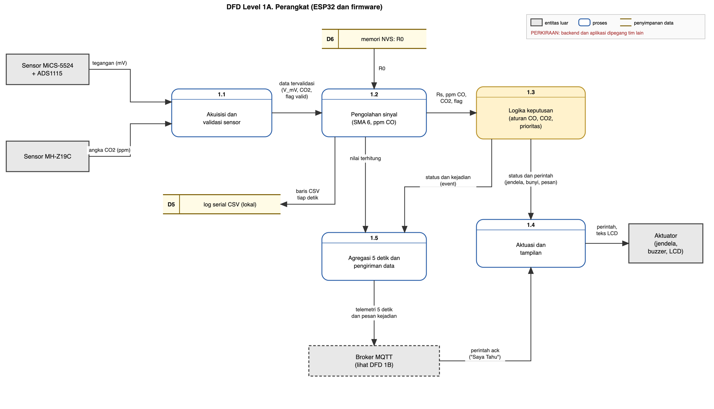
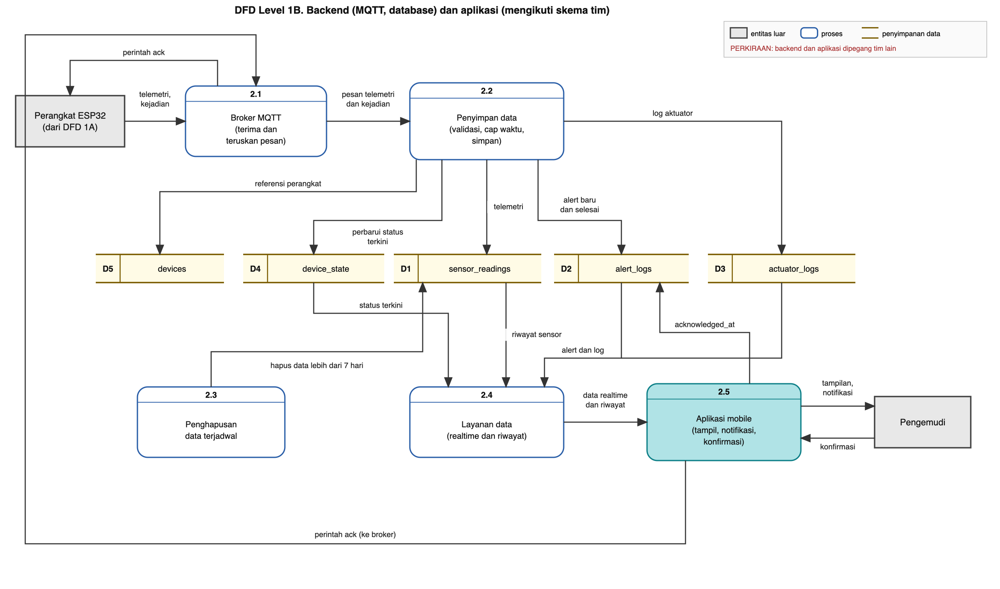

# Data dan Database

Versi 27 Oktober 2026. Status: **perkiraan**; bagian MQTT, database, dan aplikasi dipegang tim lain, jadi yang di sini adalah usulan yang harus dicocokkan dengan mereka. Isi dan format pesan ada di [komunikasi.md](komunikasi.md).

## 1. Laju kirim, laju simpan, dan retensi (alasan)
Usulan, belum disetujui tim. Angka ukuran data adalah perkiraan dengan asumsi yang tertulis.

### 1.1 Dua hal yang perlu dipisahkan

| Hal | Pertanyaannya | Usulan |
|---|---|---|
| Laju **keputusan** di ESP32 | Seberapa sering sensor dibaca dan logika alarm dievaluasi | Tetap sekitar 1 detik (sekarang). Cukup cepat menangkap lonjakan terpendek yang relevan (C-251 menyebut lonjakan CO 10 detik) |
| Laju **pengiriman dan penyimpanan** ke MQTT dan database | Seberapa sering data dikirim dan disimpan | Setiap 5 detik, ditambah pesan langsung saat status berubah |

C-251 menulis siklus 5 detik untuk keduanya. Dengan pemisahan ini keputusan tidak harus menunggu 5 detik.

### 1.2 Mengapa tidak menyimpan tiap detik

Perkiraan, dengan asumsi satu baris sekitar 150 byte di database dan sekitar 200 byte per pesan di jaringan (termasuk tambahan protokol). Nilai itu belum diukur.

| Laju | Baris per hari | Baris per 7 hari | Perkiraan ukuran 7 hari | Perkiraan data jaringan per hari |
|---|---|---|---|---|
| Tiap 1 detik | 86.400 | 604.800 | sekitar 91 MB | sekitar 17 MB |
| Tiap 5 detik | 17.280 | 120.960 | sekitar 18 MB | sekitar 3,5 MB |
| Rata-rata 1 menit | 1.440 | 10.080 | sekitar 1,5 MB | sekitar 0,3 MB |

Catatan:
- Rancangan C-251 memakai hotspot ponsel pengguna untuk internet, jadi data jaringan juga menyangkut kuota pengguna.
- Batas ukuran database pada paket gratis Supabase perlu dicek di halaman paketnya (belum diverifikasi).
- Laju 1 detik tidak bermasalah secara teknis untuk ESP32, tetapi boros untuk riwayat yang hanya ditampilkan sebagai grafik.

### 1.3 Jangan mengambil satu sampel tiap 5 detik

Analisis kita menunjukkan Rs MiCS bergoyang bolak-balik tiap detik (periode sekitar 2 detik). Mengambil **satu** sampel tiap 5 detik bisa menghasilkan pola lambat palsu (aliasing). Yang benar: **rata-ratakan sampel 1 detik di dalam setiap interval 5 detik**, lalu kirim rata-rata itu. Untuk grafik riwayat itu cukup. Untuk keputusan alarm tetap dipakai filter dari analisis di [filter.md](../analisis/filter.md).

Kirim juga **nilai maksimum** (atau minimum untuk Rs) di setiap interval agar lonjakan pendek tidak hilang dari riwayat.

### 1.4 Retensi 7 hari: apakah dihapus?

Pilihan:

| Pilihan | Isi | Kelebihan | Kekurangan |
|---|---|---|---|
| A. Hapus semua data lebih dari 7 hari | Satu tabel, ada tugas terjadwal penghapus | Paling sederhana, ukuran tetap | Riwayat lebih dari 7 hari hilang |
| B. Data 5 detik disimpan 7 hari, lalu diringkas jadi rata-rata (dan maksimum) 1 menit untuk disimpan lebih lama | Dua tabel | Tren jangka panjang tetap ada, ukuran kecil | Sedikit lebih rumit |
| C. Simpan semua | Satu tabel, tanpa penghapusan | Paling mudah | Ukuran terus bertambah dan bisa melewati batas paket |

Usulan: **B ringan**. Pembacaan 5 detik disimpan 7 hari. Catatan peringatan (`alert_logs`) dan catatan aktuator (`actuator_logs`) disimpan lama karena jumlahnya sedikit dan itu bukti paling penting. Ringkasan 1 menit disimpan sesuai kebutuhan laporan. Untuk capstone, pilihan A saja juga wajar, asalkan **dinyatakan** dan data pengujian untuk laporan **disimpan terpisah** sebagai berkas (CSV) di komputer, jangan hanya di database.

### 1.5 Dampak ke DFD

Tambahkan atau ubah:
- **Proses di ESP32: "Agregasi 5 detik dan deteksi kejadian"** (rata-rata dan maksimum per interval, serta pesan langsung saat status berubah) sebelum proses pengiriman MQTT.
- **Penyimpanan D1 `sensor_readings`** diberi keterangan retensi (7 hari).
- **Proses terjadwal "Hapus atau ringkas data lama"** yang berjalan pada D1.
- **Penyimpanan D2 `alert_logs`** dan **D3 `actuator_logs`** tanpa penghapusan (atau penghapusan sangat panjang).
- Penyimpanan data uji (CSV lokal) di luar jalur sistem, untuk bukti laporan.

## 2. Tabel database

Sumber: **skrip SQL yang sudah dibuat tim backend** (25 Oktober 2026). Bagian ini menyatukan **yang sudah ada** dan **yang diusulkan ditambah**, supaya terlihat gambaran akhirnya. Pengembangan berjalan paralel: firmware dan backend saling uji kirim data, jadi yang paling penting adalah **kontrak data** yang disepakati lebih dulu (4.1).

Tanda: ✓ = sudah ada, ＋ = usulan tambahan, ⚠ = ada masalah yang perlu diperbaiki.

### 2.1 Kontrak data minimal yang perlu disepakati sekarang

Tujuh hal ini cukup agar kedua sisi tidak berbeda arah:

| # | Kesepakatan | Usulan |
|---|---|---|
| 1 | Teks yang diizinkan | Ikuti batasan database: `status` = `normal`, `waspada`, `bahaya`. `buzzer_state` = `on`, `off`. `window_action` = `open`, `closed`. `trigger_source` = `auto`, `manual`. `execution_status` = `pending`, `success`, `failed`. `connection_status` = `online`, `offline`, `unknown` |
| 2 | `window_status` | Persen jendela terbuka, 0 sampai 100 (sudah dibatasi database) |
| 3 | Arti `status` | `bahaya` bila CO ≥ 87 atau CO2 ≥ 4000. `waspada` bila CO ≥ 35 (terkonfirmasi) atau CO2 ≥ 2500. Selain itu `normal` |
| 4 | `nonce` | Id boot ditambah nomor urut pesan. Sudah dijaga `unique (device_id, nonce)` |
| 5 | Waktu | Perangkat mengirim `measured_at` hanya bila punya waktu nyata (NTP). Server mengisi `received_at` selalu |
| 6 | Nilai `alert_type` | `CO_WASPADA`, `CO_BAHAYA`, `CO2_PERINGATAN`, `CO2_TINDAKAN`, `SENSOR_GANGGUAN` |
| 7 | Pengambil keputusan | Alarm dan jendela diputuskan di ESP32 dan dicatat sesudahnya. Server tidak memerintah jendela kecuali penggantian manual |

### 2.2 Gambaran lengkap tiap tabel (ada dan tambahan)

**`devices`** (✓ semuanya)
| Kolom | Status | Keterangan |
|---|---|---|
| `device_id` text, kunci utama | ✓ | |
| `is_active` boolean, wajib, bawaan benar | ✓ | |
| `created_at` timestamptz | ✓ | |
| `nama`, `mobil` | ＋ opsional | Untuk membedakan Classy dan Civic |

**`sensor_readings`** (telemetri)
| Kolom | Status | Keterangan |
|---|---|---|
| `id` uuid, kunci utama | ✓ | |
| `device_id` text, wajib, kunci tamu ke `devices` | ✓ | |
| `co_ppm`, `co2_ppm` double, wajib | ✓ | |
| `status` text, wajib, hanya `normal`/`waspada`/`bahaya` | ✓ | Ringkasan satu kata untuk warna di aplikasi |
| `nonce` text, wajib, unik bersama `device_id` | ✓ | |
| `measured_at` timestamptz, bawaan sekarang | ✓ ⚠ | Bawaan sekarang berarti waktu server, bukan waktu perangkat (lihat 4.3 nomor 7) |
| `received_at` timestamptz | ✓ ⚠ | Tidak punya bawaan, jadi kosong bila tidak diisi |
| `window_status` smallint 0–100 | ✓ | |
| `sim` boolean | ＋ | Data simulasi |
| `rs_kohm`, `rs_r0` double | ＋ | Bukti uji arah dan analisis |
| `co_ppm_maks`, `co2_maks` double | ＋ | Puncak dalam 5 detik |
| `st_co`, `st_co2`, `fase_co`, `fase_co2` text | ＋ | Status dan fase rinci |
| `co_ok`, `co2_ok` boolean | ＋ | Validitas sensor |
| `buzzer` text (`on`/`off`) | ＋ | |
| `fw` text | ＋ | Versi firmware |
| Indeks (`device_id`, `measured_at` menurun) dan (`received_at`) | ＋ | Untuk grafik riwayat dan penghapusan data lama |

**`alert_logs`** (catatan peringatan)
| Kolom | Status | Keterangan |
|---|---|---|
| `id` uuid, kunci utama | ✓ | |
| `device_id` text, wajib | ✓ | |
| `alert_type` text, wajib (tanpa batasan nilai) | ✓ | Nilai diatur di kontrak nomor 6 |
| `created_at`, `resolved_at`, `acknowledged_at` | ✓ | Mulai, selesai, dikonfirmasi |
| `reading_id` uuid, kunci tamu ke `sensor_readings` | ✓ ⚠ | **`ON DELETE CASCADE`: berbahaya** (lihat 4.3 nomor 1) |
| `gas`, `nilai`, `ambang` | ＋ | Gas pemicu, nilai ppm, ambang |
| `sumber` (`LUAR`/`DALAM`/`TIDAK_JELAS`) | ＋ | Hasil uji arah |
| `event_key` text, unik bersama `device_id` | ＋ | Mencocokkan pesan "mulai" dan "selesai" |
| `detail` jsonb | ＋ | Misalnya `rs_awal_uji`, `waktu_uji_s`, bukaan |
| `sim` boolean | ＋ | |
| Indeks pada `reading_id`, `resolved_at` | ✓ | |

**`actuator_logs`** (gerakan aktuator)
| Kolom | Status | Keterangan |
|---|---|---|
| `id` uuid, kunci utama | ✓ | |
| `alert_id` uuid, kunci tamu ke `alert_logs` (cascade) | ✓ | Cascade di sini wajar |
| `device_id` text, wajib | ✓ | |
| `buzzer_state` (`on`/`off`), `window_action` (`open`/`closed`) | ✓ | Status "kunci" tidak punya nilai (lihat 4.3 nomor 6) |
| `trigger_source` (`auto`/`manual`) | ✓ ⚠ | Bawaan `''` tidak lolos batasannya (lihat 4.3 nomor 2) |
| `command_id` uuid, unik; `execution_status` (`pending`/`success`/`failed`) | ✓ | Untuk perintah dari server. Aksi otomatis ESP32 diisi `success` |
| `created_at` | ✓ | |
| `alasan` text | ＋ opsional | Misalnya `CO_UJI_ARAH`, `CO_SUMBER_LUAR`, `CO2_TINDAKAN`, `SELESAI`, `APP_ACK` |
| `sim` boolean | ＋ | |

**`device_state`** (keadaan terkini, satu baris per perangkat)
| Kolom | Status | Keterangan |
|---|---|---|
| `device_id` text, kunci utama | ✓ | |
| `status` text (tanpa batasan), `buzzer_state` (`on`/`off`) | ✓ | |
| `window_status` smallint 0–100 | ✓ | |
| `active_alert_id` uuid, kunci tamu ke `alert_logs` | ✓ | |
| `ack_driver` boolean, `ack_at` | ✓ | |
| `connection_status` (`online`/`offline`/`unknown`), `last_seen_at` | ✓ | Cocok dengan topik `status` MQTT |
| `updated_at` | ✓ | |
| `fase_co`, `fase_co2`, `sim` | ＋ | Aplikasi bisa menampilkan "uji arah" dan label simulasi |

### 2.3 Masalah dan penyesuaian (diurutkan dari yang terpenting)

| # | Temuan | Dampak | Usulan |
|---|---|---|---|
| 1 | ⚠ `alert_logs.reading_id` memakai **`ON DELETE CASCADE`**, dan `actuator_logs.alert_id` juga cascade | Saat telemetri lebih dari 7 hari dihapus, **catatan peringatan ikut terhapus, lalu log aktuatornya**. Riwayat kejadian (bukti terpenting) hilang. Selain itu `device_state.active_alert_id` tidak punya aturan hapus, jadi penghapusan bisa gagal | Ubah `reading_id` menjadi **`ON DELETE SET NULL`** |
| 2 | ⚠ `actuator_logs.trigger_source` bawaan `''`, padahal batasannya hanya `auto` atau `manual` | Menambah baris tanpa mengisi kolom ini **gagal** karena `''` tidak lolos | Hapus bawaan atau jadikan `auto` |
| 3 | `sensor_readings.status` hanya tiga nilai | Tidak bisa membawa gangguan sensor atau pemanasan, dan tidak membedakan CO dan CO2 | Pertahankan sebagai ringkasan warna. Tambah `st_co`, `st_co2`, `fase_*`, `co_ok`, `co2_ok` (tabel 4.2). Putuskan apakah `gangguan` ditambah ke batasan `status` |
| 4 | Tidak ada `sim` di tabel manapun | Data simulasi bercampur dengan data nyata | Tambah `sim` |
| 5 | `alert_logs` tidak punya `gas`, `nilai`, `ambang`, `sumber`, `detail`, dan kunci kejadian | Hasil uji arah dan nilai pemicu tidak tersimpan. Pesan "mulai" dan "selesai" tidak bisa dicocokkan | Tambah kolom (tabel 4.2), termasuk `event_key` |
| 6 | `window_action` hanya `open`/`closed`, dan `window_status` persen | Keadaan "ditutup dan dikunci" (sumber luar) tidak terwakili | Catat sebagai `closed` dengan `alert_logs.sumber = 'LUAR'`. Tidak perlu nilai baru |
| 7 | `measured_at` berbawaan `now()` sedangkan `received_at` tanpa bawaan | Waktu perangkat dan waktu server tertukar maknanya | `received_at` bawaan `now()`, `measured_at` tanpa bawaan (kosong bila perangkat tidak punya NTP) |
| 8 | Tidak ada indeks waktu pada `sensor_readings`, dan tidak terlihat tugas penghapusan | Grafik riwayat dan penghapusan 7 hari akan lambat atau tidak jalan | Tambah indeks dan tugas terjadwal (contoh di 4.4) |
| 9 | Kebijakan akses (RLS) dan kunci API tidak terlihat | Risiko data terbuka | Tim backend memeriksa. Kunci tidak boleh tertanam di kode firmware yang masuk repositori |
| 10 | ⚠ Kedua fungsi database memakai kolom **`created_at`**, padahal skrip tabel `sensor_readings` **tidak punya kolom itu** (hanya `measured_at` dan `received_at`) | Fungsi akan gagal dengan "column created_at does not exist", kecuali tabel aslinya berbeda dari skrip | Cek tabel yang sebenarnya. Bila memang tidak ada, pakai `coalesce(measured_at, received_at)` (lihat 4.8) |
| 11 | ⚠ Fungsi penghapus + `ON DELETE CASCADE` (nomor 1) | Begitu fungsi dijalankan, **catatan peringatan dan log aktuator ikut terhapus**. Bila ada peringatan aktif, penghapusan bisa gagal karena `device_state.active_alert_id` | **Perbaiki nomor 1 dulu**, baru fungsi dijadwalkan |
| 12 | Fungsi rata-rata per jendela waktu tidak menyaring perangkat | Bila perangkat lebih dari satu, rata-rata tercampur | Tambah parameter `device_id` dan saring (lihat 4.8) |

### 2.4 Contoh skrip SQL usulan (untuk ditinjau tim backend)

**Belum dijalankan dan belum diuji.** Ini hanya gambaran bentuk perubahannya.

```sql
-- 1. Cascade yang berbahaya (nomor 1)
alter table public.alert_logs drop constraint alert_logs_reading_id_fkey;
alter table public.alert_logs add constraint alert_logs_reading_id_fkey
  foreign key (reading_id) references public.sensor_readings (id) on delete set null;

-- 2. Bawaan trigger_source (nomor 2)
alter table public.actuator_logs alter column trigger_source set default 'auto';

-- 3 dan 4. Kolom tambahan telemetri (nomor 3, 4)
alter table public.sensor_readings
  add column if not exists sim boolean not null default false,
  add column if not exists rs_kohm double precision,
  add column if not exists rs_r0 double precision,
  add column if not exists co_ppm_maks double precision,
  add column if not exists co2_maks double precision,
  add column if not exists st_co text,
  add column if not exists st_co2 text,
  add column if not exists fase_co text,
  add column if not exists fase_co2 text,
  add column if not exists co_ok boolean,
  add column if not exists co2_ok boolean,
  add column if not exists buzzer text check (buzzer in ('on','off')),
  add column if not exists fw text;

-- 7. Waktu (nomor 7)
alter table public.sensor_readings alter column measured_at drop default;
alter table public.sensor_readings alter column received_at set default now();

-- 8. Indeks (nomor 8)
create index if not exists idx_sensor_readings_device_time
  on public.sensor_readings (device_id, measured_at desc);
create index if not exists idx_sensor_readings_received_at
  on public.sensor_readings (received_at);

-- 5. alert_logs (nomor 5)
alter table public.alert_logs
  add column if not exists gas text check (gas in ('CO','CO2','SENSOR')),
  add column if not exists nilai double precision,
  add column if not exists ambang double precision,
  add column if not exists sumber text check (sumber in ('LUAR','DALAM','TIDAK_JELAS')),
  add column if not exists event_key text,
  add column if not exists detail jsonb,
  add column if not exists sim boolean not null default false;
create unique index if not exists uq_alert_logs_device_event
  on public.alert_logs (device_id, event_key);

-- actuator_logs dan device_state
alter table public.actuator_logs
  add column if not exists alasan text,
  add column if not exists sim boolean not null default false;
alter table public.device_state
  add column if not exists fase_co text,
  add column if not exists fase_co2 text,
  add column if not exists sim boolean not null default false;

-- 8. Penghapusan telemetri lama (contoh dengan pg_cron, bila tersedia)
-- select cron.schedule('hapus-readings-lama', '0 3 * * *',
--   $$delete from public.sensor_readings
--     where coalesce(measured_at, received_at) < now() - interval '7 days'$$);
```

### 2.5 Pemetaan pesan firmware ke tabel

| Pesan atau field firmware | Tabel dan kolom | Keterangan |
|---|---|---|
| `co_ppm`, `co2_ppm`, `status`, `window_status`, `nonce`, `measured_at` | `sensor_readings` | Sudah cocok (kontrak 4.1) |
| `rs_kohm`, `rs_r0`, `st_co`, `st_co2`, `fase_*`, `co_ok`, `co2_ok`, `buzzer`, `sim`, `fw`, `co_ppm_maks`, `co2_maks` | `sensor_readings` (kolom tambahan) | Belum ada kolomnya |
| Kejadian `CO_WASPADA`, `CO_BAHAYA`, `CO2_PERINGATAN`, `CO2_TINDAKAN`, `SENSOR_GANGGUAN` (fase mulai) | `alert_logs` baris baru (`created_at`) | Nilai `alert_type` |
| Kejadian selesai (`CO_SELESAI`, `CO2_SELESAI`, `SENSOR_PULIH`) | `alert_logs.resolved_at` | Dicocokkan lewat `event_key` |
| `CO_UJI_ARAH_MULAI`, `CO_SUMBER_LUAR`, `CO_SUMBER_DALAM` | `alert_logs.sumber` dan `detail` | Belum ada kolomnya |
| `JENDELA_BUKA`, `JENDELA_TUTUP`, `BUZZER_ON`, `BUZZER_OFF` | `actuator_logs` (`window_action`, `buzzer_state`) | Sudah cocok |
| Topik `status` (online/offline) | `device_state.connection_status`, `last_seen_at` | Sudah cocok |
| Ack dari aplikasi | `alert_logs.acknowledged_at`, `device_state.ack_driver`, `ack_at` | Sudah cocok |

### 2.6 Retensi
Bawaan: `sensor_readings` dihapus setelah 7 hari memakai fungsi hapus yang sudah ada (2.7), dijadwalkan **setelah** memperbaiki cascade dan `created_at` (2.3). `alert_logs` dan `actuator_logs` disimpan lama (jumlahnya kecil). `device_state` satu baris per perangkat, ditimpa terus. Data uji untuk laporan disimpan **terpisah sebagai CSV**, bukan hanya di database.

### 2.7 Fungsi database yang sudah ada (25 Oktober 2026)

Dua fungsi dari tim backend. Nama dan parameter lengkap tidak terlihat dari yang ditempel, jadi saya hanya menilai isinya.

**Fungsi 1: hapus telemetri lama.** Menghapus baris `sensor_readings` yang lebih tua dari `p_days` hari dan mengembalikan jumlah yang terhapus. Ini cocok dengan rencana retensi 7 hari.

| Penilaian | Keterangan |
|---|---|
| ✓ | Memakai parameter jumlah hari, dan mengembalikan jumlah baris |
| ⚠ | Memakai `created_at`, yang tidak ada di skrip tabel (4.3 nomor 10) |
| ⚠ | Dengan `ON DELETE CASCADE` akan ikut menghapus catatan peringatan dan log aktuator (4.3 nomor 11) |
| Cek | Siapa yang boleh memanggilnya (hak eksekusi), dan bagaimana dijadwalkan |
| Saran | Bila data banyak, hapus bertahap agar tidak mengunci tabel lama |

Usulan isi (belum diuji):
```sql
delete from public.sensor_readings
where coalesce(measured_at, received_at) < now() - make_interval(days => p_days);
```

**Fungsi 2: rata-rata per jendela waktu.** Mengelompokkan telemetri dalam interval `p_bucket_seconds` antara `p_start` dan `p_end`, dan mengembalikan rata-rata CO, rata-rata CO2, dan jumlah sampel. Ini cocok untuk **grafik riwayat** di aplikasi, karena data diringkas di server.

| Penilaian | Keterangan |
|---|---|
| ✓ | Ringkasan di sisi server mengurangi data yang dikirim ke aplikasi |
| ⚠ | Memakai `created_at` (4.3 nomor 10) |
| ⚠ | Tidak ada saringan `device_id` (4.3 nomor 12) |
| Kurang | Hanya rata-rata. **Nilai maksimum** perlu ikut, supaya puncak singkat terlihat di grafik |
| Kurang | Setelah kolom `sim` ditambahkan, data simulasi harus disaring (atau parameter pilihan) |

Usulan isi (belum diuji):
```sql
select
  to_timestamp(floor(extract(epoch from coalesce(measured_at, received_at)) / p_bucket_seconds) * p_bucket_seconds) as bucket_start,
  round(avg(co_ppm)::numeric, 2)  as avg_co,
  round(max(co_ppm)::numeric, 2)  as max_co,
  round(avg(co2_ppm)::numeric, 2) as avg_co2,
  round(max(co2_ppm)::numeric, 2) as max_co2,
  count(*) as sample_count
from public.sensor_readings
where device_id = p_device_id
  and coalesce(measured_at, received_at) between p_start and p_end
  -- and sim = false   (setelah kolom sim ada)
group by 1
order by 1;
```

---

## 3. Diagram aliran data (DFD)

### 3.1 Level 0 (konteks)


### 3.2 Level 1A (perangkat ESP32)


| Proses | Tugas | Masuk | Keluar |
|---|---|---|---|
| 1.1 Akuisisi dan validasi | Membaca sensor dan menilai validitas | Tegangan MiCS, angka CO2 | Data tervalidasi (`v_mv`, `co2_ppm`, `co_ok`, `co2_ok`) |
| 1.2 Pengolahan sinyal | Rs, filter SMA 6, rasio, ppm CO | Data tervalidasi, R0 (D6) | `rs_kohm`, `rs_r0`, `co_ppm`, `co2_ppm`, flag. Juga baris CSV (D5) |
| 1.3 Logika keputusan | Aturan CO, CO2, prioritas | Nilai terhitung | Status, fase, perintah, kejadian |
| 1.4 Aktuasi dan tampilan | Jendela, buzzer, LCD | Status dan perintah, perintah ack | Perintah ke aktuator |
| 1.5 Agregasi dan pengiriman | Nilai terfilter pada akhir interval 5 detik dan maksimumnya, pesan kejadian | Nilai terhitung, status dan kejadian | Telemetri dan kejadian ke broker MQTT |

Penyimpanan: **D5** log serial CSV (berkas di komputer), **D6** memori NVS (R0).

### 3.3 Level 1B (MQTT, database, aplikasi, mengikuti skema tim)


| Proses | Tugas | Masuk | Keluar |
|---|---|---|---|
| 2.1 Broker MQTT | Menerima dan meneruskan pesan | Telemetri, kejadian, ack | Pesan ke penyimpan data, ack ke perangkat |
| 2.2 Penyimpan data | Validasi, cap waktu (`received_at`), simpan | Pesan | Baris ke D1, D2, D3, dan pembaruan D4. Memakai D5 sebagai referensi perangkat |
| 2.3 Penghapusan terjadwal | Menghapus telemetri lama | D1 | Menghapus baris lebih dari 7 hari. **Fungsinya sudah ada** (4.8), penjadwalannya belum terlihat |
| 2.4 Layanan data | Melayani data realtime dan riwayat | D1, D2, D3, D4 | Data ke aplikasi. **Sebagian sudah ada**: fungsi rata-rata per jendela waktu untuk grafik (4.8) |
| 2.5 Aplikasi mobile | Tampil, notifikasi, konfirmasi | Data dari layanan | Tampilan ke pengemudi, ack ke broker, `acknowledged_at` di D2 |

Penyimpanan: **D1** `sensor_readings`, **D2** `alert_logs`, **D3** `actuator_logs`, **D4** `device_state`, **D5** `devices`.

Pemetaan DFD ke pseudocode: proses 1.1 dan 1.2 adalah langkah 1–3 program utama, 1.3 adalah langkah 4–6 (aturan CO dan CO2), 1.4 adalah langkah 7, dan 1.5 adalah langkah 8 ([algoritma-firmware.md](algoritma-firmware.md) bagian 2.3).

Diagram dibuat lewat skrip [diagram/buat_dfd.py](diagram/buat_dfd.py). Mengubah isi diagram berarti mengubah skrip lalu menjalankannya lagi.
