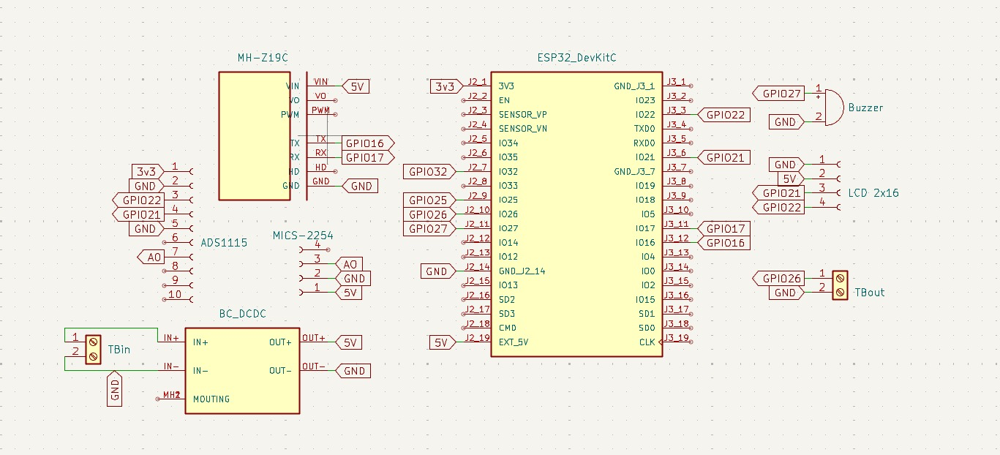
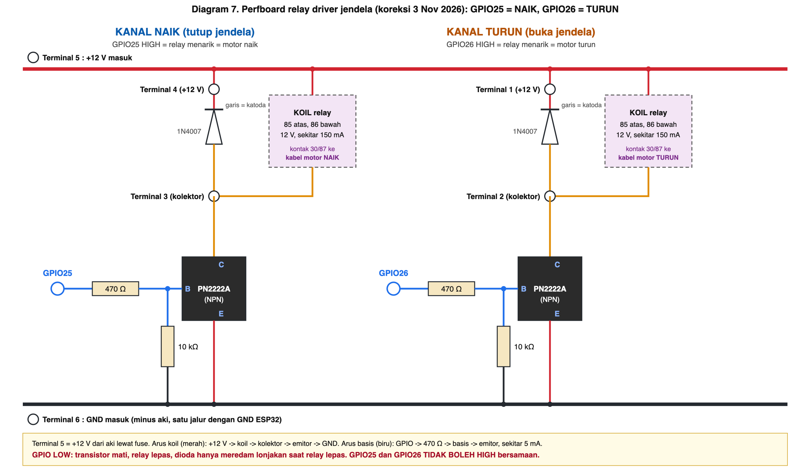

# Hardware dan wiring (3 November 2026)

Satu tempat untuk semua fakta wiring: pin ESP32, konektor PCB, perfboard relay jendela, catu daya, dan panduan mencari kesalahan wiring. Bagian 5 dan 5.1 di [algoritma-firmware.md](algoritma-firmware.md) adalah versi 28 Oktober dan **sebagian sudah usang** (lihat bagian 1); pin dan wiring yang berlaku ada di berkas ini.

Status tiap butir: **Konfirmasi pengguna** (disebut langsung oleh pengguna 3 Nov, dari teman hardware), **Terbaca** (dibaca dari gambar yang dikirim), **Usulan** (saran saya, belum diuji), **Belum diketahui**.

## 1. Koreksi hari ini (baca ini dulu)

| | Sebelumnya (salah) | Yang benar | Status |
|---|---|---|---|
| Arah relay | GPIO25 = turun, GPIO26 = naik (tabel pin dan gambar aliran listrik 3 Nov) | **GPIO26 = relay TURUN (buka jendela), GPIO25 = relay NAIK (tutup jendela)** | Konfirmasi pengguna |
| Relay naik | "Tidak ada relay arah naik" (algoritma-firmware.md 5.1) | **Ada**, di GPIO25, rangkaian sama dengan relay turun | Konfirmasi pengguna |
| Tombol reset Wi-Fi | GPIO14 (firmware dan dokumen lama) | **GPIO32** (header J2_7) | Terbaca dari tabel hardware |

Gambar "Aliran listrik perfboard relay driver" yang menulis Kanal A = TURUN (GPIO25) dan Kanal B = NAIK (GPIO26) **salah label**; rangkaiannya benar, hanya namanya tertukar. Versi yang benar: [diagram 7](diagram/diagram-7-perfboard-relay-jendela.png). Tabel pin dari teman hardware juga menulis kebalikannya; tabel di bagian 2 di bawah sudah dikoreksi.

## 2. Pin ESP32 (ESP32 DevKitC)



### Header kiri (J2)
| Kaki | GPIO / net | Menuju | Fungsi |
|---|---|---|---|
| J2_1 | 3V3 | ADS1115 pin 1 | Daya 3,3 V untuk ADS1115 |
| J2_7 | **GPIO32** | tombol (kaki lain tombol ke GND) | Tombol reset Wi-Fi. Belum ada komponennya di skematik KiCad |
| J2_9 | **GPIO25** | perfboard, input kanal NAIK | **Relay naik**. Belum ada komponennya di skematik KiCad |
| J2_10 | **GPIO26** | TBout pin 1, ke perfboard kanal TURUN | **Relay turun** |
| J2_11 | GPIO27 | Buzzer pin 1 | Buzzer |
| J2_14 | GND | jalur GND | Ground |
| J2_19 | EXT_5V (5V) | OUT+ buck | Daya 5 V ESP32 |

### Header kanan (J3)
| Kaki | GPIO | Menuju | Fungsi |
|---|---|---|---|
| J3_3 | GPIO22 | LCD pin 4, ADS1115 pin 3 | SCL (I2C) |
| J3_6 | GPIO21 | LCD pin 3, ADS1115 pin 4 | SDA (I2C) |
| J3_11 | GPIO17 | MH-Z19C RX | TX ESP32 ke sensor CO2 |
| J3_12 | GPIO16 | MH-Z19C TX | RX ESP32 dari sensor CO2 |

### Konektor lain di PCB
| Komponen | Pin | Terhubung ke |
|---|---|---|
| TBin | 1 / 2 | +12 V aki / GND, ke input buck (IN+ / IN-) |
| Buck (BC_DCDC) | OUT+ / OUT- | 5V / GND |
| TBout | 1 / 2 | GPIO26 / GND |
| Buzzer | 1 / 2 | GPIO27 / GND |
| LCD 2x16 I2C | 1, 2, 3, 4 | GND, 5V, SDA (21), SCL (22) |
| MH-Z19C | VIN, TX, RX, GND | 5V, GPIO16, GPIO17, GND |
| MiCS-5524 (tertulis "MICS-2254" di PCB) | 1, 2, 3 | 5V, GND, AO (ke A0 ADS1115) |
| ADS1115 (header 10 pin) | 1, 2, 3, 4, 5, 7 | 3V3, GND, SCL, SDA, GND (alamat 0x48), A0 |

Ringkasan semua pin yang dipakai: 16, 17 (CO2), 21, 22 (I2C), 25 (relay naik), 26 (relay turun), 27 (buzzer), 32 (tombol Wi-Fi). Tidak ada yang bentrok.

Catatan PCB ([tampak atas](diagram/pcb-tampak-atas-2026-11-03.png), [tampak bawah](diagram/pcb-tampak-bawah-2026-11-03.png)): merah = lapisan atas, biru = lapisan bawah. TBout hanya membawa GPIO26 dan GND. **GPIO25 dan GPIO32 tidak punya konektor di PCB**; keduanya diambil dari header ESP32 (J2_9 dan J2_7) dengan kabel. Karena itu dua sambungan ini yang paling mungkin longgar atau tertukar.

## 3. Perfboard relay driver



Sumber rangkaian: [sketsa tangan](diagram/perfboard-sketsa-tangan-2026-11-03.png). Dua kanal identik, masing-masing: GPIO -> 470 ohm -> basis NPN (PN2222A), basis ditarik 10 kohm ke GND, emitor ke GND, kolektor ke koil relay (kaki 86), kaki 85 ke +12 V, dioda 1N4007 melintang koil dengan **katoda (garis) ke +12 V**.

| Terminal perfboard | Isi | Kanal |
|---|---|---|
| 1 | +12 V (ke koil relay turun) | TURUN, GPIO26 |
| 2 | kolektor transistor (ke koil relay turun) | TURUN, GPIO26 |
| 3 | kolektor transistor (ke koil relay naik) | NAIK, GPIO25 |
| 4 | +12 V (ke koil relay naik) | NAIK, GPIO25 |
| 5 | +12 V masuk dari aki | |
| 6 | GND masuk (minus aki), **satu jalur dengan GND ESP32** | |

Angka kunci (Usulan, dihitung, belum diukur): arus basis sekitar 5,5 mA ((3,3 - 0,7) / 470); arus koil sekitar 150 mA; hambatan koil sekitar 80 ohm (12 V / 150 mA). Basis/emitor saat menyala sekitar 0,7 V, kolektor saat menyala di bawah sekitar 0,3 V. PN2222A kuat sampai 600 mA, jadi cukup untuk koil 150 mA.

Dengan 10 kohm ke GND, relay **lepas** saat ESP boot atau reset. Ini aman.

Bagian yang **tidak ada** di sketsa: kontak relay (30/87) dan cara tersambung ke motor. Dari dokumen 28 Okt: 30 ke aki (+) lewat fuse 15-20 A, 87 ke kabel motor. Untuk dua relay: 87 relay turun ke kabel motor arah turun, 87 relay naik ke kabel motor arah naik (Belum diketahui, minta konfirmasi hardware).

## 4. Daya

```
Aki 12 V --(fuse)--> TBin --> buck --> 5 V --> ESP32 (pin 5V), MH-Z19C, MiCS, LCD
   |                                   3V3 (dari regulator ESP32) --> ADS1115
   +--(fuse 2 A)--> perfboard terminal 5 --> koil relay
   +--(fuse 15-20 A)--> kontak relay 30
GND: minus aki = TBin GND = buck OUT- = GND ESP32 = perfboard terminal 6 (SATU jalur)
```

Aturan yang sering menjadi sumber masalah:
- **Semua GND harus tersambung jadi satu.** Tanpa GND bersama, GPIO 3,3 V tidak punya acuan dan transistor tidak menyala.
- Jangan menyambung USB komputer dan buck 5 V ke ESP32 bersamaan tanpa tahu apa yang dilakukan: dua sumber 5 V bisa saling dorong. Saat upload firmware, lepas 5 V buck atau pakai satu sumber saja (Usulan).

## 5. Hardware vs firmware: yang belum cocok

Ini yang perlu diubah di kode (belum diubah; menunggu persetujuan, sebab `main.cpp` dan sketsa sensor adalah dasar pembanding):

| # | Hardware | Firmware sekarang | Akibat | Prioritas |
|---|---|---|---|---|
| 1 | Relay naik ada di **GPIO25** | v1.8 memberi pulsa "naik" lewat **GPIO26** juga (`sensorOriginal.inl`, `PIN_JENDELA_TUTUP = -1`, siklus di `servisUjiGpio26`) | Pulsa "naik" menyalakan relay **turun**: jendela turun lagi, bukan naik | **P1** |
| 2 | Tombol reset Wi-Fi di **GPIO32** | `BUTTON_PIN = 14` (`main.cpp`) dan pesan "Portal GPIO14" | Menekan tombol tidak membuka portal Wi-Fi | **P1** |
| 3 | Buzzer di GPIO27 | benar (27) | | cocok |
| 4 | | Komentar `main.cpp` "Original sensor sketch owns GPIO25" sudah usang (buzzer v0 di GPIO25 sudah pindah ke 27) | Menyesatkan; GPIO25 sekarang relay naik | rendah |
| 5 | | `alat-uji/uji-relay-jendela` hanya GPIO26 | GPIO25 belum bisa diuji dengan firmware uji; pakai kabel 3,3 V (bagian 6, langkah C) | sedang |

Dua hal yang sudah benar dan bisa dipakai: firmware v1.8 sudah menjaga jeda LOW minimal 1 detik antar pulsa dan bergantian turun-naik, jadi dua relay tidak menyala bersamaan selama kode itu dipertahankan. Tetap pertahankan sebagai aturan: **GPIO25 dan GPIO26 tidak boleh HIGH bersamaan**.

## 6. Panduan mencari kesalahan wiring

Urutan dari yang paling aman. **Lepas kabel motor (kontak 30/87) sebelum semua langkah ini.** Alat: multimeter, adaptor 12 V (bukan aki dulu), kabel jumper.

**A. Tanpa daya (mode kontinuitas dan ohm)**
| # | Ukur | Hasil benar | Bila salah |
|---|---|---|---|
| A1 | GND ESP32 - terminal 6 - GND buck OUT- - minus aki | berbunyi (tersambung) | GND tidak bersama; periksa kabel GND ke perfboard |
| A2 | Terminal 5 (+12 V) ke GND | **tidak** berbunyi, hambatan tinggi | korsleting 12 V; cari solder yang menjembatani |
| A3 | Buck OUT+ (5 V) ke GND | tidak berbunyi | korsleting 5 V |
| A4 | Pad GPIO25 ke basis, pad GPIO26 ke basis | sekitar 470 ohm | resistor salah nilai atau putus |
| A5 | Basis ke GND (tiap kanal) | sekitar 10 kohm | pull-down salah atau tidak ada |
| A6 | Koil relay (85 ke 86) | sekitar 60-120 ohm | koil putus atau salah kaki |
| A7 | Mode dioda: probe merah ke kolektor (terminal 3 / 2), hitam ke +12 V (terminal 4 / 1) | sekitar 0,5-0,7 V; dibalik: OL | dioda terbalik. Terbalik = korsleting saat relay menyala |
| A8 | Pin transistor | C, B, E sesuai gambar. Urutan kaki PN2222A **berbeda antar pabrik** (ada yang E-B-C, ada yang C-B-E dari sisi datar), cek datasheet pabrik yang tertera di badan transistor | transistor dipasang terbalik |

**B. Dengan daya 12 V, ESP32 belum dipasang atau tidak berprogram**
Relay **tidak boleh** klik. Bila klik sendiri: basis mengambang (10 kohm putus) atau transistor bocor.

**C. Uji kanal tanpa firmware**
Ambil kabel dari pin 3V3 ESP32 ke pad GPIO25 (ujung 470 ohm sisi luar).
| Ukur | Hasil benar |
|---|---|
| Relay naik | klik (menarik) |
| Basis ke GND | sekitar 0,7 V |
| Kolektor (terminal 3) ke GND | di bawah sekitar 0,3 V |
| Terminal 4 ke terminal 3 | sekitar 11-12 V (tegangan koil) |
| Kontak 87 ke GND (tanpa motor) | 12 V saat menarik, 0 saat lepas |

Lepas kabel: relay lepas. **Ulangi untuk GPIO26 (relay turun). Jangan kedua kanal bersamaan.**

**D. Uji GPIO dari ESP32**
1. `alat-uji/uji-gpio26`: paksa GPIO26 HIGH, ukur di pad: sekitar 3,3 V (3,2-3,35). Bila di bawah 3 V, ada beban tak semestinya di jalur itu.
2. `alat-uji/uji-relay-jendela`: relay turun ikut pulsa firmware.
3. GPIO25: belum ada firmware uji (lihat bagian 5, butir 5).

**E. Gejala dan dugaan**
| Gejala | Dugaan paling mungkin (urut) |
|---|---|
| Relay tidak klik sama sekali | GND tidak bersama (A1); kabel GPIO tidak sampai ke pad; transistor terbalik (A8); 12 V tidak sampai terminal 5 |
| Klik tetapi motor diam | kontak 30/87 tidak mendapat 12 V (fuse 15-20 A putus); kabel 87 salah; motor/kabel arah salah |
| Relay naik malah menurunkan jendela | firmware masih memakai GPIO26 untuk naik (bagian 5, butir 1) atau kabel 87 tertukar |
| Relay menyala saat ESP boot | 10 kohm tidak ada (A5); GPIO sempat HIGH karena kode |
| Relay panas, berdengung, atau bergetar | tegangan koil turun (kabel kecil atau adaptor lemah); transistor tidak jenuh (basis kurang arus) |
| ESP32 reboot saat relay menyala | 5 V jatuh karena 12 V dan 5 V berbagi kabel tipis; dioda terbalik; GND jalur motor lewat jalur GND sinyal |
| Transistor sangat panas | tidak jenuh, atau dioda terbalik/ korsleting koil |
| Tombol Wi-Fi tidak bereaksi | firmware masih GPIO14 (bagian 5, butir 2); tombol ke GND belum tersambung |
| LCD kacau atau ADS1115 tidak terbaca | I2C: SDA/SCL tertukar (21=SDA, 22=SCL); catu 5 V lemah |

## 7. Risiko yang perlu dicek (bukan penyebab pasti)

1. **Kabel motor dan GND di saklar asli** (Belum diketahui, **keselamatan**). Pada saklar power window mobil, saat tidak ditekan kedua kabel motor biasanya tersambung ke GND lewat saklar. Bila relay (kontak biasa buka) memberi +12 V ke kabel yang sedang tersambung GND lewat saklar, itu **korsleting 12 V ke GND** (hanya fuse yang melindungi). Cek dengan aki dilepas: ukur kontinuitas kabel motor turun dan naik ke GND. Bila tersambung, jangan sambung relay ke situ sebelum bicara dengan teman hardware (perlu relay dengan kontak 87a atau sambungan lain).
2. **Tegangan AO MiCS ke ADS1115.** ADS1115 dicatu 3,3 V sehingga masukan A0 tidak boleh melewati sekitar 3,6 V. MiCS dicatu 5 V. Ukur AO terhadap GND saat sensor panas dan saat ada gas: harus tetap di bawah 3,3 V. (Sudah tercatat sebagai butir terbuka di [tugas-per-subsistem.md](../tugas/tugas-per-subsistem.md).)
3. **Pull-up I2C modul LCD ke 5 V.** Modul LCD biasanya menarik SDA/SCL ke 5 V, sedangkan GPIO ESP32 tahan 3,3 V. Sistem sudah berjalan di uji mobil, jadi bukan prioritas.
4. **Dua relay bersamaan** (lihat bagian 5): dapat memberi +12 V ke kedua kabel motor.
5. **Fuse**: 2 A di jalur koil, 15-20 A di jalur kontak. Pastikan terpasang sebelum ke aki.

## 8. Yang masih perlu dijawab teman hardware

1. Kabel 87 relay naik dan turun tersambung ke kabel motor yang mana, dan bagaimana kabel satunya mendapat GND? (bagian 7, butir 1)
2. Jenis relay (SPST atau SPDT), dan arus motor maksimum.
3. Kabel dari header ESP32 ke perfboard: GPIO25 dan GPIO26 benar tidak tertukar, dan GND-nya?
4. Tombol Wi-Fi di GPIO32: tersambung ke GND saat ditekan?

## 9. Langkah sekarang

1. Lakukan bagian 6 langkah A sampai C (tanpa motor). Cukup multimeter dan satu kabel.
2. Kirim hasil langkah yang gagal (angka yang terukur) supaya bisa dicari penyebabnya.
3. Putuskan: boleh mengubah firmware untuk butir 1 dan 2 di bagian 5?
