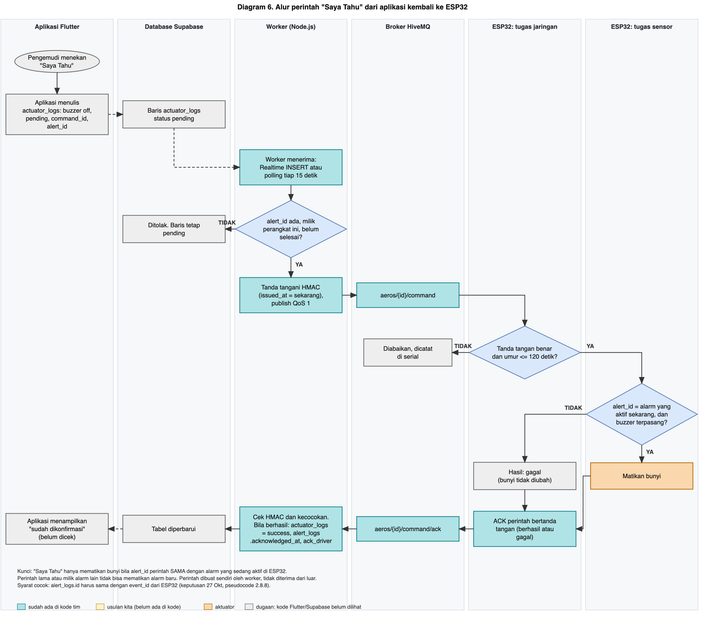

# Komunikasi Data (ESP32, MQTT, Worker, Database, Aplikasi)

Versi 27 Oktober 2026. Dasar: kode tim `iot-mainproject 3` (dibaca langsung; salinan di `kode-tim/iot-mainproject-3/`, tanpa `.env`) dan rencana kita. Analisis kodenya: [analisis-kode-tim.md](../analisis/analisis-kode-tim.md). Tabel database ada di [data-dan-database.md](data-dan-database.md).

Penanda: **[kode tim]** sudah ada di kodenya. **[usulan]** belum ada, menunggu persetujuan. Temuan dari kode versi 3 perlu dicek ulang setelah temanmu melaporkan hasil ujinya.

**Keputusan 27 Okt:** isi pesan dan kerja worker **mengikuti kebutuhan firmware dan data yang harus dikirim**, bukan sebaliknya. Pesan versi 3 menjadi acuan.

## 1. Gambaran
```
ESP32 (sensor, alarm, aktuator)  ->  antrean flash  ->  MQTT (HiveMQ, TLS)  ->  worker (Node.js)  ->  Supabase  ->  aplikasi Flutter
                                                                                       ^                                |
                                                                                       +------ perintah "Saya Tahu" ----+
```
Diagram: [diagram 5](diagram/diagram-5-alur-data-ke-aplikasi.png) (data ke aplikasi) dan [diagram 6](diagram/diagram-6-alur-perintah-saya-tahu.png) (perintah balik). Prinsip utama: **alarm dan jendela diputuskan di ESP32 dan tidak bergantung pada internet.**

## 2. Kontrak pesan versi 3 [kode tim]

### 2.1 Topik
| Topik | Arah | Isi |
|---|---|---|
| `aeros/{id}/telemetry` | ESP ke broker | telemetri tiap 5 detik (bertanda tangan) |
| `aeros/{id}/telemetry/ack` | worker ke ESP | konfirmasi "sudah tersimpan di database" (QoS 1) |
| `aeros/{id}/status` | ESP ke broker | `ONLINE` (retained) dan `OFFLINE` lewat last will |
| `aeros/{id}/cmd` | worker ke ESP | perintah (`MUTE_BUZZER`, `WINDOW_OPEN`, `WINDOW_CLOSE`) |
| `aeros/{id}/cmd/ack` | ESP ke worker | hasil perintah |
| `aeros/data`, `.../data/ack`, `.../command`, `.../command/ack` | | jalur versi 2, masih diterima worker |

### 2.2 Telemetri
| Field | Tipe | Aturan yang diperiksa worker |
|---|---|---|
| `version` | 3 | 2 atau 3 |
| `device_id` | teks | huruf, angka, `_`, `-`; harus sama dengan topik; harus aktif di tabel `devices` |
| `nonce` | 32 heksadesimal | acak per pesan; pesan ganda ditolak database |
| `timestamp`, `time_valid` | integer, boolean | `0` bila belum ada NTP; bila valid: maksimal 90 hari lalu atau 5 menit ke depan |
| `co_ppm`, `co2_ppm` | integer | 0 sampai 100000 |
| `co_peak_ppm`, `co2_peak_ppm` | integer | tidak boleh lebih kecil dari nilai terakhir |
| `co_peak_second`, `co2_peak_second` | integer 1 sampai 5 | detik ke berapa puncak terjadi dalam jendela 5 detik |
| `status` | `normal`, `waspada`, `bahaya` | selain `normal` wajib membawa `event_id`; `normal` tidak boleh punya `event_id` |
| `buzzer_state` | `on`, `off` | `on` hanya bila bukan `normal` |
| `window_status` | `null` atau 0 sampai 100 | `null` = tidak diketahui (belum ada motor), bukan 0 palsu |
| `event_id` | UUID atau `null` | dibuat ESP saat alarm mulai |
| `demo` | boolean | `false` untuk data nyata; worker menolak `true` kecuali diizinkan |
| `signature` | 64 heksadesimal | HMAC-SHA256 huruf kecil |

String yang ditandatangani (tanpa baris baru, UTF-8):
```
r3|device_id|nonce|timestamp|time_valid(1/0)|co_ppm|co2_ppm|co_peak_ppm|co2_peak_ppm|co_peak_second|co2_peak_second|status|buzzer_state|window_status-atau--|event_id-atau--|demo(1/0)
```
Semua angka di string itu bilangan bulat, jadi tanda tangan sama di C++ dan JavaScript.

### 2.3 Konfirmasi dan perintah
- ACK data: `{version, device_id, nonce, result:"stored", signature}` dengan tanda tangan atas `dataack2|device|nonce|stored`. ESP **menghapus berkas hanya setelah ACK ini cocok**.
- Perintah: `cmd2|device|command_id|alert_id|MUTE_BUZZER|issued_at` atau `cmd3|device|command_id|alert_id|AKSI|issued_at`. Diterima bila tanda tangan benar, umur maksimal 120 detik, dan `alert_id` sama dengan alarm yang sedang aktif.
- ACK perintah: `cmdack2|device|command_id|alert_id|success/failed` (mute) dan `cmdack3|device|command_id|alert_id|aksi|received/failed` (jendela).

### 2.4 Yang ditulis worker ke database
| Tabel | Isi |
|---|---|
| `sensor_readings` | tiap telemetri, termasuk kolom `co_peak_ppm`, `co2_peak_ppm`, `co_peak_second`, `co2_peak_second` (**kolom ini harus ada**) |
| `device_state` | nilai terakhir, status, buzzer, jendela, `active_alert_id`, `ack_driver`, `ack_at`; hanya untuk data yang masih baru (kurang dari 90 detik) |
| `alert_logs` | baris dengan `id = event_id`; `resolved_at` diisi saat kembali normal atau saat episode baru. **Sekarang hanya `alert_type = status`** |
| `actuator_logs` | perintah `pending`; hasilnya mengubah `execution_status` dan `received_at` |

## 3. Data yang tersedia dari firmware

Diturunkan dari variabel di pseudocode baru.

| Variabel di pseudocode | Nama field | Tipe | Satuan | Keterangan | Dipakai di |
|---|---|---|---|---|---|
| (jam sejak menyala) | `t_s` | integer | detik | Penghitung sejak menyala. Kembali 0 saat ESP32 mulai ulang | CSV serial |
| (jam dinding) | `ts` | waktu (UTC) | | Cap waktu. **Belum fix** apakah dari NTP di ESP32 atau diisi server saat pesan diterima [B14] | Telemetri, kejadian |
| V (tegangan MiCS) | `v_mv` | real | mV | Rata-rata 16 pembacaan ADS1115 | CSV serial |
| Rs | `rs_kohm_mentah` | real | kΩ | Sebelum filter | CSV serial |
| RsHalus | `rs_kohm` | real | kΩ | Sesudah filter SMA 6 | CSV, telemetri |
| rasio | `rs_r0` | real | tanpa satuan | RsHalus dibagi R0 | CSV, telemetri |
| R0 | `r0_kohm` | real | kΩ | Patokan udara bersih dari memori NVS | Status |
| ppmCO | `co_ppm` | real | ppm | **Estimasi indikatif**, dihitung dari Rs yang **sudah difilter** | CSV, telemetri (nilai akhir interval), kejadian |
| (maksimum ppmCO) | `co_ppm_maks` | real | ppm | Nilai terbesar dari ppmCO terfilter selama 5 detik | Telemetri |
| CO2 | `co2_ppm` | integer | ppm | Angka dari MH-Z19C (tanpa filter di firmware). Di telemetri dirata-ratakan 5 detik | CSV (tiap detik), telemetri |
| (maksimum CO2) | `co2_maks` | integer | ppm | Nilai terbesar selama 5 detik | Telemetri |
| CO_VALID, CO2_VALID | `co_ok`, `co2_ok` | boolean | | Hasil validasi data | CSV, telemetri |
| (pemanasan) | `co_panas`, `co2_panas` | boolean | | Sensor masih memanas | CSV, telemetri |
| faseCO | `fase_co` | teks | | `TIDAK_AKTIF`, `UJI_ARAH`, `SUMBER_DALAM`, `SUMBER_LUAR` | CSV, telemetri, kejadian |
| faseCO2 | `fase_co2` | teks | | `NORMAL`, `PERINGATAN`, `TINDAKAN` | CSV, telemetri, kejadian |
| (status teks) | `st_co`, `st_co2` | teks | | Misalnya `OK`, `WASPADA`, `BAHAYA`, `GANGGUAN`, `PEMANASAN` | CSV, telemetri |
| jendela | `jendela` | teks | | `TERTUTUP`, `TERBUKA` (dan bukaan bila ada) | Telemetri, kejadian |
| (bunyi) | `buzzer` | teks | | `OFF`, `SINGKAT`, `CO`, `CO_KERAS`, `CO2` | Telemetri, kejadian |
| rsAwalUji, waktuUji | `rs_awal_uji`, `waktu_uji_s` | real, integer | kΩ, detik | Hanya pada kejadian uji arah | Kejadian (detail) |
| MODE_SIMULASI | `sim` | boolean | | Data dari mode simulasi | Semua pesan |
| (versi) | `fw` | teks | | Versi firmware | Telemetri, status |
| (identitas) | `device_id` | teks | | Misalnya `aeros-01` | Semua pesan |
| (urutan pesan) | `seq` | integer | | Untuk mendeteksi pesan hilang | Telemetri |

**Mengapa yang disimpan nilai terfilter.** Filter SMA 6 dijalankan **sebelum** perhitungan ppm: Rs mentah, lalu SMA 6, lalu rasio Rs/R0, lalu ppm. Jadi `rs_kohm`, `rs_r0`, dan `co_ppm` di telemetri sudah berasal dari hasil SMA, dan itu juga nilai yang dipakai alarm di perangkat. Dengan begitu data di database sama dengan yang dipakai untuk memutuskan. Karena sudah terfilter, nilai pada akhir interval 5 detik **tidak perlu dirata-ratakan lagi** (rata-rata ganda tidak menambah manfaat). Nilai maksimum tetap dikirim agar puncak singkat tidak hilang dari riwayat. Hanya CO2 yang dirata-ratakan 5 detik, karena di firmware ia tidak difilter. **Data mentah (`v_mv`, `rs_kohm_mentah`) hanya ada di CSV serial** sebagai bukti analisis noise dan pemilihan filter, tidak dikirim ke database.

**Format CSV serial** (usulan, melanjutkan format sekarang): `t_s, v_mv, rs_kohm, rs_r0, co_ppm, co2_ppm, co_ok, co2_ok, fase_co, fase_co2, st_co, st_co2, jendela, buzzer, sim`. Baris tetap dicetak tiap 1 detik untuk bukti pengujian.

---

## 4. Rancangan sisi ESP32 (dua tugas)

Versi 27 Oktober 2026. Status: **USULAN**, untuk dibahas dengan tim backend. Dasarnya adalah kode tim (`kode-tim/iot-mainproject/`, analisis di [analisis-kode-tim.md](../analisis/analisis-kode-tim.md)). Tujuannya **menempelkan** kode itu, bukan menggantinya.

### 4.1 Yang dipertahankan dari kode tim (tidak boleh hilang)

| # | Fitur milik tim | Tetap berlaku |
|---|---|---|
| 1 | **Offline first**: setiap pembacaan ditulis ke berkas flash (LittleFS) dulu, baru dikirim | ya |
| 2 | Berkas **dihapus hanya setelah ACK dari database** yang tanda tangannya benar. Terkirim ke broker belum berarti tersimpan | ya |
| 3 | Antrean **dipulihkan setelah mati listrik** (dibaca ulang saat menyala). Tidak pernah memformat flash otomatis. Berkas rusak tidak dihapus diam-diam | ya |
| 4 | **Tanda tangan HMAC-SHA256** pada telemetri, ACK data, perintah, dan ACK perintah. Perbandingan dengan cara aman waktu | ya |
| 5 | **TLS dengan sertifikat CA diperiksa**, tidak pernah `setInsecure()` | ya |
| 6 | **Nonce acak** per pesan (database menolak pesan ganda) | ya |
| 7 | **Last will** `OFFLINE` dan pesan `ONLINE` (retained) | ya |
| 8 | Perintah hanya diterima bila: tanda tangan benar, umur ≤ 120 detik, dan `alert_id` sama dengan alarm yang **sedang aktif** | ya |
| 9 | Jam dari NTP. Bila belum ada: `timestamp = 0` dan `time_valid = false` | ya |
| 10 | Portal Wi-Fi (hotspot AEROS-Setup), 5 kali percobaan sambung, tombol GPIO14 tahan 5 detik, tunggu 30 detik lalu ulangi | ya |
| 11 | Kata sandi, kunci HMAC, dan sertifikat hanya di `secrets.h` dan `root_ca.h` yang tidak masuk git | ya |
| 12 | Bendera data simulasi (`demo` di kode tim, `sim` di rancangan kita) dan worker menolaknya kecuali diizinkan | ya |

### 4.2 Dua tugas yang berjalan sendiri

Aturan utama: **alarm, jendela, dan siklus 1 detik tidak pernah menunggu jaringan, dan kegagalan jaringan tidak boleh menghentikan alarm.** Dua tugas berbagi dua antrean kecil di memori (bukan berkas).

```
TUGAS_SENSOR   (loop utama, inti 1)          TUGAS_JARINGAN   (tugas terpisah, inti 0)
  siklus 1 detik, alarm, jendela, LCD          Wi-Fi, NTP, MQTT, LittleFS, portal
        |                                              ^
        |-- ANTREAN_KELUAR (pesan jadi) ---------------|
        |<-- ANTREAN_MASUK (perintah, status) ---------|
```

- **Hanya TUGAS_JARINGAN yang menyentuh** Wi-Fi, MQTT, LittleFS, dan NTP. (Objeknya tidak aman dipakai dua tugas sekaligus.)
- **Hanya TUGAS_SENSOR yang menulis ke LCD**, buzzer, dan jendela. TUGAS_JARINGAN hanya mengirim kode status (misalnya `WIFI_OK`, `MQTT_OK`, `PORTAL_AKTIF`, `OFFLINE`) lewat ANTREAN_MASUK. Alarm selalu mengalahkan pesan jaringan di LCD. Saat portal aktif, boleh tampil layar penuh "PORTAL WIFI" selama tidak ada alarm.

### 4.3 TUGAS_SENSOR: bagian pengiriman (tambahan di langkah 8 dan 9)

```
SAAT DINYALAKAN:
    mulai TUGAS_JARINGAN
    kalau TUGAS_JARINGAN gagal mulai (konfigurasi kosong, flash rusak):
        tandai JARINGAN_MATI, tampilkan indikator di LCD
        LANJUTKAN sensor dan alarm seperti biasa          (kode tim saat ini berhenti total di sini; itu tidak boleh)

TIAP 1 DETIK (setelah langkah 1 sampai 7):
    kumpulkan: nilai CO terfilter, CO2, maksimum sejak pesan terakhir

    TIAP 5 DETIK  (INTERVAL_TELEMETRI, usulan; kode tim 10 detik):
        susun TELEMETRI dari nilai terakhir:  ppm dibulatkan ke bilangan bulat, rs_r0 dalam per seribu
        isi: nonce baru, jam dari NTP (atau 0 dan time_valid = tidak), sim, fw, event_id alarm aktif atau kosong
        tandatangani dengan HMAC
        taruh di ANTREAN_KELUAR            (tidak menunggu terkirim)

    SAAT ADA KEJADIAN  (alarm mulai atau selesai, hasil uji arah, jendela bergerak,
                        sensor gangguan, pemanasan selesai, mulai menyala):
        susun KEJADIAN dengan nonce baru, event_id yang sesuai, tanda tangan
        taruh di ANTREAN_KELUAR di depan telemetri       (kejadian didahulukan)

    kalau ANTREAN_KELUAR penuh:
        buang TELEMETRI tertua di antrean RAM
        KEJADIAN tidak pernah dibuang

    baca ANTREAN_MASUK:
        status jaringan   -> simpan untuk LCD
        perintah SAYA_TAHU(alert_id, command_id):
            kalau alarm aktif dan alert_id = event_id alarm aktif: matikan bunyi, hasil = berhasil
            selain itu                                          : hasil = gagal
            kirim hasil ke ANTREAN_KELUAR           (jaringan yang menandatangani dan mengirim ACK)
```

`event_id` dibuat UUID acak oleh firmware saat alarm dimulai (seperti kode tim) dan tetap sama sampai alarm selesai.

### 4.4 TUGAS_JARINGAN

```
SAAT DINYALAKAN:
    periksa secrets.h dan root_ca.h; kalau tidak lengkap: kirim status KONFIGURASI_KOSONG lalu berhenti (hanya tugas ini)
    mount LittleFS TANPA memformat; kalau gagal: status PENYIMPANAN_RUSAK lalu berhenti (hanya tugas ini)
    pulihkan antrean dari berkas yang ada (hitung berkas, lanjutkan nomor urut)
    mulai tugas tombol GPIO14 (tahan 5 detik = buka portal)
    baca Wi-Fi dari memori NVS; kalau ada: mulai 5 percobaan; kalau tidak ada: buka portal

ULANGI TERUS:
    1. PINDAHKAN pesan dari ANTREAN_KELUAR ke flash (tulis ke berkas sementara, lalu ganti nama):
           kalau flash penuh: buang telemetri tertua di flash; kejadian dipertahankan
           kalau tidak bisa disimpan sama sekali: catat "pesan hilang" (jangan palsukan data)

    2. KELOLA SAMBUNGAN (state machine kode tim, tidak diubah):
           PORTAL, COBA_WIFI (5 kali, 10 detik), GAGAL (password diduga salah, buka portal),
           TUNGGU_ULANG (SSID tidak ada, tunggu 30 detik), MENUNGGU_TOMBOL, NORMAL
           kirim kode status ke TUGAS_SENSOR tiap berubah

    3. KALAU NORMAL dan Wi-Fi tersambung:
           NTP belum sinkron      : mulai NTP, tunggu (TLS butuh jam valid)
           MQTT belum tersambung  : sambung dengan TLS + last will OFFLINE (retained);
                                    subscribe topik perintah dan ACK; kirim ONLINE (retained)
           MQTT tersambung        : proses pesan masuk, lalu KIRIM_SATU()

KIRIM_SATU:
    kalau sedang menunggu ACK dan belum lewat 6 detik: tunggu
    ambil berkas tertua; urutan: KEJADIAN dulu, baru TELEMETRI
    kirim isinya ke broker
    tandai "menunggu ACK untuk nonce ini"

SAAT ACK_DATA MASUK:
    periksa: perangkat benar, versi benar, nonce sama dengan yang ditunggu,
             tanda tangan HMAC benar (dataack|device|nonce|stored)
    kalau semua benar: HAPUS berkas itu. Kalau salah satu salah: abaikan (berkas tetap, akan dikirim ulang)

SAAT PERINTAH MASUK:
    periksa: versi, perangkat, aksi dikenal, tanda tangan, umur <= 120 detik
    kalau lolos: teruskan ke TUGAS_SENSOR; setelah ada hasilnya, tandatangani dan kirim ACK_PERINTAH
    kalau tidak lolos: abaikan dan catat di serial
```

Saat internet mati, tugas ini hanya menyimpan ke flash. Telemetri dan kejadian tersusul otomatis setelah tersambung, tanpa data ganda karena nonce.

### 4.5 Pesan tambahan yang kita usulkan [usulan]
Kode tim sudah memuat field di bagian 2. Field di bawah belum ada, dan setiap field yang masuk string tanda tangan HMAC harus diubah di **dua sisi sekaligus** (ESP dan worker). Semua angka di string yang ditandatangani berupa bilangan bulat, supaya tanda tangan sama di C++ dan JavaScript.

| Field | Keterangan |
|---|---|
| `jenis` | `telemetri` atau `kejadian` (satu jalur untuk keduanya, jadi kejadian ikut offline first) |
| `fw` | versi firmware (juga di pesan `ONLINE`) |
| `rs_r0_milli` | Rs/R0 dikali 1000, bilangan bulat |
| `kond_co`, `kond_co2` | `ok`, `pemanasan`, `gangguan`: tempat untuk keadaan yang tidak punya nilai di `status`; selama pemanasan LCD menampilkan `----`, serial mencatat angka mentah, dan data dikirim dengan penanda ini |
| `fase_co`, `fase_co2` | fase aturan (uji arah, tindakan, dan seterusnya) |
| `kejadian`, `detail` | hanya pada `jenis = kejadian` |

**Jalan mundur (v2 sementara):** bila v3 belum selesai sebelum 29 Okt, firmware memakai pesan versi tim apa adanya. Versi itu tidak punya tempat untuk penanda pemanasan, jadi pesan selama masa pemanasan **ditahan (tidak dikirim)** supaya angka palsu tidak masuk database; angkanya tetap tercatat di serial.

### 4.6 Tugas worker untuk `alert_logs` (keputusan 27 Okt: worker yang menulis, id = `event_id`)

Status 27 Okt sore: **sudah ada versi sederhana di worker terbaru** (`telemetryStateService.js`): `alert_logs` dibuat dari telemetri dengan `id = event_id` dan ditutup saat normal. Belum ada: gas, nilai, ambang, sumber, dan pesan `kejadian` terpisah (jendela, uji arah). Lihat [analisis-kode-tim.md](../analisis/analisis-kode-tim.md) bagian 7.

```
SAAT PESAN MASUK (setelah HMAC benar dan perangkat aktif, seperti sekarang):
    simpan baris ke sensor_readings, TERMASUK event_id dan jenis      (sekarang event_id dibuang)

    kalau jenis = kejadian:
        kejadian ALARM_MULAI:
            tulis alert_logs dengan id = event_id   (gas, nilai, ambang, sumber, waktu mulai)
            kalau id sudah ada: dianggap pesan ulang yang sah, bukan kesalahan
            isi device_state.active_alert_id = event_id
        kejadian ALARM_SELESAI:
            isi alert_logs.resolved_at untuk id = event_id (hanya bila belum terisi)
            kosongkan device_state.active_alert_id bila sama dengan event_id
            kalau barisnya belum ada (pesan mulai belum sampai): buat baris sudah selesai
        kejadian JENDELA atau UJI_ARAH:
            tulis actuator_logs dengan trigger_source = auto dan event_id terkait

    kirim ACK_DATA hanya setelah SEMUA penulisan di atas berhasil (seperti sekarang)
```

Syaratnya: tiap penulisan **idempoten** (pesan yang sama dua kali tidak menghasilkan baris ganda), karena offline first memang mengirim ulang. Nama kolom mengikuti usulan di [data-dan-database.md](data-dan-database.md) bagian 4.3.

---

### 4.7 Usulan: pesan kejadian -> `alert_logs` dan `actuator_logs`

Kejadian peringatan (membuka dan menutup satu baris `alert_logs`):
```json
{
  "device_id": "aeros-01",
  "event_key": "b7f3-000045",
  "fase": "mulai",
  "alert_type": "CO2_TINDAKAN",
  "gas": "CO2",
  "nilai": 4012,
  "ambang": 4000,
  "sumber": null,
  "detail": { "bukaan": 100 },
  "sim": false
}
```
Saat selesai, pesan yang sama dikirim dengan `"fase": "selesai"` dan `event_key` yang sama, sehingga backend mengisi `resolved_at`. Kunci `event_key` **belum ada kolomnya** (usulan 4.3 nomor 5).

Gerakan aktuator (satu baris `actuator_logs`):
```json
{
  "device_id": "aeros-01",
  "event_key": "b7f3-000045",
  "window_action": "open",
  "buzzer_state": "on",
  "trigger_source": "auto",
  "execution_status": "success",
  "window_status": 100,
  "sim": false
}
```
Aksi yang diputuskan di ESP32 dicatat sesudah terjadi (`execution_status` = `success`, `command_id` kosong).

Daftar `alert_type` dan jenis kejadian lain, dan kapan dibuat (dari pseudocode). Kolom `alert_type` di database tidak membatasi nilainya, jadi daftar ini bisa dipakai langsung:

| `tipe` | Dibuat saat |
|---|---|
| `CO_WASPADA` | Aturan CO aktif karena CO ≥ 35 ppm setelah konfirmasi |
| `CO_BAHAYA` | Aturan CO aktif karena CO ≥ 87 ppm |
| `CO_UJI_ARAH_MULAI` | Jendela dibuka untuk uji arah (`rs_awal_uji` dicatat) |
| `CO_SUMBER_LUAR` | Uji arah selesai dan Rs turun melebihi kriteria (jendela ditutup dan dikunci) |
| `CO_SUMBER_DALAM` | Uji arah selesai dan CO turun (jendela tetap terbuka) |
| `CO_SELESAI` | CO di bawah batas selesai selama waktu pemulihan |
| `CO2_PERINGATAN` | CO2 ≥ 2500 (sekali per kejadian) |
| `CO2_TINDAKAN` | CO2 ≥ 4000 |
| `CO2_SELESAI` | CO2 di bawah 2400 selama 60 detik |
| `SENSOR_GANGGUAN` | Sensor jadi tidak valid (`gas` menyebut CO atau CO2) |
| `SENSOR_PULIH` | Sensor valid kembali |
| `JENDELA_BUKA`, `JENDELA_TUTUP` | Perintah jendela dikirim ke aktuator |
| `BUZZER_ON`, `BUZZER_OFF` | Bunyi dinyalakan atau dimatikan |
| `ACK_DITERIMA` | Perintah ack dari aplikasi diterima |

## 5. Diagram alur data dan perintah

### Diagram 5. Alur data dari sensor sampai aplikasi Flutter


### Diagram 6. Alur perintah "Saya Tahu" dari aplikasi kembali ke ESP32


Dibuat oleh [diagram/buat_diagram_alur_data.py](diagram/buat_diagram_alur_data.py). Warna: hijau kebiruan = sudah ada di kode tim, kuning = usulan kita, abu = bagian Flutter dan Supabase yang kodenya belum kita lihat.

## 6. A. Yang baik dari kode tim dan dimasukkan ke rencana kita
Semuanya sudah ada di kode tim, jadi tidak menambah beban. Kita hanya menjaganya saat inti sensor diganti.

| # | Yang dipakai | Manfaat |
|---|---|---|
| 1 | **Nilai tidak diketahui dikirim `null`, tidak pernah angka palsu** (contoh `window_status = null` selama motor belum ada) | Aman dari tuduhan data karangan |
| 2 | **Waktu tiap sampel dikoreksi** bila pengiriman sempat tertahan jaringan | Grafik waktunya benar walau Wi-Fi putus sebentar |
| 3 | **Nilai puncak per 5 detik** (`co_peak`, `co2_peak`) selain nilai terakhir | Lonjakan singkat tidak hilang dari data |
| 4 | **`event_id` baru untuk tiap episode CO**, dan perintah lama tidak bisa mematikan alarm baru | "Saya Tahu" tidak bisa salah sasaran |
| 5 | Perintah ulang untuk alarm yang sudah dimatikan tetap aman (tidak menimbulkan efek ganda) | Tahan terhadap pesan terkirim dua kali |
| 6 | **Balasan jujur: `received` (diterima) berbeda dari `executed` (dijalankan)** untuk perintah jendela | Tidak mengklaim motor bergerak bila tidak terbukti |
| 7 | Data offline lama **disimpan tapi tidak membuka ulang alarm** di aplikasi (batas 90 detik) | Aplikasi tidak menampilkan peringatan basi |
| 8 | **Antrean sampel 128 di RAM**: bacaan tidak hilang saat TLS memblokir | Bukti uji utuh |
| 9 | Worker dalam **Docker** dan **tes otomatis** (HMAC, ACK, status) | Mudah dijalankan ulang oleh penguji |

Ditambah 12 fitur keamanan dan offline-first yang **dipertahankan** (bagian 4.1): tulis ke flash dulu, hapus hanya setelah ACK database, HMAC, TLS dengan sertifikat diperiksa, nonce, last will, aturan perintah, NTP dengan `time_valid`, portal Wi-Fi (GPIO14 tahan 5 detik), rahasia di luar git.

## 7. B. Tambahan sederhana [usulan, perlu persetujuan]
Dipilih karena murah dan langsung menjawab pertanyaan yang biasa diajukan penguji ("bagaimana tahu sistem hidup?", "bagaimana kalau macet?").

| # | Tambahan | Isi singkat | Beban |
|---|---|---|---|
| T1 | **Uji mandiri saat menyala** | LCD menampilkan `CEK`; periksa ADS1115, MH-Z19C (menjawab), LCD; **satu bip pendek** membuktikan buzzer. Bila ada yang gagal: tag `ERR` dan sensor lain tetap jalan | beberapa baris kode |
| T2 | **Pengawas (watchdog) dan alasan reset** | Bila siklus sensor macet lebih dari 10 detik, ESP mulai ulang sendiri. Alasan reset dicatat di serial dan di pesan `ONLINE` | 1 pengaturan + 1 baris |
| T3 | **"Data terakhir X detik lalu" di aplikasi** | Bila tidak ada data lebih dari 30 detik, aplikasi menulis "tidak terhubung", tanpa menunggu pesan last will yang bisa lambat | di sisi aplikasi, 1 hitungan waktu |
| T4 | **Pesan `ONLINE` membawa `fw`, `r0_kohm`, dan `rst`** | ppm bergantung pada R0, jadi R0 yang dipakai ikut tercatat. Versi firmware dan alasan reset juga | 3 field di pesan status |
| T5 | **Daftar periksa demo dan rekaman cadangan** | Satu halaman: hotspot 2,4 GHz, pemanasan 3 menit sebelum penonton datang, uji bip, cek R0, dan rekaman cadangan (video dan log CSV) bila jaringan atau jendela bermasalah | dokumen, tanpa kode |

Sengaja tidak ditambahkan: baseline adaptif, kalibrasi otomatis, deteksi gas lain, enkripsi tambahan. Semuanya butuh gas acuan atau waktu uji yang tidak ada.

## 8. C. Kalimat yang aman untuk laporan
- "Tanda tangan HMAC mencegah pesan palsu atau diubah; tidak menjamin sensor mengukur dengan benar."
- "Alarm dan jendela berjalan di ESP32 dan tidak bergantung pada internet."
- "ppm CO adalah estimasi dari kurva datasheet (±10% pembacaan grafik), belum dikalibrasi gas referensi."
- "Perangkat tidak terhubung bukan berarti udara aman."

## 9. Status dan yang belum cocok (27 Okt sore)
| Hal | Status |
|---|---|
| Data sensor nyata terkirim (bukan acak) | **ada** (memakai v0 apa adanya) |
| Siklus sensor 1 detik tidak tertahan jaringan | **ada** (tugas terpisah) |
| `alert_logs` dibuat dari telemetri | **ada**, isinya minimal |
| Perintah jendela | diterima, **belum ada motor**, dibalas `received` |
| Status mengikuti keputusan kita (waspada 35 ppm, bahaya 87 ppm, CO2 2500 dan 4000) | **belum**: masih mengikuti label v0 |
| Data masa pemanasan | **tidak dikirim** (dibuang); ide kita: dikirim dengan penanda `kond` |
| Field tambahan kita (`rs_r0_milli`, `kond_co`, `kond_co2`, `fase_*`, `fw`) | **belum** [usulan, perlu diubah di dua sisi sekaligus] |
| Bisa dikompilasi | **belum apa adanya**: `lcd` dan `prefs` terdefinisi dua kali; perlu `huge_app.csv` |
| **Antrean offline di flash** | **dimatikan di firmware-v2 (keputusan 29 Okt 2026)**: kapasitas nyata sekitar 200 item (17 menit), pencarian berkas O(N) membuat pengiriman 27 detik per item dan tidak terkejar, dan data baru yang dibuang saat penuh. Diganti penyangga RAM 4 data dan pengiriman hanya saat tersambung; alarm dan jendela tetap jalan tanpa internet. Bila dibutuhkan lagi: indeks antrean di RAM, kirim terbaru dulu, simpan 1 dari 6 data normal saat offline |
| Alarm tetap jalan bila konfigurasi atau flash gagal | **belum**: `setup()` berhenti sebelum tugas sensor dimulai |
| Indikator Wi-Fi di LCD | **belum** |

Pertanyaan untuk temanmu (hasil uji versi 3) ada di [belum-diputuskan.md](belum-diputuskan.md).
