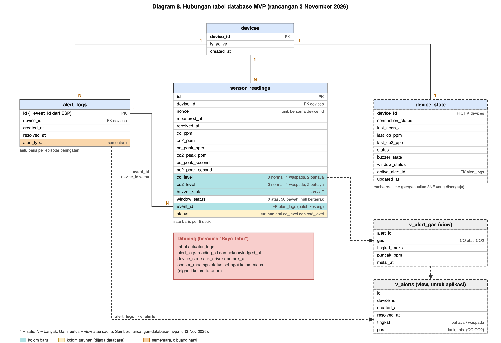

# Rancangan Database dan Pencatatan Peringatan untuk MVP

Versi 3 November 2026. Menggantikan rencana tabel lama di [data-dan-database.md](data-dan-database.md) (bagian 2 dan 4) dan usulan pesan kejadian di [komunikasi.md](komunikasi.md) (4.6 dan 4.7) untuk hal yang dibahas di sini. SQL di bagian 4 sudah diuji di PostgreSQL 17 lokal dengan data nyata (bagian 8), tetapi **belum dijalankan di Supabase**; untuk ditinjau pemilik database. Diagram hubungan tabel: [diagram-8-hubungan-tabel-mvp.png](diagram/diagram-8-hubungan-tabel-mvp.png).

## 1. Keputusan

| # | Keputusan | Dasar |
|---|---|---|
| 1 | MVP: CO dan CO2 dibaca; ada waspada dan bahaya; **tiap peringatan direkam** beserta gas penyebabnya | permintaan pengguna 3 Nov |
| 2 | **Tidak ada mode offline.** Peringatan saat ESP tidak tersambung tidak masuk database (alarm, LCD, dan jendela tetap jalan di alat) | keputusan 29 Okt dipertegas |
| 3 | **"Saya Tahu" dibuang**, termasuk tabel `actuator_logs` | di luar MVP |
| 4 | Kolom `actuator_logs` yang berguna dipindah ke tabel lain (buzzer ke `sensor_readings`; jendela sudah di `sensor_readings.window_status`) | menghindari redundansi |
| 5 | Pencatatan gas dirancang sampai **3NF** | permintaan pengguna |
| 6 | Ambang CO2 dan CO diganti setelah pengembangan selesai | rancangan di bawah tidak bergantung pada nilai ambang |

## 2. Tabel akhir

| Tabel | Kolom | Kunci |
|---|---|---|
| `devices` | `device_id`, `is_active`, `created_at` | PK `device_id` |
| `alert_logs` (satu baris per episode peringatan) | `id` (= `event_id` dari ESP), `device_id`, `created_at`, `resolved_at` | PK `id`; FK `device_id` |
| `sensor_readings` (satu baris per 5 detik) | `id`, `device_id`, `nonce`, `measured_at`, `received_at`, `co_ppm`, `co2_ppm`, `co_peak_ppm`, `co2_peak_ppm`, `co_peak_second`, `co2_peak_second`, **`co_level`**, **`co2_level`**, **`buzzer_state`**, `window_status`, **`event_id`**, `status` (kolom turunan) | PK `id`; unik (`device_id`, `nonce`); FK `device_id`; FK `event_id` ke `alert_logs.id` |
| `device_state` (satu baris per perangkat, untuk realtime) | `device_id`, `connection_status`, `last_seen_at`, `last_co_ppm`, `last_co2_ppm`, `status`, `buzzer_state`, `window_status`, `active_alert_id`, `updated_at` | PK `device_id` |

Kolom tebal adalah tambahan. `level` adalah angka 0 = normal, 1 = waspada, 2 = bahaya, **per gas**. Memakai angka (bukan teks) karena `max()` pada teks urut abjad menempatkan `waspada` di atas `bahaya`.

Dihapus: `actuator_logs`, `alert_logs.reading_id`, `alert_logs.acknowledged_at`, `device_state.ack_driver`, `device_state.ack_at`.

### Cara gas dicatat

Tidak ada kolom `gas`. Satu peringatan bisa melibatkan CO, CO2, atau keduanya, dan tingkatnya bisa naik pada waktu berbeda. Kolom teks berisi "CO,CO2" melanggar 1NF. Karena itu tiap bacaan membawa `co_level` dan `co2_level`, dan tiap bacaan dalam satu episode menunjuk ke peringatannya lewat `event_id`. Tingkat tertinggi, puncak ppm, dan daftar gas per peringatan dihitung oleh view (bagian 4), bukan disimpan ulang.

### Alasan 3NF

| Tabel | Pemeriksaan |
|---|---|
| `devices`, `alert_logs` | semua kolom bergantung hanya pada kunci |
| `sensor_readings` | `co_level`, `co2_level`, `buzzer_state`, `window_status` adalah keputusan ESP yang bergantung pada riwayat (konfirmasi 30 detik untuk CO, 3 bacaan dan 10 detik pulih untuk CO2, timer jendela), jadi bukan fungsi dari `co_ppm` atau `co2_ppm` baris yang sama. Tidak ada ketergantungan transitif. |
| `status` | `status` = tingkat tertinggi dari kedua gas. Kalau disimpan biasa, itu ketergantungan transitif. Dibuat sebagai **kolom turunan (`generated always`)**, jadi database yang menjaganya dan tidak bisa tidak konsisten. Aplikasi lama yang membaca `status` tetap jalan. |
| `device_state` | **pengecualian yang disengaja:** tabel cache dari bacaan terakhir untuk langganan realtime aplikasi. Hanya `connection_status` dan `last_seen_at` yang tidak turunan. Kalau ingin murni, diganti view dan aplikasi mengubah langganannya. |
| Ambang | tidak disimpan di tabel mana pun. Tingkat dihitung di ESP, jadi mengganti ambang tidak mengubah database. |

## 3. Kenapa pilihan ini

- Peringatan tidak perlu menyalin puncak dan tingkat: semuanya dihitung dari bacaan yang menunjuk ke peringatan itu.
- Aturan hapus 7 hari: hanya bacaan **tanpa** `event_id` yang dihapus. Bacaan milik peringatan tetap ada, jadi bukti peringatan tidak hilang walau tabel peringatan kecil. Ini menggantikan `ON DELETE CASCADE` yang berbahaya di rencana lama.
- Tidak ada baris `actuator_logs`, karena riwayat buzzer dan jendela sudah ada per 5 detik di `sensor_readings`.

## 4. SQL usulan

Dua bagian, karena bagian B **merusak worker lama** (worker lama menulis `status` ke kolom yang menjadi turunan, menulis `ack_driver` dan `ack_at`, dan membaca `actuator_logs`). Bagian A aman dijalankan kapan saja. Bagian B dijalankan bersama worker baru (lihat [rancangan-worker-mvp.md](rancangan-worker-mvp.md) bagian 7). Tiap bagian dijalankan **sekali, utuh** (satu transaksi; gagal berarti tidak ada yang berubah).

### 4a. Tambahan (tidak merusak apa pun)

```sql
begin;

-- A1. sensor_readings: tingkat per gas, buzzer, tautan ke peringatan
alter table public.sensor_readings
  add column if not exists co_level smallint not null default 0 check (co_level between 0 and 2),
  add column if not exists co2_level smallint not null default 0 check (co2_level between 0 and 2),
  add column if not exists buzzer_state text check (buzzer_state in ('on','off')),
  add column if not exists event_id uuid;
-- bacaan hanya boleh menunjuk peringatan milik perangkat yang sama (butuh PostgreSQL 15 atau lebih)
alter table public.alert_logs add constraint uq_alert_logs_id_device unique (id, device_id);
alter table public.sensor_readings add constraint fk_sensor_readings_alert
  foreign key (event_id, device_id) references public.alert_logs (id, device_id) on delete set null (event_id);
create index if not exists idx_sensor_readings_event on public.sensor_readings (event_id);
create index if not exists idx_sensor_readings_device_time on public.sensor_readings (device_id, measured_at desc);

-- A2. data lama: dianggap CO2 saja (CO nonaktif sebelum 2 Nov)
update public.sensor_readings
  set co2_level = case status when 'bahaya' then 2 when 'waspada' then 1 else 0 end;

-- A3. view untuk aplikasi: gas dan tingkat tiap peringatan
create or replace view public.v_alert_gas as
select r.event_id as alert_id, g.gas,
       max(g.tingkat) as tingkat_maks,
       max(g.ppm) as puncak_ppm,
       min(r.measured_at) filter (where g.tingkat > 0) as mulai_at
from public.sensor_readings r
cross join lateral (values ('CO',  r.co_level,  coalesce(r.co_peak_ppm,  r.co_ppm)),
                           ('CO2', r.co2_level, coalesce(r.co2_peak_ppm, r.co2_ppm))) as g(gas, tingkat, ppm)
where r.event_id is not null and g.tingkat > 0
group by r.event_id, g.gas;

create or replace view public.v_alerts as
select a.id, a.device_id, a.created_at, a.resolved_at,
       case max(g.tingkat_maks) when 2 then 'bahaya' when 1 then 'waspada' end as tingkat,   -- kosong bila belum ada bacaan bertingkat
       array_agg(g.gas order by g.gas) filter (where g.gas is not null) as gas
from public.alert_logs a
left join public.v_alert_gas g on g.alert_id = a.id
group by a.id;

commit;
```

### 4b. Pemutusan (setelah worker baru berjalan; matikan ESP selama ini)

```sql
begin;

-- B1. bacaan yang ditulis worker lama sejak 4a belum punya tingkat: isi dari status
update public.sensor_readings
  set co2_level = case status when 'bahaya' then 2 when 'waspada' then 1 else 0 end
  where co_level = 0 and co2_level = 0 and status <> 'normal';

-- B2. status jadi kolom turunan
alter table public.sensor_readings drop column status;
alter table public.sensor_readings add column status text generated always as
  (case greatest(co_level, co2_level) when 2 then 'bahaya' when 1 then 'waspada' else 'normal' end) stored;

-- B3. alert_logs: buang yang terkait "Saya Tahu" dan reading_id
alter table public.alert_logs drop constraint if exists alert_logs_reading_id_fkey;
alter table public.alert_logs drop column if exists reading_id;
alter table public.alert_logs drop column if exists acknowledged_at;

-- B4. buang "Saya Tahu"
drop table if exists public.actuator_logs;
alter table public.device_state drop column if exists ack_driver, drop column if exists ack_at;

-- B5. hapus bacaan lama yang bukan bukti peringatan (jadwalkan sesudah B3)
-- delete from public.sensor_readings where event_id is null and measured_at < now() - interval '7 days';

commit;
```

`alert_logs.alert_type` dipertahankan **sementara** (diisi worker = tingkat tertinggi) agar aplikasi yang sudah ada tidak rusak. Hapus kolom itu setelah aplikasi membaca `v_alerts.tingkat`.

## 5. Perubahan per pihak

| Pihak | Perubahan |
|---|---|
| ESP | `SensorSnapshot` ditambah `coLevel` (dari status CO: WASPADA = 1, BAHAYA = 2, **LUAR = 1, usulan, perlu dipastikan**). Telemetri versi 4: kirim `co_level` dan `co2_level`, buang `status`. Format yang ditandatangani: `r4`, sama dengan `r3` tetapi `co_level\|co2_level` menggantikan `status`. **Perbaiki bug:** sekarang `coAlarm` (termasuk CO waspada) membuat status `bahaya`. |
| Worker | terima `r3` dan `r4`. Saat ada `event_id`: **buat baris `alert_logs` dulu, baru simpan bacaan** (urutan penting karena kunci tamu). Tulis `co_level`, `co2_level`, `buzzer_state`, `event_id`. Tutup peringatan lama seperti sekarang. Buang `actuatorService.js`, `realtimeAckService.js`, langganan `cmd/ack`, dan pengecekan 15 detik. |
| Database | 4a sebelum worker baru; 4b sesudah worker baru berjalan (ESP dimatikan selama 4b). |
| Aplikasi | riwayat peringatan dari `v_alerts`; keadaan sekarang dari `device_state`; buang tombol "Saya Tahu". |
| Firmware (dibiarkan) | `handleCommand` dan sejenisnya boleh tetap ada, tidak dipakai. Dibuang pada versi berikutnya kalau waktu ada. |

Urutan aman: (1) database 4a, (2) worker yang menerima `r3` dan `r4`, (3) database 4b dengan ESP dimatikan, (4) ESP versi 4, (5) aplikasi pindah ke `v_alerts`, (6) buang `alert_type`. Rincian worker: [rancangan-worker-mvp.md](rancangan-worker-mvp.md).

## 6. Batasan yang diterima

| Hal | Catatan |
|---|---|
| Peringatan saat offline tidak tercatat | mode online-only |
| Jendela tercatat per 5 detik | pulsa 1,5 detik bisa jatuh di antara dua baris; `window_status` null (bergerak) terlihat hanya beberapa baris |
| Bacaan CO tidak sah dikirim sebagai 0 | skema belum punya "CO tidak diketahui" |
| Ambang masih mode pengembangan (700/800 untuk CO2) | diganti setelah pengembangan selesai; data uji dengan ambang lama perlu dibersihkan atau ditandai |
| Data lama | 2 peringatan belum ditutup (`7b1b3c7d`, `d6dc1da2`), dan data `AEROS_DEMO_01` (156 bacaan, 13 peringatan) masih ada |

## 7. Diagram hubungan tabel



Dibuat dengan [buat_diagram_erd.py](diagram/buat_diagram_erd.py). Diagram 6 (alur perintah "Saya Tahu") tidak berlaku lagi untuk MVP.

## 8. Hasil uji 3NF dan SQL

Diuji 3 November 2026 di PostgreSQL 17 lokal sementara, dengan 2401 bacaan dan 29 peringatan nyata `AEROS_01` yang dibaca dari Supabase (hanya baca). Berkas dan cara mengulang: [uji-3nf/](../analisis/skrip/uji-3nf/README.md).

### 8.1 Uji perilaku

| Uji | Hasil |
|---|---|
| Migrasi (SQL tunggal, sebelum dipisah 4a dan 4b) pada skema lama | berhasil tanpa galat. Dijalankan dua kali: kali kedua gagal dan tidak mengubah apa pun (satu transaksi). |
| `status` kolom turunan vs `status` lama | 2401 dari 2401 sama, 0 beda |
| Pemisahan 4a dan 4b dengan worker lama dan baru | 4a: worker lama masih bisa menulis. Sebelum 4b, penulisan tanpa `status` ditolak (kolom masih wajib). Sesudah 4b: penulisan `status` oleh worker lama **ditolak** ("cannot insert a non-DEFAULT value"), `ack_driver` dan `actuator_logs` hilang, penulisan worker baru berhasil, baris yang ditulis worker lama di antara 4a dan 4b diisi ulang tingkatnya dengan benar |
| Ubah `status` manual | ditolak ("can only be updated to DEFAULT") |
| `co_level` = 3, `buzzer_state` = 'mungkin', `event_id` tak dikenal, `nonce` ganda, `event_id` milik perangkat lain | kelimanya ditolak |
| View `v_alerts` pada 29 peringatan nyata (bacaan dihubungkan lewat jendela waktu, bukan `event_id` asli) | 17 tercatat `waspada` padahal mencapai bahaya (sama dengan hitungan sebelumnya), 1 bahaya cocok, 10 waspada cocok, 1 tidak punya bacaan bertingkat |
| Episode sintetis CO dan CO2 sekaligus | `v_alerts`: bahaya, gas `{CO,CO2}`; puncak CO 95, CO2 4100 |
| Hapus peringatan | bacaan tetap, `event_id` kosong |
| Hapus bacaan | peringatan tetap |
| Aturan hapus lama (ambang uji 1 hari) | dari 2403 bacaan, 172 tanpa `event_id` terhapus; 2229 milik peringatan tetap; 29 peringatan utuh |
| `max()` pada teks | `waspada` mengalahkan `bahaya` (alasan tingkat berupa angka) |

Tiga perbaikan lahir dari uji ini dan sudah masuk ke SQL: (1) semua langkah dibungkus transaksi, (2) `v_alerts.tingkat` kosong bila belum ada bacaan bertingkat (semula bernilai `waspada` yang menyesatkan), (3) kunci tamu gabungan (`event_id`, `device_id`) agar bacaan tidak bisa menunjuk peringatan milik perangkat lain.

### 8.2 Uji ketergantungan fungsional (`sensor_readings`, 2229 bacaan)

| Pemeriksaan | Hasil |
|---|---|
| Kunci kandidat | `id` unik; (`device_id`, `measured_at`) juga unik |
| `co2_ppm` → `co2_level` | **tidak berlaku**: 70 dari 265 nilai ppm yang berulang punya lebih dari satu tingkat |
| `co2_level` → `co2_ppm`, `co2_level` → `window_status`, `co2_ppm` → `window_status` | tidak berlaku |
| `co_level` | selalu 0 di data ini (CO belum pernah mencapai waspada), jadi tidak bisa diuji |
| Yang tampak berlaku | (`co2_ppm`, `co_peak_ppm`) → `co_ppm` dan (`co_peak_ppm`, `co2_peak_ppm`) → `co_ppm` |

Dua ketergantungan terakhir adalah **kebetulan data**: CO bernilai lebih dari 0 hanya pada 5 dari 2229 baris, dan `co_ppm` sama dengan `co_peak_ppm` di hampir semua baris (hanya 8 yang berbeda). Secara arti, puncak 5 detik tidak menentukan nilai satu detik. Ulangi uji ini setelah CO nyata cukup bervariasi.

### 8.3 Yang tidak bisa dibuktikan uji ini

- Data hanya bisa **menyalahkan** ketergantungan (menemukan pelanggar), tidak bisa membuktikan 3NF. Dasar 3NF tetap arti kolom (bagian 2), dan uji ini memperkuatnya: tingkat bukan fungsi dari ppm.
- Skema lama di `01-skema-lama.sql` adalah **perkiraan**, bukan dump asli Supabase. Jalankan SQL terlebih dahulu di salinan atau cabang database.
- Constraint gabungan dengan `ON DELETE SET NULL (event_id)` butuh PostgreSQL 15 atau lebih; versi di Supabase belum dicek.
- `buzzer_state` dan `co_level` belum punya data nyata (butuh telemetri baru), jadi hubungannya dengan kolom lain belum diuji.
- Peringatan `49b4db51` tercatat `bahaya` tetapi CO2 di sekitarnya hanya 656 ppm dan tidak ada bacaan bertingkat; penyebabnya belum diketahui.
