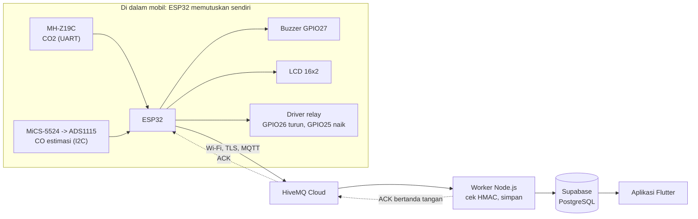
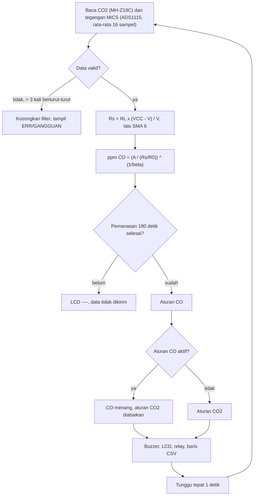
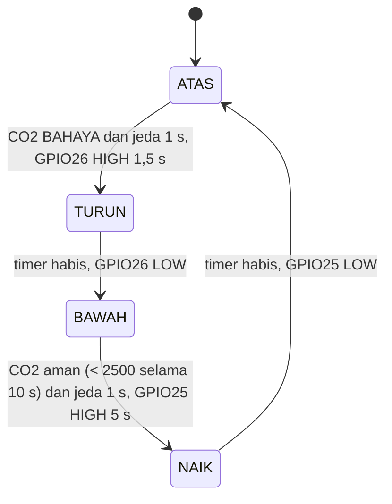
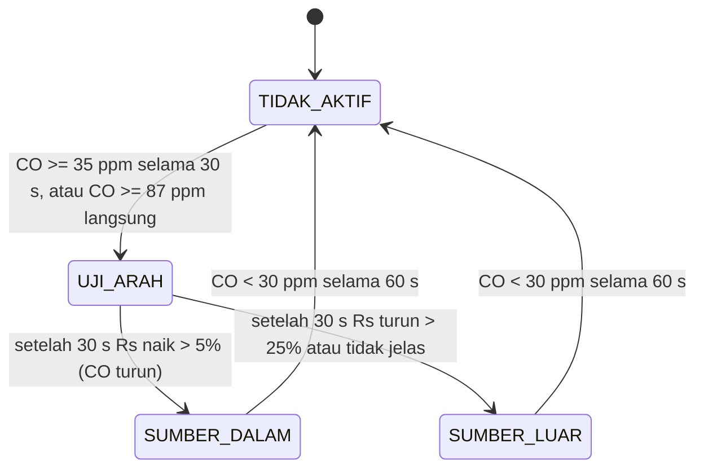
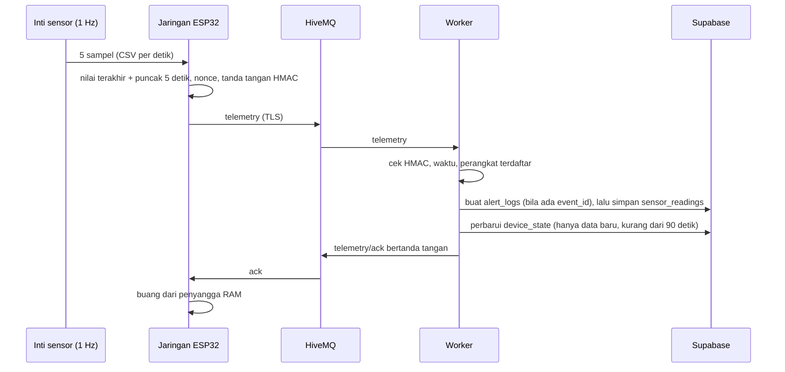
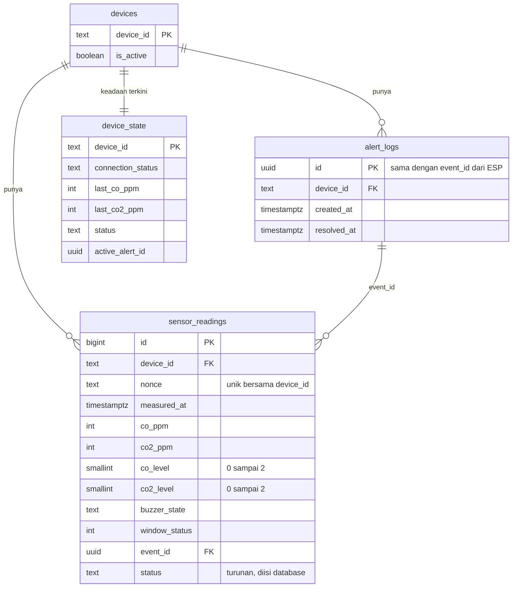

# Materi PPT Expo AEROS: "Ini dari mana? Skematiknya bagaimana?"

Disusun 4 November 2026. Isi diambil dari **kode yang ada sekarang** (firmware-v2, worker, SQL 4a/4b), lalu dicocokkan dengan dokumen dan hasil uji. Kalau dokumen lama bertentangan dengan kode, **kode yang dipakai** dan dokumen lama dicatat di bagian 10.

Ini ringkasan turunan untuk presentasi. Angka final tetap hidup di [keputusan.md](../keputusan/keputusan.md); wiring di [hardware-wiring.md](../keputusan/hardware-wiring.md). Kalau berbeda, perbaiki sumbernya, lalu perbarui berkas ini.

Diagram memakai Mermaid (tampil di GitHub, atau di VS Code dengan ekstensi "Markdown Preview Mermaid Support", atau tempel ke mermaid.live lalu simpan PNG untuk slide).

Penanda: ✔ terbukti (ada data uji atau terbaca di kode) · ◐ sementara/usulan · ✖ belum terbukti.

---

## 1. Hasil evaluasi (baca ini dulu)

### 1.1 Yang sudah sinkron (aman dipresentasikan)

| Bagian | Bukti |
|---|---|
| Pin firmware = skematik (SDA21, SCL22, CO2 16/17, buzzer 27, relay turun 26, relay naik 25, **tombol Wi-Fi 32** sejak 4 Nov) | kode `sensorOriginal.inl` baris 63-80 vs [skematik 3 Nov](../keputusan/diagram/skematik-pin-2026-11-03.png) |
| Format pesan ESP = worker (`r4|...`, 17 bagian yang sama persis) | `main.cpp` `sampleAndQueue` vs `securityService.js` `canonicalReading` |
| Worker | 36 uji otomatis lulus (`npm test`, 4 Nov); repo sama dengan `origin/main` |
| Siklus CO2 sampai relay | uji 8: 11 pasang turun 1,5 s lalu naik 5 s, tidak ada yang terbalik |
| Data sampai database | uji 7 (Civic): 431 ACK untuk ±431 kiriman, tunda simpan median 1,45 s |
| Alarm tanpa internet | uji 8: 4 episode saat Wi-Fi mati, bunyi dan sinyal jendela tetap jalan |

### 1.2 Yang belum sinkron (perbaiki atau siapkan jawabannya)

| # | Temuan | Dampak di expo | Tindakan |
|---|---|---|---|
| ~~P1-a~~ **selesai 4 Nov** | Tombol Wi-Fi dipindah ke **GPIO32** ([main.cpp:53](../../firmware-v2/src/main.cpp#L53)) dan pesan serial diperbarui. **Belum dikompilasi dan belum diuji di alat** (PlatformIO tidak ada di mesin ini) | Bila tombol di PCB belum tersambung ke GPIO32 dan GND, portal tidak terbuka | Upload, lalu tahan tombol 5 detik: serial harus menulis "[BUTTON] Hold 5s terdeteksi". Belum di-commit |
| **P1-b** | **Mode ambang**: `MODE_PENGEMBANGAN = true` di berkas kerja ([sensorOriginal.inl:56](../../firmware-v2/src/sensorOriginal.inl#L56), belum di-commit). Commit v2.4 bernilai `false` | `true` = ambang 700/800 ppm (cocok untuk demo meja, napas ke sensor). `false` = 2500/4000 (cocok untuk mobil). Salah pilih = demo gagal atau data mobil salah | Putuskan per skenario dan **tulis di slide** ("mode demo meja" atau "mode rancangan"). Layar LCD baris bawah menulis "Mode pengembang" saat `true` |
| **P1-c** | **Versi pesan**: firmware v2.4 mengirim **versi 4**. Worker lama hanya paham versi 3 dan akan menolak versi 4 | Data tidak masuk database walau alat jalan | **Diperiksa 4 Nov (baca saja):** `cek-database.js` semua OK, kolom `co_level`, `co2_level`, `buzzer_state`, `event_id` dan view `v_alerts` ada (SQL 4a berlaku). 1644 baris berisi `buzzer_state`, terakhir 4 Nov 12:05 WIB, jadi worker versi baru **sedang menulis**. Belum diketahui: apakah SQL 4b sudah dijalankan |
| **P1-d** | Celah data **19:53:09-20:12:34 WIB** di uji 8 ([uji 8](../pengujian/laporan/uji-8-meja-wifi-mqtt-firmware-v2.3-2026-11-03.md) bagian 2a). **Terbukti di database:** 0 baris selama 19,4 menit, tetapi 2 peringatan tetap terbuat (20:05:30 dan 20:06:25) | Penguji bisa bertanya "datanya pernah hilang?" | **Dugaan kuat (belum terbukti):** saat itu worker baru sudah menulis (kolom baru terisi sejak 19:48) tetapi SQL 4b dijalankan, sehingga penulisan `status` ditolak database; peringatan dibuat dulu lalu bacaan gagal, sampai worker diatur `WRITE_STATUS_COLUMN=false` pukul ±20:12. Cocok dengan uji 3NF di [rancangan-database-mvp.md](../keputusan/rancangan-database-mvp.md) bagian 8.1. Konfirmasi dengan log Railway jam itu atau tanya teman backend. Sampai itu, klaim "tidak ada data hilang" hanya untuk uji 7 |
| P2-a | **Jalur jendela CO beda dengan CO2.** CO2: siklus relay 1,5 s turun (GPIO26) lalu 5 s naik (GPIO25). CO: pulsa turun **10 s** ([baris 683](../../firmware-v2/src/sensorOriginal.inl#L683)) dan **tidak ada** sinyal tutup (`PIN_JENDELA_TUTUP = -1`, baris 79), LCD hanya meminta "Tutup jendela" | Kalau ditanya "kenapa CO dan CO2 beda?" | Jawaban jujur ada di Q14. Jangan menggambar relay naik untuk jalur CO |
| P2-b | `co_level` untuk sumber **LUAR** dikirim **2 (bahaya)** di kode ([sensorBridge.cpp:89](../../firmware-v2/src/sensorBridge.cpp#L89)); rancangan DB menulis "1, usulan" | Beda angka antar dokumen | Pakai angka kode (2). Perbarui rancangan DB |
| P2-c | Posisi jendela hanya **estimasi timer** (0 = atas, 50 = bawah, null = bergerak). Tidak ada sensor posisi. Relay belum terpasang ke jendela mobil; di uji mobil jendela dibuka tim secara manual | "Jendela benar-benar bergerak?" | Jawab: yang terbukti sinyal GPIO (1,5 s dan 5 s). Gerak fisik belum terbukti |
| P2-d | Lama pulsa naik: 5000 ms (5 kali) dan ±5340 ms (6 kali). Pulsa turun selalu 1500 ms | Selisih ±0,34 s | Sebutkan "±0,3 s", penyebab belum diselidiki |
| P2-e | Pertanyaan keselamatan relay belum dijawab hardware: kabel motor di saklar asli bisa terhubung GND ([hardware-wiring.md](../keputusan/hardware-wiring.md) bagian 7-8) | Risiko korsleting bila disambung ke mobil | Jangan klaim "siap dipasang ke mobil"; klaim "sinyal dan driver relay sudah diuji di meja" |
| P2-f | R0 sensor CO masih harus **dikalibrasi ulang di mobil**; ppm CO selalu estimasi | Angka CO bisa diserang | Gunakan kalimat aman bagian 9 |

### 1.3 Penilaian singkat (sudut pandang dosen)

- **Kuat**: tiap angka punya sumber atau data; alarm tidak bergantung internet; pesan bertanda tangan; hasil uji nyata dari 3 mobil dan meja; ada pembanding model C-251 dengan kenyataan.
- **Lemah yang pasti ditanya**: CO belum dikalibrasi gas asli; jendela belum terbukti bergerak otomatis; satu mobil per angka jendela; ambang CO2 bukan standar medis tetapi pilihan rancangan.
- **Cara menjawab lemah**: nyatakan batasnya lebih dulu, lalu tunjukkan apa yang **sudah** terbukti (bagian 9).

---

## 2. Gambaran sistem (1 slide)



Tiga kalimat inti untuk slide:
1. **Keputusan alarm dan jendela dibuat di ESP32 tiap 1 detik; internet hanya untuk melapor.**
2. Data dikirim tiap **5 detik**, bertanda tangan **HMAC**, disimpan database, baru dibalas **ACK**.
3. Peringatan tersimpan sebagai **episode** (`alert_logs`) yang menunjuk ke bacaan-bacaannya.

---

## 3. Skematik hardware

Gambar sumber: [skematik-pin-2026-11-03.png](../keputusan/diagram/skematik-pin-2026-11-03.png) (KiCad), [perfboard relay](../keputusan/diagram/diagram-7-perfboard-relay-jendela.png), [PCB atas](../keputusan/diagram/pcb-tampak-atas-2026-11-03.png) dan [bawah](../keputusan/diagram/pcb-tampak-bawah-2026-11-03.png). Gunakan gambar-gambar itu di slide; tabel di bawah untuk catatan pembicara.

### 3.1 Pin dan fungsi (ESP32 DevKitC)

| Komponen | Pin ESP32 | Jalur | Alasan |
|---|---|---|---|
| MH-Z19C (CO2) | GPIO16 (RX2), GPIO17 (TX2) | UART 9600 8N1, catu 5 V | sensor NDIR kirim ppm langsung |
| ADS1115 (pembaca analog MiCS) | GPIO21 (SDA), GPIO22 (SCL) | I2C alamat 0x48, catu 3,3 V | ADC ESP32 kasar dan tidak linear; ADS1115 16-bit |
| MiCS-5524 | A0 ADS1115 | catu 5 V, keluaran AO | sensor CO semikonduktor |
| LCD 16x2 | GPIO21/22 (satu jalur I2C dengan ADS1115) | alamat 0x27 | berbagi bus |
| Buzzer | GPIO27 | ke GND | bunyi peringatan |
| Relay **TURUN** (buka jendela) | **GPIO26** (TBout) | lewat driver perfboard | 1,5 s per episode bahaya |
| Relay **NAIK** (tutup jendela) | **GPIO25** | lewat driver perfboard | 5 s setelah aman |
| Tombol Wi-Fi | **GPIO32** | ke GND; tahan 5 s | firmware sudah GPIO32 (4 Nov), belum diuji di alat |

Pin yang dipakai tidak ada yang bentrok. GPIO25 dan GPIO32 tidak punya konektor di PCB (kabel dari header).

### 3.2 Catu daya

```
Aki/USB mobil 12 V -> TBin -> buck DC-DC -> 5 V -> ESP32, MH-Z19C, MiCS, LCD
                                         ESP32 3V3 -> ADS1115
Aki 12 V (fuse 2 A)  -> koil relay (perfboard)
Aki 12 V (fuse 15-20 A) -> kontak relay 30 -> 87 -> motor jendela
SEMUA GND SATU JALUR: minus aki = buck OUT- = GND ESP32 = GND perfboard
```

- Uji mobil memakai **USB mobil** (alat menyala saat mobil menyala), bukan relay ke motor.
- Tanpa GND bersama, sinyal 3,3 V tidak punya acuan dan transistor tidak menyala.

### 3.3 Driver relay (dua kanal identik di perfboard)

```
GPIO -> 470 ohm -> basis PN2222A
                   basis -> 10 kohm -> GND   (relay lepas saat ESP boot/reset)
                   emitor -> GND
                   kolektor -> koil relay (kaki 86); kaki 85 -> +12 V
                   dioda 1N4007 melintang koil, garis (katoda) ke +12 V
```

| Komponen | Fungsi (jawaban singkat) | Angka (dihitung, belum diukur ◐) |
|---|---|---|
| ESP32 GPIO | hanya memberi sinyal 3,3 V, tidak kuat menarik koil | arus keluar ≈ 5,5 mA |
| 470 ohm | membatasi arus basis | (3,3 - 0,7) / 470 ≈ 5,5 mA |
| PN2222A | saklar elektronik; arus kecil mengendalikan arus koil | kuat 600 mA, koil ±150 mA |
| 10 kohm ke GND | menjaga basis tetap rendah saat ESP belum menyala | relay tidak klik waktu boot |
| Dioda 1N4007 | meredam lonjakan tegangan koil saat relay lepas | terbalik = korsleting |
| Dua relay | satu arah putar motor masing-masing | **tidak boleh HIGH bersamaan** |

Pengaman di firmware: pin lawan dipaksa LOW dulu sebelum pulsa, jeda LOW minimal 1 detik antar pulsa, batas satu pulsa 10 s ([ujiMulaiPulsa](../../firmware-v2/src/sensorOriginal.inl#L362)).

### 3.4 Jika ditanya soal hardware
- *"Kenapa ADS1115, bukan ADC ESP32?"* Hasil MiCS hanya puluhan mV; ADC internal ESP32 kasar. ADS1115 16-bit dengan gain otomatis 1,024 / 2,048 / 4,096 V.
- *"Kenapa ada transistor?"* GPIO tidak sanggup menarik koil relay; transistor jadi saklar.
- *"Kenapa 5 V dan 3,3 V campur?"* MH-Z19C, MiCS, LCD butuh 5 V; ADS1115 dicatu 3,3 V supaya sinyal I2C aman untuk ESP32. ✖ tegangan AO MiCS ke ADS1115 pernah terbaca 3,68 V (melewati batas ±3,6 V) dan masih perlu diukur ulang.

---

## 4. Firmware

### 4.1 Arsitektur: dua bagian

| Bagian | Berkas | Tugas |
|---|---|---|
| **Inti sensor** (task FreeRTOS terpisah) | `sensorOriginal.inl` lewat `sensorBridge.cpp` | baca sensor, filter, aturan alarm, buzzer, relay, LCD, cetak 1 baris CSV per detik |
| **Jaringan** (loop utama) | `main.cpp` | Wi-Fi, portal, NTP, MQTT TLS, HMAC, kirim tiap 5 detik, terima ACK |

- Jembatan: `sensorBridge` membaca **baris CSV** yang dicetak inti sensor, jadi inti sensor tidak disentuh oleh kode jaringan. Hasil: kegagalan Wi-Fi tidak mengganggu alarm.
- Konfigurasi jaringan kosong atau rusak: inti sensor tetap jalan, jaringan tidak dimulai.
- Versi: **v2.4** (jalur CO aktif, siklus jendela dua pin, ambang 2500/4000, LCD baru, telemetri versi 4).

### 4.2 Siklus 1 detik



Aturan prioritas: **CO menang atas CO2.** Satu sensor gagal: sensor yang sehat tetap jalan. Dua-duanya gagal: tampil "SENSOR GANGGUAN", tidak ada aksi otomatis.

### 4.3 Model dan rumus (untuk slide "bagaimana angkanya dihitung")

| Langkah | Rumus | Catatan |
|---|---|---|
| CO2 | ppm dibaca langsung dari MH-Z19C | akurasi ±(50 ppm + 5%); tanpa filter; ABC dimatikan ✔ |
| Hambatan sensor CO | `Rs = RL x (VCC - V) / V` | RL = 9970 ohm, VCC = 4,64 V (hasil ukur) |
| Filter | **SMA 6** pada Rs (rata-rata 6 detik terakhir) | alasan di bagian 7.1 |
| Rasio | `Rs / R0` | R0 = hambatan di udara bersih, disimpan di memori ESP (perintah `r`, 120 detik) |
| ppm CO (estimasi) | `ppm = (A / (Rs/R0)) ^ (1/beta)`, A = 3,46, beta = 0,840 | dari digitalisasi kurva datasheet; rasio ≥ 0,5 (≈ 10 ppm) ditampilkan 0 |
| Ambang dalam rasio | 35 ppm ≈ 0,175 · 87 ppm ≈ 0,081 · 30 ppm ≈ 0,199 | dihitung dari rumus di atas |

Selalu tulis di slide: **"ppm CO = estimasi dari kurva datasheet, belum dikalibrasi gas CO asli."**

### 4.4 Parameter, nilai di kode, sumber

Nilai di bawah dibaca dari kode 4 Nov. Dokumen lama [parameter-dan-sumber.md](../keputusan/parameter-dan-sumber.md) masih menulis EMA 0,2, pemanasan 300 detik, dan ABC aktif; itu **sudah tidak berlaku**.

| Parameter | Nilai | Sumber / dasar | Status |
|---|---|---|---|
| Interval siklus | 1 detik | syarat filter jumlah genap | ✔ |
| Sampel ADS1115 | 16 per detik | rata-rata kasar noise ADC | ✔ |
| Filter CO | SMA 6 | analisis 13.000 baris: meredam 76% goyangan, lebih halus dari EMA 0,2 | ✔ (satu sesi kamar + 4 uji) |
| Pemanasan | 180 detik, CO dan CO2 | MH-Z19C angka palsu 410/500 sampai detik 64 (4 dari 5) dan 128 (1); MiCS Rs 156 → ±1650 kΩ dalam 3 menit | ✔ |
| Kurva CO | A = 3,46; beta = 0,840 | digitalisasi piksel kurva datasheet SGX | ✔ pembacaan grafik, ✖ kalibrasi gas |
| R0 | 5470 kΩ (kalibrasi garasi 2 Nov), kalibrasi ulang di mobil menyusul | perintah `r`, batas selisih max-min 40% | ◐ |
| CO waspada | ≥ 35 ppm estimasi selama 30 detik | NIOSH REL 35 ppm | ◐ (30 detik sementara) |
| CO bahaya | ≥ 87 ppm, tanpa konfirmasi | WHO 15 menit 87 ppm | ✔ sumber, keputusan |
| Uji arah | 30 detik; Rs turun > 25% = luar; naik > 5% = dalam; di antaranya = anggap luar | tanpa gas Rs tidak pernah turun > 25% dalam ±28.000 detik | ◐ |
| CO selesai | < 30 ppm selama 60 detik | ±6 kali konstanta waktu filter | ◐ |
| CO2 peringatan | ≥ 2500 ppm, 3 bacaan berturut-turut | Satish 2012 (bukti lemah, jadi peringatan lembut) | ◐ |
| CO2 bahaya/tindakan | ≥ 4000 ppm, 3 bacaan | batas kerja 5000 ppm dikurangi margin sensor ±250 ppm dan jeda 130-350 ppm | ◐ |
| CO2 selesai | < 2500 selama 10 detik | data Avanza: CO2 terus turun setelah jendela ditutup | ◐ |
| Mode demo meja | 700 / 800 / selesai < 700 | hanya untuk uji meja | ✔ (uji 8) |
| Bunyi waspada | 3 bip pendek (300 ms nyala, 300 ms jeda) | keputusan tim | ✔ |
| Bunyi bahaya | 1 bip panjang 3 detik | keputusan tim | ✔ |
| Ulang bunyi CO | tiap 60 detik, maksimum 5 menit; CO2 tidak diulang | keputusan tim | ◐ |
| Pulsa jendela CO2 | turun 1,5 s (GPIO26), naik 5 s (GPIO25), jeda ≥ 1 s | uji v1.8: 1501 ms dan 5000 ms; naik lebih lama agar sampai atas | ◐ (belum dicocokkan waktu tempuh penuh) |
| Batas pulsa | 10 s per pulsa | pengaman motor | ✔ |

### 4.5 Status jendela (siklus CO2)



- Selalu bergantian: tidak turun dua kali, tidak naik sebelum turun. Perintah `x` menghentikan relay.
- Sensor hilang **bukan** dianggap aman, jadi tidak ada pulsa naik.
- ✖ Tidak ada sensor posisi dan tidak ada anti-jepit (batasan yang dinyatakan).

### 4.6 Aturan CO (uji arah)



Idenya: buka jendela sebentar. Kalau CO **turun**, sumbernya di dalam mobil, jendela tetap terbuka. Kalau CO **naik**, sumbernya di luar (knalpot kendaraan lain), jendela diminta ditutup. Tidak jelas = anggap luar (lebih aman). Di LCD: "Sumber CO diduga dari dalam/luar mobil", "Tutup jendela".

### 4.7 LCD dan buzzer

- Baris atas: `CO  xxppm OK/WARN/DANG/LUAR`. Baris bawah: `CO2 xxxxppm OK/WARN/DANG`. Pemanasan: `----` dan `WARM`. Error: `ERR`.
- Pesan menimpa **baris gas lain** (pesan karena CO menimpa baris CO2 dan sebaliknya), bergantian tiap 2 detik dengan angka supaya nilai tetap terbaca.
- "Jendela membuka" tampil 3 detik; "Udara aman / Tutup jendela" tampil 20 detik setelah CO2 aman.

### 4.8 Jika ditanya soal firmware
Lihat bagian 9 (Q1-Q10).

---

## 5. Alur komunikasi

### 5.1 Topik MQTT (broker HiveMQ Cloud, port 8883, TLS)

| Topik | Arah | Isi |
|---|---|---|
| `aeros/AEROS_01/telemetry` | ESP → worker | data tiap 5 detik, QoS 0 |
| `aeros/AEROS_01/telemetry/ack` | worker → ESP | "sudah tersimpan", QoS 1, bertanda tangan |
| `aeros/AEROS_01/status` | ESP → semua | `ONLINE` (retained); `OFFLINE` lewat Last Will saat putus |

Topik perintah (`.../cmd`, `.../cmd/ack`) masih ada di firmware, tetapi **tidak dipakai** di MVP (fitur "Saya Tahu" dibuang).

### 5.2 Urutan satu data



### 5.3 Isi pesan (versi 4)

| Field | Arti |
|---|---|
| `co_ppm`, `co2_ppm` | nilai terakhir dalam jendela 5 detik |
| `co_peak_ppm`, `co2_peak_ppm`, `*_peak_second` | puncak dan detik ke-berapa (agar lonjakan singkat tidak hilang) |
| `co_level`, `co2_level` | 0 normal, 1 waspada, 2 bahaya, **per gas** (status gabungan dihitung worker) |
| `buzzer_state`, `window_status` | `on/off`; 0 atas, 50 bawah, `null` bergerak (tidak pernah angka palsu) |
| `event_id` | UUID episode peringatan; `null` bila normal |
| `nonce`, `timestamp`, `time_valid` | acak 128 bit; jam NTP (0 dan `false` bila belum sinkron) |
| `demo` | `true` untuk data simulasi; worker menolaknya kecuali diizinkan |
| `signature` | HMAC-SHA256 atas string `r4|device|nonce|timestamp|valid|co|co2|coPeak|co2Peak|coDtk|co2Dtk|coLv|co2Lv|buzzer|window|event|demo` |

### 5.4 Keamanan (yang bisa diklaim)

| Lapis | Cara | Apa yang dicegah |
|---|---|---|
| TLS | sertifikat ISRG Root X1 diperiksa, tidak pernah `setInsecure()` | penyadapan, broker palsu |
| HMAC-SHA256 | kunci rahasia di ESP dan worker saja, perbandingan waktu-tetap | pesan palsu atau diubah |
| Nonce + kunci unik (`device_id`, `nonce`) di database | pesan ganda ditolak | pengulangan pesan |
| Jendela waktu | maks 90 hari lalu, 5 menit ke depan | stempel waktu ngawur |
| Daftar perangkat | `devices.is_active` | perangkat tak dikenal |
| ACK bertanda tangan | `dataack2|device|nonce|stored` | ESP percaya "tersimpan" padahal tidak |
| Last Will | `OFFLINE` otomatis dari broker | tahu perangkat putus |

Batas yang harus disebut: HMAC mencegah **pesan palsu**, bukan memastikan sensor mengukur dengan benar. Satu kunci untuk satu perangkat (prototipe).

### 5.5 Ketahanan jaringan

- Wi-Fi: 5 percobaan × 10 detik; gagal → tunggu 30 detik; password diduga salah → portal `AEROS-Setup` (192.168.4.1, 5 menit).
- MQTT: ulang tiap 5 detik; keep-alive 30 detik.
- Penyangga RAM **4 data**; tanpa ACK dikirim ulang tiap 6 detik; data tertahan > 30 detik **dibuang** (bukan dikirim terlambat).
- **Mode online-saja** (keputusan): saat jaringan putus data tidak disimpan. Alarm, buzzer, LCD, dan jendela tetap jalan. Alasannya: antrean flash terbukti tidak terkejar (±200 item, 27 detik per item).
- "Perangkat tidak terhubung" **bukan** berarti udara aman.

---

## 6. Worker dan database

### 6.1 Urutan kerja worker (`handleSensorMessage`)

1. Subscribe `aeros/+/telemetry` dan `aeros/+/status` (QoS 1); sambungan TLS dengan sertifikat diperiksa.
2. `verifyReading`: versi 3 atau 4, bentuk tiap field, puncak ≥ nilai, `event_id` wajib saat tidak normal, buzzer `on` hanya saat tidak normal, **HMAC**.
3. `device_id` di pesan harus sama dengan topik; data `demo` ditolak.
4. `assertActiveDevice`: perangkat harus ada dan aktif di tabel `devices`.
5. `pastikanPeringatan`: buat baris `alert_logs` dengan `id = event_id` **lebih dulu** (kunci tamu); duplikat sah diterima.
6. `persistReading`: simpan `sensor_readings`; duplikat `nonce` dibuktikan ada, lalu dianggap sukses.
7. `mirrorRecentTelemetry` (usaha terbaik): perbarui `device_state` dan tutup peringatan lama, **hanya** untuk data < 90 detik dan yang terbaru.
8. Kirim ACK bertanda tangan **hanya setelah** bacaan tersimpan.
9. Pesan `status`: `ONLINE` → `device_state.connection_status = online`; `OFFLINE` → `offline`.

Lingkungan: `WRITE_STATUS_COLUMN=false` (kolom `status` turunan), `ACCEPT_V3=true` sampai semua ESP v4. Satu worker aktif per perangkat. Tes: 36 lulus (`npm test` di repo `aeros-worker`).

### 6.2 Tabel database (rancangan MVP, SQL 4a dan 4b)



(Kolom puncak `co_peak_*`, `co2_peak_*` dan waktu tidak ditampilkan agar muat.)

Alasan rancangan (untuk "kenapa tabelnya begini?"):
- **Tidak ada kolom "gas"**: satu peringatan bisa CO, CO2, atau keduanya. Tiap bacaan membawa `co_level` dan `co2_level`; gas, tingkat tertinggi, dan puncak dihitung di view `v_alert_gas` dan `v_alerts`. Ini menjaga **3NF** (kolom teks "CO,CO2" melanggar 1NF).
- `status` = tingkat tertinggi kedua gas, jadi dibuat **kolom turunan** (`generated always`): database yang menjaganya, tidak bisa tidak konsisten.
- Tingkat berupa **angka** karena `max()` pada teks menaruh `waspada` di atas `bahaya`.
- `device_state` adalah **pengecualian yang disengaja** (cache untuk realtime aplikasi).
- Ambang tidak disimpan di database, jadi mengganti ambang tidak mengubah skema.
- Hapus data 7 hari hanya untuk bacaan **tanpa** `event_id`; bukti peringatan tidak hilang.
- Diuji di PostgreSQL 17 lokal dengan 2401 bacaan nyata: `status` turunan sama 2401 dari 2401; 5 jenis data salah ditolak. **Belum** diuji di Supabase asli.

Urutan rilis aman: SQL 4a → worker baru → (ESP mati) SQL 4b → ESP v4 → `ACCEPT_V3=false`.

---

## 7. Cara kita menganalisis (bukti, bukan tebakan)

### 7.1 Filter: kenapa SMA 6
- Rekaman kamar 4 jam: Rs bergoyang ±13% per detik; **±95% goyangan adalah pola naik-turun bergantian tiap detik** (0,5 Hz), stabil, proporsional terhadap sinyal.
- Rata-rata **jumlah genap** menghapus pola itu (respons SMA jumlah genap bernilai nol tepat di 0,5 Hz; jumlah ganjil tidak). SMA 2/4/6/8/10 sama-sama meredam 76%; beda di kecepatan dan lonjakan: SMA 6 respons ±5 detik, lonjakan buatan lolos 4,9% (EMA 0,2: respons 10 detik, lolos 5,9%).
- Diulang di kamar, ruang rapat, 2 mobil: SMA 6 lebih halus dari EMA 0,2. SMA 8 cadangan.
- Sisa noise ±3% adalah gerakan lambat (tidak bisa disaring). Penyebab 0,5 Hz belum diketahui (dugaan catu pemanas) ✖.

### 7.2 Kalibrasi R0 dan sifat sensor
- R0 bukan konstan: Rs turun >50% dalam 4 jam di kamar. Karena itu ppm CO **selalu estimasi**.
- R0 dikalibrasi di udara bersih 120 detik dan disimpan di memori ESP; ditolak bila selisih max-min > 40%.
- Uji parfum: Rs turun 92% dalam 13 detik, estimasi 72-83 ppm. **Sensor tidak selektif** (alkohol, parfum ikut terbaca). Konfirmasi 30 detik menolak lonjakan singkat.

### 7.3 Dari mana kriteria uji arah
Kriteria 8% dan 15% terlampaui gerakan alami Rs. 25% **tidak pernah** terlampaui tanpa gas dalam ±28.000 detik (maks -21,4%), kecuali pintu dibuka (-23%). Jadi 25% dipilih sebagai batas "jelas naik". ✖ Belum diuji dengan sumber CO nyata (tidak boleh membuat CO sendiri).

### 7.4 Model pertukaran udara (dari proposal C-251, dibandingkan dengan kenyataan)

Model: `dC/dt = P - N x (C - C_luar)`, dengan `P = n x G x 1e6 / V` (n orang, G produksi CO2 per orang, V volume kabin, N laju pertukaran udara per jam).

| Parameter | Model C-251 | Terukur | Kesimpulan |
|---|---|---|---|
| Produksi CO2 per orang G (L/jam) | 19,6 | ±10,5 (Avanza) | nyata ±54% dari model; model **konservatif** (waktu ke ambang 2× lebih cepat dari kenyataan) |
| N jendela tertutup (/jam) | 0,5-3 | Avanza 0,5-2 (cocok); Civic 6,6-11 (jauh lebih bocor, kasar) | beda antar mobil |
| N dua jendela depan setengah (/jam) | 13-26 | 46-79 (dengan jeda sensor) | model terlalu hati-hati |
| Laju naik CO2, 4 orang tertutup | 389-462 ppm/menit | **207-218** (Avanza), **213-268** (Civic) | |
| Waktu 2500 → 4000 ppm | 3,3-3,9 menit | ±7 menit (Avanza), ±15 menit (Civic) | |

Catatan: angka jendela berasal dari **satu mobil** (Avanza). Bila model dipakai di C-501, laporkan dua versi (asumsi C-251 dan parameter terukur). Detail: [model-vs-uji.md](../analisis/model-vs-uji.md).

### 7.5 Hasil uji lapangan dan KPI (sumber: [banner-hasil-uji-dan-kpi.md](../analisis/banner-hasil-uji-dan-kpi.md), [uji 7](../pengujian/laporan/uji-7-mobil-civic-firmware-v2-2026-10-30.md), [uji 8](../pengujian/laporan/uji-8-meja-wifi-mqtt-firmware-v2.3-2026-11-03.md))

| Ukuran | Hasil | Status |
|---|---|---|
| Kabin 4 orang tertutup lewat 2500 ppm | beberapa menit; naik 213-268 ppm/menit (Civic) | ✔ |
| Buzzer setelah ambang | ≤ 2 detik (target ≤ 5) | ✔ |
| Sinyal jendela setelah ≥ 4000 | 1,3 detik (target ≤ 10; gerak fisik belum diukur) | ✔ sinyal, ✖ gerak |
| Jendela dibuka manual: CO2 turun | 4025 → 2210 dalam 75 detik; 2881 → 1289 dalam ±80 detik | ✔ |
| Ke database | tunda simpan (received_at - measured_at) median 1,45 s, p95 1,68 s, maks 2,68 s | ✔ |
| Kehilangan data (uji 7) | 0 dari 431 | ✔ |
| Uji meja (uji 8) | 13 waspada, 11 bahaya, 11 pasang turun-naik benar, bunyi dan sinyal keluar 6-12 ms setelah status berubah | ✔ |
| Deteksi CO > 35 ppm | belum ada sumber CO nyata; estimasi sempat 81 ppm (≤ 15 detik, di bawah syarat 30 detik) | ✖ tidak bisa dibuktikan |
| Tampil di ponsel ≤ 20 detik | sisi ESP → database terpenuhi; sampai layar ponsel belum diukur | ✖ |

---

## 8. Yang sengaja **tidak** dibahas di slide (sudah dibuang atau di luar MVP)

| Jangan disebut | Alasan |
|---|---|
| "Saya Tahu", tabel `actuator_logs` | di luar MVP; dibuang daripada setengah jadi |
| Antrean offline di flash (LittleFS), "offline first" | diganti mode online-saja |
| Pesan versi 3 dan `status` yang dikirim ESP | sekarang versi 4: `co_level`, `co2_level` |
| EMA 0,2, MQ-7, MH-Z19B, filter 150 detik | digantikan SMA 6, MiCS-5524, MH-Z19C |
| Ambang 1000/2000/5000 dan CO 35/25 ppm dengan konfirmasi 10 detik | angka lama; sekarang 2500/4000 dan 30 detik |
| Servo/diorama, jendela "setengah lewat `WAKTU_SETENGAH`" | rencana awal; sekarang pulsa 1,5 s dan 5 s |
| Pembagian dua inti (inti 0 jaringan, inti 1 sensor) | usulan lama; kode sekarang: task sensor terpisah, jaringan di loop utama |

---

## 9. Jawaban siap pakai

### Kalimat aman
- "ppm CO adalah **estimasi** dari kurva datasheet, belum dikalibrasi gas referensi."
- "HMAC mencegah pesan palsu atau diubah; **tidak** menjamin sensor mengukur dengan benar."
- "Alarm dan jendela berjalan di ESP32 dan **tidak bergantung internet**."
- "Perangkat tidak terhubung **bukan** berarti udara aman."
- "Angka jendela berasal dari satu mobil; ini uji eksplorasi, bukan uji formal."
- Hindari kata: "akurat", "terkalibrasi", "alat keselamatan".

### Tanya-jawab cepat

| # | Pertanyaan | Jawaban singkat | Bukti |
|---|---|---|---|
| Q1 | Angka CO dari mana? | Hambatan sensor dikonversi lewat kurva datasheet (A = 3,46, beta = 0,84). Estimasi, belum gas asli | 4.3, digitalisasi kurva |
| Q2 | Kenapa 2500 dan 4000 ppm? | 2500 peringatan lembut (bukti kognitif lemah); 4000 = batas kerja 5000 dikurangi margin sensor ±250 ppm dan jeda sensor. Pilihan rancangan, bukan standar medis | [peringatan-dan-ambang.md](../keputusan/peringatan-dan-ambang.md) |
| Q3 | Kenapa SMA 6? | Goyangan 0,5 Hz ±95% dari noise; rata-rata genap menghapusnya; 6 detik responsif | 7.1 |
| Q4 | Kenapa pemanasan 180 detik? | MH-Z19C angka palsu sampai detik 128 pada nyala dingin; MiCS stabil ±3 menit | 4.4 |
| Q5 | Kenapa uji arah 30 detik dan 25%? | 25% tak pernah terlampaui tanpa gas dalam 28.000 detik. 30 detik pilihan sementara | 7.3 |
| Q6 | Kenapa ada transistor dan dioda? | GPIO tak kuat menarik koil; dioda meredam lonjakan koil | 3.3 |
| Q7 | Kenapa GND harus satu? | Sinyal 3,3 V butuh acuan yang sama dengan transistor | 3.2 |
| Q8 | Kalau internet mati? | Alarm, LCD, jendela jalan sendiri; data saat putus tidak disimpan (keputusan). Terbukti 4 episode di uji 8 | 5.5 |
| Q9 | Bagaimana data tidak bisa dipalsukan? | TLS + HMAC + nonce + daftar perangkat + ACK bertanda tangan; batas: tidak menjamin sensor benar | 5.4 |
| Q10 | Kenapa tidak simpan data offline? | Antrean flash tidak terkejar (±200 item, 27 detik per item); fitur setengah jadi dibuang | 5.5 |
| Q11 | Buktinya data sampai database? | 431 ACK untuk ±431 kiriman, tunda median 1,45 s (uji 7) | 7.5 |
| Q12 | Jendelanya benar-benar bergerak? | Belum terbukti. Terbukti: sinyal GPIO 1,5 s dan 5 s serta driver relay di meja. Uji mobil: jendela dibuka manual sesuai perintah LCD | P2-c |
| Q13 | Kalau sensor rusak? | Sensor sehat tetap jalan; dua-duanya gagal: "SENSOR GANGGUAN" tanpa aksi otomatis | 4.2 |
| Q14 | Kenapa jalur CO dan CO2 beda untuk jendela? | CO2: siklus relay otomatis (turun lalu naik). CO: membuka untuk **uji arah** lalu LCD meminta tutup manual; relay naik untuk CO belum dihubungkan (keputusan tim, dicatat sebagai batasan) | P2-a |
| Q15 | Kenapa tidak ada anti-jepit? | Tidak dibangun (waktu dan risiko), ditulis sebagai batasan | [keputusan.md](../keputusan/keputusan.md) |
| Q16 | Kenapa 3 level, bukan lebih? | Normal, waspada, bahaya cukup untuk tindakan berbeda: bunyi pendek lalu panjang + jendela | 4.4 |
| Q17 | Kenapa tabel `status` turunan? | Agar tidak melanggar 3NF dan tidak bisa tidak konsisten | 6.2 |
| Q18 | Apa beda model C-251 dengan hasil? | Produksi CO2 nyata ±54% dari model; model konservatif; N jendela terbuka lebih besar dari model | 7.4 |
| Q19 | Apa yang belum dikerjakan? | Kalibrasi CO gas asli, kompensasi suhu/kelembapan, uji formal di kendaraan, anti-jepit, sensor posisi jendela | [batasan-sistem.md](../keputusan/batasan-sistem.md) |
| Q20 | Akurasi CO2? | ±(50 ppm + 5%) menurut manual Winsen, ±250 ppm di 4000 ppm | 4.4 |

---

## 10. Dokumen yang sudah tidak sesuai kode (bahan pembersihan, **belum diubah**)

| Berkas | Yang usang |
|---|---|
| [dokumentasi/README.md](../README.md) | menulis firmware v1.8, expo 30 Okt, v2.0 |
| [komunikasi.md](../keputusan/komunikasi.md) | pesan versi 3, offline-first flash, dua tugas inti 0/1, "Saya Tahu", GPIO14, jalur versi 2 |
| [data-dan-database.md](../keputusan/data-dan-database.md) | rencana tabel lama (sudah digantikan [rancangan-database-mvp.md](../keputusan/rancangan-database-mvp.md)) |
| [algoritma-firmware.md](../keputusan/algoritma-firmware.md) bagian 5/5.1 | "tidak ada relay naik" |
| [hardware-wiring.md](../keputusan/hardware-wiring.md) bagian 5 | butir 1 (relay naik lewat GPIO26) **sudah teratasi di v2.3**; butir 2 (tombol GPIO14) masih benar |
| [parameter-dan-sumber.md](../keputusan/parameter-dan-sumber.md) | nilai kode lama (EMA 0,2, pemanasan 300 detik, ABC aktif, CO 35/25) |
| [banner-hasil-uji-dan-kpi.md](../analisis/banner-hasil-uji-dan-kpi.md) | "CO tidak dipakai di MVP" (CO sekarang aktif) dan skema hanya GPIO26 |
| [firmware-v2/README.md](../../firmware-v2/README.md) | topik `aeros/data`, string HMAC `device_id|timestamp|nonce|co_ppm|co2_ppm`, `worker_example`, `secrets.h.example` |
| Komentar kepala `sensorOriginal.inl` baris 1-40 | "Komunikasi BELUM ada", wiring tanpa GPIO25, perintah `p`/`o` lama |
| Komentar `main.cpp` baris 34-43 | "sketch asli memakai GPIO25" (sekarang relay naik), variabel `*_dummy` tak terpakai |

---

## 11. Urutan slide yang disarankan

1. Masalah dan tujuan (kabin tertutup, CO2 naik 200+ ppm/menit)
2. Gambaran sistem (bagian 2)
3. Skematik dan pin (3.1, gambar KiCad)
4. Catu daya dan driver relay (3.2, 3.3)
5. Siklus 1 detik dan rumus (4.2, 4.3)
6. Parameter dan sumbernya (4.4)
7. Aturan CO2 dan siklus jendela (4.5), aturan CO (4.6)
8. Alur komunikasi dan keamanan (5.2, 5.4)
9. Worker dan database (6.1, 6.2)
10. Cara menganalisis: filter, kalibrasi, model (bagian 7)
11. Hasil uji dan KPI (7.5)
12. Batasan jujur dan rencana (bagian 9, kalimat aman)
13. Cadangan: tabel Q&A (bagian 9)

## 12. Daftar periksa sebelum expo

- [ ] Putuskan `MODE_PENGEMBANGAN` (meja = `true`, mobil = `false`) dan tulis di slide.
- [ ] Upload firmware baru, uji tombol Wi-Fi GPIO32 (tahan 5 detik), lalu simpan Wi-Fi expo (P1-a).
- [x] SQL 4a berlaku dan `node cek-database.js` semua OK (4 Nov).
- [ ] Satu uji ujung ke ujung dengan ESP menyala: pastikan baris baru masuk dan `device_state` online (data terakhir 4 Nov 12:05 WIB, perangkat sedang offline).
- [ ] Tanyakan ke teman backend: kapan SQL 4b dijalankan dan kapan `WRITE_STATUS_COLUMN=false` dipasang (P1-d).
- [ ] Pemanasan 3 menit sebelum penonton datang; rekaman video dan log CSV sebagai cadangan.
- [ ] Hotspot 2,4 GHz tersedia.
